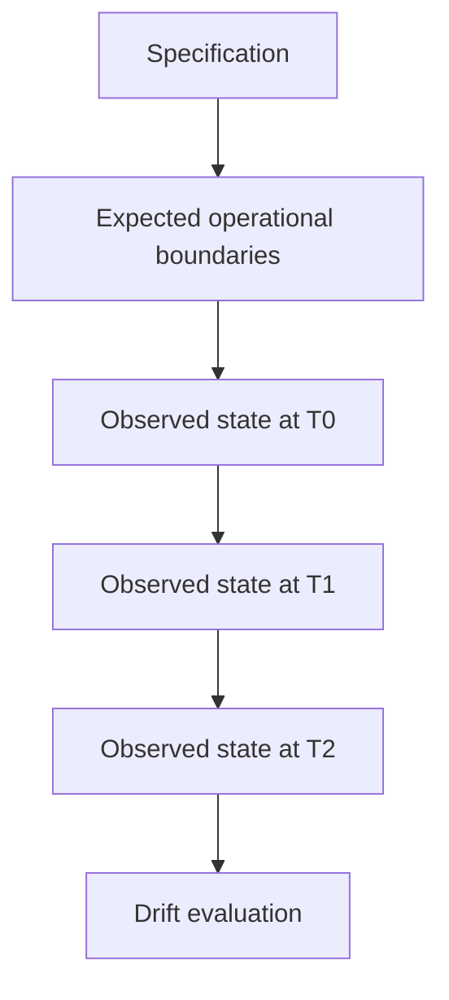
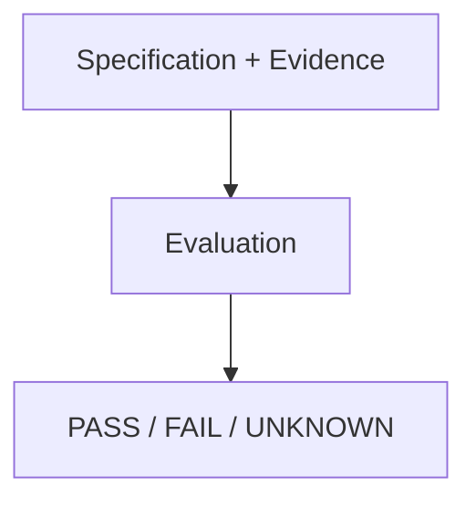
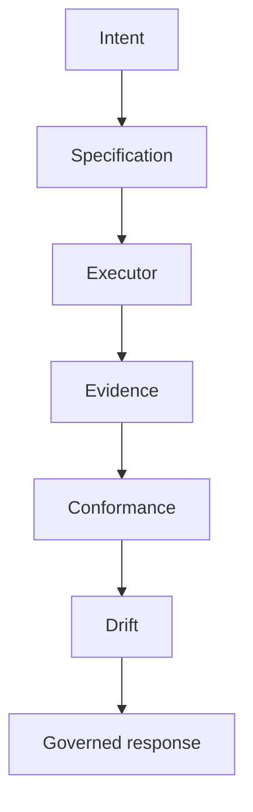

# {{ $frontmatter.title }} 관련

```component VPCard
{
  "title": "TypeScript > Article(s)",
  "desc": "Article(s)",
  "link": "/programming/ts/articles/README.md",
  "logo": "/images/ico-wind.svg",
  "background": "rgba(10,10,10,0.2)"
}
```

```component VPCard
{
  "title": "LLM > Article(s)",
  "desc": "Article(s)",
  "link": "/ai/llm/articles/README.md",
  "logo": "/images/ico-wind.svg",
  "background": "rgba(10,10,10,0.2)"
}
```

[[toc]]

---

<SiteInfo
  name="How to Detect Operational Drift Before It Becomes an Incident"
  desc="In my previous article, I explored operational conformance: how to evaluate whether observed evidence satisfies an operational specification. That gives us a useful point-in-time question: Does the s"
  url="https://freecodecamp.org/news/detect-operational-drift-before-incident"
  logo="https://cdn.freecodecamp.org/universal/favicons/favicon.ico"
  preview="https://cdn.hashnode.com/uploads/covers/5e1e335a7a1d3fcc59028c64/883e3abc-de6f-48c8-aff5-5c5cab4093c2.png"/>

In [**my previous article**](/freecodecamp.org/measure-conformance-operational-specification-execution.md), I explored operational conformance: how to evaluate whether observed evidence satisfies an operational specification.

That gives us a useful point-in-time question:

> Does the system satisfy the specification right now?

But production systems don't stay still.

Traffic changes. Dependencies degrade. Certificates expire. Configuration is modified. Feature flags move. Data grows. People make manual changes. Agents take actions. Infrastructure is replaced. And so on.

A system can be conformant immediately after a deployment and stop being conformant hours or days later.

That's the problem I want to explore here.

Operational drift is the divergence between the operational specification and the state we continue to observe over time.

This is broader than configuration drift. Configuration drift asks whether infrastructure or configuration differs from a declared state.

Operational drift asks whether the system still behaves within the boundaries we intended, even if the configuration has not changed at all.

A service can have exactly the same configuration it had yesterday and still drift operationally because latency increased, error rate degraded, replica availability fell, a dependency became unhealthy, a policy is no longer being enforced, or evidence disappeared.

In this article, I’ll show you how to model operational drift, establish a conformance baseline, reevaluate a system over time, distinguish temporary noise from meaningful divergence, preserve drift evidence, classify severity, and decide when drift should trigger an alert, an investigation, or an automated response.

The central idea is this: conformance tells you whether reality matches intent at a point in time. Drift tells you whether that relationship is changing.

::: note Prerequisites

You should be comfortable with:

- software architecture
- TypeScript or a similar language
- observability
- operational specifications
- evidence-based evaluation
- conformance
- basic monitoring concepts

:::

You don't need a specific infrastructure platform.

The examples use a deployment scenario, but the same model applies to infrastructure, data pipelines, backup systems, access controls, AI agents, and other operational workflows.

---

## What Operational Drift Means

Suppose a deployment finishes at 10:00. The operational specification says:

```plaintext
version = v42
available replicas >= 3
error rate <= 1%
p95 latency <= 400 ms
```

Immediately after deployment, the evidence says:

```plaintext
version = v42
available replicas = 3
error rate = 0.4%
p95 latency = 280 ms
```

The system is conformant.

Now suppose that at 14:00 the evidence says:

```plaintext
version = v42
available replicas = 3
error rate = 0.8%
p95 latency = 370 ms
```

The system is still conformant, but something has changed.

The error rate and latency are moving toward their limits.

At 16:00:

```plaintext
version = v42
available replicas = 3
error rate = 1.4%
p95 latency = 460 ms
```

Now the system is no longer conformant.

The operational specification didn't change. The executor did not necessarily run again. But reality moved.

That's operational drift.

A useful way to think about it is:



The key idea is temporal: conformance is a snapshot, while drift is a relationship across snapshots.

---

## Operational Drift Isn't the Same as Configuration Drift

Configuration drift is likely a familiar infrastructure concept to you.

By **configuration drift**, I mean a difference between the configuration or infrastructure state you declared and the state that actually exists in the environment.

For example:

```plaintext
desired replicas = 3
actual replicas = 2
```

Here, the declared state says the service should have three replicas, but the running environment only has two. The configuration and the actual state no longer match.

Or:

```plaintext
Terraform state != deployed infrastructure
```

In that case, infrastructure has changed outside the expected Terraform-managed state, or Terraform's record no longer matches what's actually deployed.

Those are both configuration drift because the mismatch is between a declared configuration and the environment that should reflect it.

That's useful, but it's narrower.

Operational drift can exist even when configuration is unchanged.

Consider this specification:

```plaintext
error rate <= 1%
```

The deployment configuration may still be identical to yesterday.

Yet traffic mix may have changed, a downstream API may have slowed down, a database index may have degraded, a certificate may be approaching expiration, or a queue backlog may have grown.

So:

```plaintext
configuration drift
=
declared configuration != actual configuration
```

while:

```plaintext
operational drift
=
observed operational state != intended operational boundaries
```

The two can overlap, but they're not the same thing.

That distinction matters because production failures are often behavioral before they are configurational.

---

## Start with a Conformance Baseline

Drift needs a reference point. The easiest reference is a known conformant state.

For example:

```ts
type DeploymentEvidence = {
  version?: string;
  replicas?: number;
  errorRate?: number;
  p95LatencyMs?: number;
};
```

Suppose the system was evaluated after deployment:

```ts
const baseline: DeploymentEvidence = {
  version: "v42",
  replicas: 3,
  errorRate: 0.004,
  p95LatencyMs: 280,
};
```

and all required constraints passed.

That baseline gives you two useful things.

First, you know the system satisfied the specification at that point. And second, you have a concrete evidence snapshot against which later observations can be compared.

This doesn't mean later evidence must match the baseline exactly. That would be too strict.

It means later evidence can be evaluated in two ways:

```plaintext
Does it still satisfy the specification?

How is it changing relative to the baseline?
```

Those are different questions. Both are useful.

---

## Observe the Same Constraints Over Time

Suppose you collect evidence every hour:

```ts
type TimedEvidence = {
  timestamp: string;
  evidence: DeploymentEvidence;
};
```

For example:

```ts
const observations: TimedEvidence[] = [
  {
    timestamp: "10:00",
    evidence: {
      version: "v42",
      replicas: 3,
      errorRate: 0.004,
      p95LatencyMs: 280,
    },
  },
  {
    timestamp: "12:00",
    evidence: {
      version: "v42",
      replicas: 3,
      errorRate: 0.006,
      p95LatencyMs: 320,
    },
  },
  {
    timestamp: "14:00",
    evidence: {
      version: "v42",
      replicas: 3,
      errorRate: 0.008,
      p95LatencyMs: 370,
    },
  },
];
```

Each observation can be evaluated against the same specification.

This gives you a conformance sequence:

```plaintext
10:00  PASS
12:00  PASS
14:00  PASS
```

At first glance, everything looks healthy. But a closer look reveals that the evidence is moving in one direction.

That's where drift detection becomes more interesting than ordinary threshold monitoring.

---

## Model Drift Explicitly

A minimal drift result might look like this:

```ts
type DriftStatus =
  | "STABLE"
  | "DEGRADING"
  | "VIOLATED"
  | "UNKNOWN";
```

This gives the evaluator four explicit states. `STABLE` means the observed behavior remains within the expected range without meaningful deterioration. `DEGRADING` means the system is still within its allowed boundary but is moving in an unfavorable direction. `VIOLATED` means the current evidence has crossed the specification's limit. `UNKNOWN` means there's not enough evidence to classify the state safely.

Then:

```ts
type DriftResult = {
  constraint: string;
  status: DriftStatus;
  baseline?: number;
  current?: number;
  limit?: number;
};
```

`DriftResult` keeps the classification together with the values that explain it. `baseline` is the known-good reference, `current` is the latest observation, and `limit` is the boundary defined by the specification. Those fields are optional because some constraints may not be numeric or some evidence may be missing.

For latency:

```plaintext
baseline = 280
current = 370
limit = 400
```

This example says latency started from a known-good value of 280 ms, is now 370 ms, and must remain at or below 400 ms. The constraint hasn't failed, but the current value is much closer to the boundary.

That may be worth labeling:

```plaintext
DEGRADING
```

A drift model therefore doesn't replace conformance. It adds another dimension.

You can have:

```plaintext
conformance = PASS
drift = DEGRADING
```

That combination is often more actionable than either signal alone.

---

## Temporary Variation Isn't Always Drift

Production systems are noisy.

One slow request doesn't mean the system is drifting. One missing sample doesn't mean the service is unhealthy. And one temporary spike doesn't necessarily justify intervention.

Suppose latency samples are:

```plaintext
280
290
420
285
295
```

The `420` sample crosses the limit. But the system immediately returns to normal.

Compare that with:

```plaintext
280
310
340
370
395
```

The second sequence may never cross the limit. But it shows persistent degradation.

That's why drift shouldn't be defined as:

```plaintext
current != baseline
```

or even:

```plaintext
one sample crossed threshold
```

Drift is more useful when it accounts for persistence and direction.

---

## Use Windows Instead of Single Samples

A better approach is to evaluate observations over a window.

For example:

```ts
function average(
  values: number[]
): number {
  return (
    values.reduce(
      (sum, value) => sum + value,
      0
    ) / values.length
  );
}
```

Now suppose you evaluate the last five latency observations:

```ts
const latencyWindow = [
  300,
  320,
  340,
  360,
  380,
];

const currentAverage =
  average(latencyWindow);
```

This smooths temporary noise.

You can compare that window with an earlier window:

```ts
const baselineWindow = [
  270,
  275,
  280,
  285,
  290,
];

const baselineAverage =
  average(baselineWindow);
```

The earlier window gives you a short historical reference for typical behavior. The later window represents the more recent operating state. Comparing the two averages helps you see whether the whole signal has shifted, rather than reacting to one unusual sample.

Then calculate the change:

```ts
const delta =
  currentAverage -
  baselineAverage;
```

If `baselineAverage` is 280 ms and `currentAverage` is 340 ms, the delta is `+60 ms`. That doesn't mean the latency constraint has failed, but it does show that recent latency is materially worse than the earlier window.

This doesn't prove a problem exists, but it gives you a more stable signal.

The exact window size should come from the operational context.

A five-minute window may make sense for latency. A one-day window may make more sense for storage growth.

---

## Distinguish Drift from Missing Evidence

This follows the same principle as conformance.

Suppose latency evidence disappears.

That's not the same as:

```plaintext
latency is stable
```

and it's not the same as:

```plaintext
latency violated the threshold
```

It is:

```plaintext
UNKNOWN
```

For example:

```ts
function evaluateLatencyDrift(
  baseline: number | undefined,
  current: number | undefined,
  limit: number
): DriftStatus {
  if (
    baseline === undefined ||
    current === undefined
  ) {
    return "UNKNOWN";
  }

  if (current > limit) {
    return "VIOLATED";
  }

  if (current > baseline) {
    return "DEGRADING";
  }

  return "STABLE";
}
```

The function evaluates the cases in a deliberate order. First, if either the baseline or the current observation is missing, it returns `UNKNOWN` because there's not enough evidence to make a safe comparison. If evidence exists and the current value is already above the allowed limit, it returns `VIOLATED`. If the value is still below the limit but worse than the baseline, it returns `DEGRADING`. Only when none of those conditions apply does it return `STABLE`.

This is still simplistic because any increase over the baseline becomes `DEGRADING`, even if the change is tiny or temporary. In a real system, you would usually combine this with tolerances, windows, persistence, or trend rules. But it preserves an important rule: absence of evidence isn't evidence of stability.

That becomes especially important when the observability system itself is degraded.

---

## Add Severity and Persistence

Drift becomes more useful when you know how important the constraint is and how long the drift has persisted.

For example:

```ts
type DriftSeverity =
  | "INFO"
  | "WARNING"
  | "CRITICAL";

type DriftObservation = {
  constraint: string;
  status: DriftStatus;
  severity: DriftSeverity;
  consecutiveWindows: number;
};
```

Here, `severity` describes the operational impact of the affected constraint, while `consecutiveWindows` records how many observation windows have produced the same drift condition in a row. Keeping both matters because one brief warning is different from a warning that has persisted for eight consecutive windows, and a critical replica violation may deserve action even if it has only appeared twice.

Now you can distinguish:

```plaintext
latency
DEGRADING
WARNING
1 window
```

from:

```plaintext
latency
DEGRADING
WARNING
8 windows
```

and:

```plaintext
replicas
VIOLATED
CRITICAL
2 windows
```

The second signal is more persistent, but the third is more severe.

That helps determine what response is appropriate.

---

## Detect Directional Drift Before a Threshold Fails

One of the most useful aspects of drift detection is recognizing directional movement.

Suppose the error-rate limit is:

```plaintext
1%
```

and observations are:

```plaintext
0.2%
0.4%
0.6%
0.8%
```

Nothing has failed yet, but the trend is clear.

A simple slope can capture that direction.

For example:

```ts
function slope(
  values: number[]
): number {
  if (values.length < 2) {
    return 0;
  }

  return (
    values[values.length - 1] -
    values[0]
  ) / (values.length - 1);
}
```

This helper looks at the first and last values in the series and divides their difference by the number of intervals between them. It's a deliberately simple trend indicator: a positive result means the metric increased across the window, a negative result means it decreased, and a value near zero means it stayed roughly flat.

Then:

```ts
const errorRates = [
  0.002,
  0.004,
  0.006,
  0.008,
];

const trend =
  slope(errorRates);
```

Here, the error rate rises from `0.002` to `0.008`, so `trend` is positive. The code isn't trying to predict the future or perform full statistical analysis. It's only making the direction of change explicit so the system can notice sustained movement toward the `1%` boundary before the boundary is actually crossed.

A positive trend doesn't automatically mean failure, but it tells you the system is moving toward the boundary.

This is where drift detection differs from basic alerting.

Basic threshold alert:

```plaintext
tell me when error rate > 1%
```

Drift detection:

```plaintext
tell me when error rate is persistently moving toward 1%
```

The second can give you time to investigate before the system becomes non-conformant.

---

## Preserve the Evidence Behind Drift

A drift result should be explainable.

For example:

```json
{
  "constraint": "error-rate",
  "status": "DEGRADING",
  "baseline": 0.004,
  "current": 0.008,
  "limit": 0.01,
  "window": "10m",
  "consecutiveWindows": 4,
  "observedAt": "2026-10-13T18:00:00Z"
}
```

This is better than:

```plaintext
drift detected
```

because someone can answer:

```plaintext
what changed?
compared with what?
how close are we to the limit?
how long has this been happening?
when was it observed?
```

That matters for debugging, as well as for auditability.

---

## A Reusable Drift Evaluator

We can generalize the model.

First define a drift rule:

```ts
type DriftRule<T> = {
  name: string;
  severity: DriftSeverity;
  evaluate(
    baseline: T,
    current: T
  ): DriftStatus;
};
```

Then define a drift specification:

```ts
type DriftSpec<T> = {
  name: string;
  rules: DriftRule<T>[];
};
```

And an evaluator:

```ts
type DriftRuleResult = {
  name: string;
  status: DriftStatus;
  severity: DriftSeverity;
};

function evaluateDrift<T>(
  spec: DriftSpec<T>,
  baseline: T,
  current: T
): DriftRuleResult[] {
  return spec.rules.map(
    (rule) => ({
      name: rule.name,
      status:
        rule.evaluate(
          baseline,
          current
        ),
      severity:
        rule.severity,
    })
  );
}
```

The evaluator doesn't need to understand latency, error rate, replicas, or certificates.

Each rule owns its own comparison logic. That makes the engine reusable.

---

## A Small End-to-End Example

Let’s create a drift specification for a deployment.

Start with evidence:

```ts
type DeploymentEvidence = {
  replicas?: number;
  errorRate?: number;
  p95LatencyMs?: number;
};
```

Now define rules:

```ts :collapsed-lines
const driftRules:
  DriftRule<DeploymentEvidence>[] = [
    {
      name: "replicas",
      severity: "CRITICAL",
      evaluate: (
        baseline,
        current
      ) => {
        if (
          baseline.replicas === undefined ||
          current.replicas === undefined
        ) {
          return "UNKNOWN";
        }

        if (current.replicas < 3) {
          return "VIOLATED";
        }

        if (
          current.replicas <
          baseline.replicas
        ) {
          return "DEGRADING";
        }

        return "STABLE";
      },
    },
    {
      name: "error-rate",
      severity: "CRITICAL",
      evaluate: (
        baseline,
        current
      ) => {
        if (
          baseline.errorRate === undefined ||
          current.errorRate === undefined
        ) {
          return "UNKNOWN";
        }

        if (current.errorRate > 0.01) {
          return "VIOLATED";
        }

        if (
          current.errorRate >
          baseline.errorRate * 1.5
        ) {
          return "DEGRADING";
        }

        return "STABLE";
      },
    },
    {
      name: "latency",
      severity: "WARNING",
      evaluate: (
        baseline,
        current
      ) => {
        if (
          baseline.p95LatencyMs === undefined ||
          current.p95LatencyMs === undefined
        ) {
          return "UNKNOWN";
        }

        if (
          current.p95LatencyMs > 400
        ) {
          return "VIOLATED";
        }

        if (
          current.p95LatencyMs >
          baseline.p95LatencyMs * 1.25
        ) {
          return "DEGRADING";
        }

        return "STABLE";
      },
    },
  ];
```

Create the drift specification:

```ts
const driftSpec:
  DriftSpec<DeploymentEvidence> = {
    name: "orders-runtime-drift",
    rules: driftRules,
  };
```

Now define baseline and current evidence:

```ts
const baseline:
  DeploymentEvidence = {
    replicas: 3,
    errorRate: 0.004,
    p95LatencyMs: 280,
  };

const current:
  DeploymentEvidence = {
    replicas: 3,
    errorRate: 0.007,
    p95LatencyMs: 360,
  };
```

Evaluate:

```ts
const drift =
  evaluateDrift(
    driftSpec,
    baseline,
    current
  );
```

Possible output:

```plaintext
replicas     STABLE      CRITICAL
error-rate   DEGRADING   CRITICAL
latency      DEGRADING   WARNING
```

The system may still be conformant, but it's no longer operationally stable relative to its baseline.

That's valuable information.

---

## How Drift Detection Applies to Multiple Executors

Suppose two executors both successfully deployed the same service.

Immediately after deployment:

```plaintext
Executor A → conformant
Executor B → conformant
```

That doesn't mean their long-term operational behavior is identical.

Over time:

```plaintext
Executor A
error rate stable
latency stable
replicas stable

Executor B
error rate rising
latency rising
replicas stable
```

Both executors satisfied the initial specification, but their downstream operational behavior is different.

Drift gives you another comparison dimension.

You can ask:

```plaintext
Which executor produces more stable outcomes?
Which one drifts more often?
Which one produces more unknown evidence?
Which one needs recovery more frequently?
```

This is especially useful when executor choice is dynamic.

---

## How Drift Detection Applies to AI Agents

AI agents introduce another kind of variability.

An agent may produce different plans for the same objective.

For example:

```plaintext
Run 1:
scale
deploy
observe

Run 2:
deploy canary
observe
expand

Run 3:
create parallel environment
switch traffic
```

Each plan may be valid, and each may initially conform.

But the long-term outcomes can differ.

One plan may produce a stable system, while another may create a system that slowly moves toward a boundary.

This gives us a useful separation:

```plaintext
agent chooses the execution path
specification defines acceptable boundaries
evidence describes the observed state
conformance evaluates the current state
drift evaluates how that state changes over time
```

That allows agent autonomy without making the agent the only judge of its own outcomes.

---

## When Drift Should Trigger Action

Not every drift signal should trigger automation.

A useful response model might be:

```plaintext
STABLE
→ no action

DEGRADING + low severity
→ observe

DEGRADING + persistent
→ investigate

VIOLATED + warning
→ alert

VIOLATED + critical
→ rollback / remediate / escalate

UNKNOWN
→ collect evidence / block risky automation
```

The exact policy depends on the operation.

For example, automatically restarting a stateless service may be acceptable. But automatically rolling back a database migration may not be.

Drift detection should therefore produce evidence and classification. Policy should decide what action is permitted. That keeps observation, evaluation, decision, and execution separate.

---

## What Operational Drift Can't Tell You

Operational drift doesn't automatically tell you why the system changed.

Suppose latency rises from:

```plaintext
280 ms
```

to:

```plaintext
390 ms
```

Drift detection can tell you:

```plaintext
latency is degrading
```

It can't automatically prove the cause.

The cause might be traffic growth, database contention, a downstream dependency, network degradation, a code regression, or resource exhaustion.

Drift is therefore a detection mechanism. It's not root-cause analysis.

The baseline can also be wrong.

If the baseline was captured during an unusually good period, normal behavior may look like degradation.

So drift quality depends on good specifications, good evidence, good baselines, appropriate windows, and correct rules.

---

## A Practical Drift Detection Workflow

If you want to introduce operational drift detection into an existing system, I would use this sequence.

### 1. Start with a Conformant Operation

Pick an operation where you already know the system satisfies the specification.

### 2. Preserve the Baseline Evidence

Store the evidence associated with that known-good state.

### 3. Identify Drift-Sensitive Constraints

Not every constraint needs trend analysis.

Start with things like:

```plaintext
latency
error rate
capacity
queue depth
availability
certificate age
backup freshness
```

### 4. Define Observation Windows

Choose windows based on operational behavior.

### 5. Define Stable, Degrading, Violated, and Unknown

Make the states explicit.

### 6. Add Severity

Separate informational drift from critical drift.

### 7. Add Persistence

Avoid reacting to one noisy sample.

### 8. Preserve Evidence

Store baseline, current state, thresholds, windows, and timestamps.

### 9. Separate Detection from Response

Don't make every drift signal trigger an automatic action.

### 10. Revisit the Model

If the system produces constant false positives, improve the rule. If it misses real degradation, improve the evidence or the window.

Don't simply widen thresholds until everything looks stable.

---

## From Point-in-Time Conformance to Continuous Verification

Conformance gives us this:



Drift adds time:

```plaintext
Specification
+
Evidence at T0
+
Evidence at T1
+
Evidence at T2
↓
Drift Evaluation
↓
STABLE / DEGRADING / VIOLATED / UNKNOWN
```

That changes the operational model.

We're no longer asking only:

> Did the operation succeed?

or:

> Is the system conformant now?

We can also ask:

> Is the system moving away from the intended state?

That's a much stronger foundation for operational control, especially when systems become more autonomous.

---

## Conclusion

Operational conformance tells us whether observed evidence satisfies the specification at a point in time.

Operational drift tells us whether that relationship is changing.

A useful drift model should preserve:

```plaintext
baseline evidence
current evidence
constraint boundaries
observation windows
direction of change
severity
persistence
unknown states
timestamps
```

That gives us a way to distinguish temporary noise, persistent degradation, actual violation, and missing evidence.

The executor doesn't need to know any of this. The executor performs the work. The specification defines the intended boundaries.

Evidence tells us what's happening. Conformance tells us whether the current state is acceptable. Drift tells us whether the system is moving away from that acceptable state.

At this point, the pieces are starting to form a larger operational model:



The next step is to put those pieces together explicitly.

That's where I want to define **Specification-Driven Operations**, or SDOps, as a complete operating model.

<!-- TODO: add ARTICLE CARD -->
```component VPCard
{
  "title": "How to Detect Operational Drift Before It Becomes an Incident",
  "desc": "In my previous article, I explored operational conformance: how to evaluate whether observed evidence satisfies an operational specification. That gives us a useful point-in-time question: Does the s",
  "link": "https://chanhi2000.github.io/bookshelf/freecodecamp.org/detect-operational-drift-before-incident.html",
  "logo": "https://cdn.freecodecamp.org/universal/favicons/favicon.ico",
  "background": "rgba(10,10,35,0.2)"
}
```
