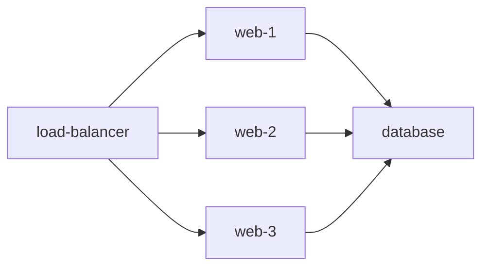

# {{ $frontmatter.title }} 관련

```component VPCard
{
  "title": "Python > Article(s)",
  "desc": "Article(s)",
  "link": "/programming/py/articles/README.md",
  "logo": "/images/ico-wind.svg",
  "background": "rgba(10,10,10,0.2)"
}
```

[[toc]]

---

<SiteInfo
  name="How to Create System Design Diagrams using Python"
  desc="Creating system architecture design diagrams is an important part of technical documentation. As system complexity grows, clarity within teams becomes even more important. But creating diagrams from s"
  url="https://freecodecamp.org/news/how-to-create-system-design-diagrams-using-python"
  logo="https://cdn.freecodecamp.org/universal/favicons/favicon.ico"
  preview="https://cdn.hashnode.com/uploads/covers/5e1e335a7a1d3fcc59028c64/dc8376e4-76df-4ea5-90cf-38a90069be19.png"/>

Creating system architecture design diagrams is an important part of technical documentation. As system complexity grows, clarity within teams becomes even more important.

But creating diagrams from scratch using canvas-like tools isn't always efficient.

Luckily, there's an alternative way to create diagrams using a diagram-as- code approach. In this approach, you explain the diagram components using a predefined syntax instead of drawing them.

::: info Benefits of Diagram-as-Code:

- Changes are tracked via version control.
- Saves time as drawing from scratch or a tool takes time due to manual formatting.
- Most diagram-as-a-code tools support standard tech icons like database, storage bucket, load balancers, and so on.
- Diagrams can be generated automatically in CI/CD pipelines or documentation builds using code.

:::

::: note Prerequisites and Installation

In this tutorial, you'll learn how to draw diagrams using the Python **Diagrams** library. The basic prerequisites are:

- **Python 3.7+**
- **pip** for installing Python packages
- **Graphviz** installed on your operating system for rendering output images
- The Python package:

```sh
pip install diagrams
```

- A terminal to run files like:

```sh
python diagram.py
```

:::

---

## What is Diagrams?

Diagrams is a Python library that lets you draw cloud system architecture in Python code. It supports different providers like Azure, GCP, AWS, and so on.

By the end of this tutorial, you'll be able to understand how this diagram was made:


---

## Your First Diagram

First, make sure your setup is complete as per the prerequisites. Then create a Python file with the `.py` extension and add this code to it:

```py
from diagrams import Diagram
from diagrams.aws.compute import EC2

with Diagram("Practice Architecture"):
    EC2("api-server")
```

Let's understand the program line by line.

First, we have import `Diagram`:

```py
from diagrams import Diagram
```

Think of `Diagram` as a blank canvas and everything you draw goes inside it. `Diagram` represents a global diagram context.

Then we import a node type. A **node** represents one component in your architecture. For example, ECS, lambda, Service, and firewall are resource types.

```py
from diagrams.aws.compute import EC2
```

A node object consists of three parts: **provider**, **resource type**, and **name**. In the example above, the `EC2` is a node of resource type `compute` which is provided by the `aws` provider.

This imports the `EC2` node from the AWS compute group. We'll use this class to create EC2 nodes.

`diagrams.aws.compute` is the import path and it tells you where the `EC2` icon is located.

```sh
diagrams
└── aws
    └── compute
        └── EC2
```

You can explore more official node types for different providers [<VPIcon icon="fas fa-globe"/>here](https://diagrams.mingrammer.com/docs/guides/node).

Let's say you want to use the Analytics component from AWS in your diagram. First, you'll search for Analytics from the list of node types shared above. Your import statement will look like this: `from diagrams.aws.analytics import Analytics`.

Then create the diagram context using `with Diagram`:

```py
with Diagram("Practice Architecture"):
```

Coming back to your example, this creates a diagram named `Practice Architecture`. Everything indented underneath `with Diagram` belongs to that diagram.

Now create a node:

```py
EC2("api-server")
```

This creates one EC2 node with the label displayed as `api-server` underneath it.

And finally, run the code. If you saved your Python code file as <VPIcon icon="fa-brands fa-python"/>`test.py`, run it using `python test.py`. Diagrams generates an image file for you in the current folder:


In short, this is what the process looks like:


Note that you're describing infrastructure instead of manually drawing it. You aren't thinking about drawing and arranging icons. Instead, you just code `EC2("api-server")` and Diagrams decides how to render it.

We can slightly expand the above example to include two EC2 instances:

```py
from diagrams import Diagram
from diagrams.aws.compute import EC2

with Diagram("Practice Architecture"):
    EC2("api-server")
    EC2("worker")
```


Note that you can assign your node instances to variables. In this way, it's easy to reference them.

The example below demonstrates variable assignment:

```py
from diagrams import Diagram
from diagrams.aws.compute import EC2

with Diagram("Practice Architecture"):
    api_server = EC2("api-server")
    worker = EC2("worker")
```

---

## How to Connect Nodes and Data Flow

You've learned how to create nodes. Now you'll see how to connect them.

Directions are represented by the following symbols:

- `>>` for left-to-right flow
- `<<` for the opposite direction (right-to-left)
- `-` for an undirected connection

Let's see an example of these together:

```py
from diagrams import Diagram
from diagrams.aws.compute import EC2
from diagrams.aws.database import RDS
from diagrams.aws.network import ELB

with Diagram("The three directions"):
    load_balancer = ELB("load-balancer")
    web_server = EC2("web-server")
    database = RDS("database")
    backup_server = EC2("backup-server")

    load_balancer >> web_server
    web_server << database
    database - backup_server
```

Pay attention to connections between nodes:

```py
# Connects load balancer to web server with a left to right arrow
load_balancer >> web_server
    
# Connects web server and database using a right to left arrow
web_server << database

# connects database and web server using a straight line
database - backup_server
```


---

## Grouping Data Flows

You can also connect one node to multiple nodes using a Python list. This way you don't need to connect individual nodes one by one to another node.

Let's say you want to implement this architecture:



First, create a load balancer:

```py
load_balancer = ELB("entry-point")
```

Then create several servers. Instead of creating three separate variables like this:

```py
server1 = EC2("web-1")
server2 = EC2("web-2")
server3 = EC2("web-3")
```

You can put them inside a Python list:

```py
web_servers = [
    EC2("web-1"),
    EC2("web-2"),
    EC2("web-3")
]
```

Then connect LB node to the listload_balancer >> web_servers like this:

```py
load_balancer >> web_servers
```

This way, you don't need to manually write:

```py
load_balancer >> web_servers[0]
load_balancer >> web_servers[1]
load_balancer >> web_servers[2]
```

Now, connect the whole list to the database:

```py
web_servers >> database
```

This approach is useful for reducing redundancy in code. It helps in targeting repeated components like multiple pods, workers, and so on.

The complete code looks like this:

```py
from diagrams import Diagram
from diagrams.aws.compute import EC2
from diagrams.aws.database import RDS
from diagrams.aws.network import ELB

with Diagram("Scaled Web App"):
    load_balancer = ELB("entry-point")

    web_servers = [
        EC2("web-1"),
        EC2("web-2"),
        EC2("web-3")
    ]

    database = RDS("orders-db")

    load_balancer >> web_servers >> database
```


---

## Clusters

You can group related nodes inside a labeled box using clusters. You can still connect nodes inside a cluster to outside nodes.

Grouping is necessary to demonstrate what belongs together. It helps represent concepts such as:

- application tiers
- database tiers
- availability zones
- regions
- environments
- microservice groups
- worker groups

This is the syntax to create a cluster:

```plaintext
with Cluster("Cluster name"):
```

Anything indented under this will be part of the cluster.

Here's an example to demonstrate clusters:

```py
from diagrams import Diagram, Cluster
from diagrams.aws.compute import EC2
from diagrams.aws.database import RDS

with Diagram("Shop Platform"):
    with Cluster("Application Tier"):
        apps = [
            EC2("app-1"),
            EC2("app-2")
        ]

    with Cluster("Database Tier"):
        primary_db = RDS("primary-db")
        replica_db = RDS("read-replica")

    apps >> primary_db
    primary_db - replica_db
```


It's also possible to nest clusters using this syntax:

```plaintext
with Cluster("Production"):

    with Cluster("Backend"):

        with Cluster("API"):
            ...
```

Let's look into a more realistic example that nests clusters:

```py
from diagrams import Diagram, Cluster
from diagrams.aws.compute import EC2
from diagrams.aws.database import RDS

with Diagram("Production Platform"):

    with Cluster("Production Region"):

        with Cluster("Application Tier"):

            with Cluster("API Servers"):
                api1 = EC2("api-1")
                api2 = EC2("api-2")

        database = RDS("main-db")

        api1 >> database
        api2 >> database
```

The example demonstrates a `Production Platform` that contains a `Production Region`, which contains an `Application Tier`. The `Application Tier` which further groups two API servers. A separate RDS database sits inside the production region, and both API servers connect to it.

Indenting the clusters beneath each other enables nesting of clusters. Refer to the code snippet below:

```plaintext
with Cluster("Production Region"):

        with Cluster("Application Tier"):

            with Cluster("API Servers"):
                api1 = EC2("api-1")
                api2 = EC2("api-2")
```


---

## Edges

Edges provide another way to connect nodes. Unlike plain `>>` or `<<`, edges let you add properties such as label, color and style.

Previously you used:

```py
from diagrams import Diagram
```

To use an edge, add:

```py
from diagrams import Diagram, Edge
```

Now connect `app` to `database` using an edge:

```py
# Labeling an edge
app >> Edge(label="SQL queries") >> database
```

This connects `app` to `database` using an edge labeled `"SQL queries"`.


You can also customize edge color:

```py
app >> Edge(label="SQL", color="red") >> database
```


You can also modify the line style:

```plaintext
app >> Edge(style="dashed") >> database
```


These are some other available edge styles:

```plaintext
Edge(style="dotted")
Edge(style="bold")
```

The example below combines multiple edge styles:

```py
from diagrams import Diagram, Edge
from diagrams.aws.compute import EC2
from diagrams.aws.database import RDS

with Diagram("Payment Service"):
    api = EC2("payment-api")
    database = RDS("payments-db")

    api >> Edge(
        label="payment records",
        color="darkgreen",
        style="dashed"
    ) >> database
```


Note that you can also use edge with `<<` and `-`.

---

## Conclusion

In this tutorial, you learned how to create meaningful, consistent diagrams that scale well across teams using the diagram-as-code approach. This allows you to be efficient without compromising on quality and other development or maintenance tasks.

In this tutorial you mostly used AWS components. You can explore other available providers in this [<VPIcon icon="fas fa-globe"/>guide](https://diagrams.mingrammer.com/docs/nodes/onprem) and create diagrams as per your requirements.

Thank you for reading the article until the end. If gained something from the article, consider sharing it with others.

**Stay Connected and Continue Your Learning Journey!**

**Connect with me on**:

- [LinkedIn (<VPIcon icon="fa-brands fa-linkedin"/>`zaira-hira`)](https://linkedin.com/in/zaira-hira/): I share content related to Linux, Cyber security and DevOps. If you found the article helpful, please leave a recommendation on LinkedIn.
- [X (<VPIcon icon="fa-brands fa-x-twitter"/>`hira_zaira`)](https://twitter.com/hira_zaira): I share pre-launch updates and some behind the scenes.

Happy coding!

<!-- TODO: add ARTICLE CARD -->
```component VPCard
{
  "title": "How to Create System Design Diagrams using Python",
  "desc": "Creating system architecture design diagrams is an important part of technical documentation. As system complexity grows, clarity within teams becomes even more important. But creating diagrams from s",
  "link": "https://chanhi2000.github.io/bookshelf/freecodecamp.org/how-to-create-system-design-diagrams-using-python.html",
  "logo": "https://cdn.freecodecamp.org/universal/favicons/favicon.ico",
  "background": "rgba(10,10,35,0.2)"
}
```
