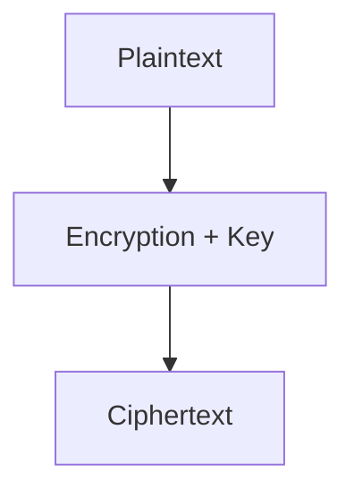
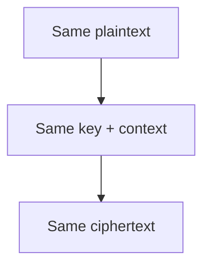

# {{ $frontmatter.title }} 관련

```component VPCard
{
  "title": "Security > Article(s)",
  "desc": "Article(s)",
  "link": "/devops/security/articles/README.md",
  "logo": "/images/ico-wind.svg",
  "background": "rgba(10,10,10,0.2)"
}
```

[[toc]]

---

<SiteInfo
  name="How to Encrypt PII in Data Pipelines While Keeping It Searchable"
  desc="At Intuit, my team built a data pipeline that processed TurboTax e-filing data. This data needed to be made available for dashboards, analytics, and other downstream use cases. One of the biggest chal"
  url="https://freecodecamp.org/news/how-to-encrypt-pii-in-data-pipelines-while-keeping-it-searchable"
  logo="https://cdn.freecodecamp.org/universal/favicons/favicon.ico"
  preview="https://cdn.hashnode.com/uploads/covers/5e1e335a7a1d3fcc59028c64/b9b99f84-c0c8-46a0-b217-0b2e598c8ac1.png"/>

At Intuit, my team built a data pipeline that processed TurboTax e-filing data. This data needed to be made available for dashboards, analytics, and other downstream use cases.

One of the biggest challenges was protecting **Personally Identifiable Information (PII)** such as Social Security Numbers (SSNs).

SSNs are highly sensitive and must be protected at every stage of the data pipeline. At the same time, analytics teams sometimes need to perform legitimate business operations such as identifying records associated with a particular customer or performing exact-match lookups.

So how do you protect sensitive data while still allowing controlled equality searches without exposing the plaintext?

In this article, I'll explain the encryption concepts behind this problem, including:

- Probabilistic vs. deterministic encryption
- Equality searches on encrypted data
- Base keys and derived keys
- Key separation
- Local vs. remote cryptographic operations
- Tokenization
- The security trade-offs involved in making encrypted data searchable

---

## Why Encrypt PII?

PII such as SSNs, email addresses, phone numbers, and financial information is highly sensitive.

If you store plaintext PII directly in a data lake or database, a storage-layer compromise could expose large amounts of sensitive information.

Encryption provides protection by transforming plaintext into ciphertext:



```plaintext
SSN:        111-22-3333

Encrypted:  8f92a7c1...
```

Without the appropriate cryptographic key, the ciphertext shouldn't reveal the original value.

For a data platform, though, encryption introduces another requirement.

Suppose an analytics application needs to find records for:

```plaintext
SSN = 111-22-3333
```

If the SSN is encrypted, we don't want the application to decrypt the entire dataset just to perform an equality lookup.

This is where **deterministic encryption** becomes useful.

---

## AES: Advanced Encryption Standard

Before looking at probabilistic and deterministic encryption, let's briefly understand **AES (Advanced Encryption Standard)**.

AES (Advanced Encryption Standard) is a widely used symmetric encryption algorithm for protecting sensitive data. It uses a secret key to transform plaintext into ciphertext, and the same key is used to decrypt the ciphertext back into the original plaintext.

The diagram below illustrates this basic process: the plaintext is encrypted using AES and a secret key to produce ciphertext. The ciphertext can then be decrypted using the same secret key to recover the original plaintext.

In real-world systems, AES is used with different encryption modes and constructions depending on the security and application requirements. The way randomness, initialization vectors, or nonces are handled affects properties such as whether repeated encryption of the same plaintext produces the same or different ciphertext.


For example:

```plaintext
Plaintext:   111-22-3333
Key:         key1


        ↓ AES encryption


Ciphertext:  8f92a7c1...
```

AES is widely used to protect sensitive data such as PII. But how encryption behaves depends on how the encryption is constructed and used. One important distinction is whether randomness is used during encryption.

This brings us to **probabilistic encryption**.

---

## Probabilistic Encryption

Probabilistic encryption introduces randomness during encryption.

This means that even when we encrypt the **same plaintext with the same key**, the resulting ciphertext can differ each time.

```plaintext
Encrypt("ABC", key1) → qwoeoewowe
Encrypt("ABC", key1) → cXcslslsd
Encrypt("ABC", key1) → fjkdfdfd
```

Although the input is the same:

```plaintext
ABC
```

the encrypted values are different.

This randomness is intentional. It prevents someone looking at encrypted data from easily determining that two ciphertexts represent the same underlying value.

For example:

```plaintext
Record 1 → qwoeoewowe
Record 2 → cXcslslsd
Record 3 → fjkdfdfd
```

An observer can't simply compare the ciphertexts and conclude that the records contain the same plaintext.

This makes probabilistic encryption a strong choice when **confidentiality is the primary requirement**.

### Advantages

- Provides strong protection against equality-pattern analysis
- Makes repeated plaintext values look different after encryption
- Suitable when encrypted values don't need to be directly compared

### Limitation

The randomness that improves security also creates a challenge for analytics.

Suppose we want to find all records containing:

```plaintext
SSN = 111-22-3333
```

If the same SSN was encrypted multiple times, we could have:

```plaintext
111-22-3333 → X8a91...
111-22-3333 → P72k4...
111-22-3333 → M91q2...
```

The encrypted values are different, even though the underlying SSN is the same.

Therefore, a simple equality query such as:

```plaintext
WHERE encrypted_ssn = encrypted_search_value
```

wouldn't work reliably.

This creates an important trade-off for data platforms: randomness provides stronger protection against pattern leakage, but it makes equality-based searching more difficult.

When analytics requires exact-match searches on sensitive fields, we need a different approach: **deterministic encryption**.

---

## Deterministic Encryption

**Deterministic encryption** is designed so that the same plaintext, encrypted under the same key and encryption context, produces the same ciphertext.

For Example:

```plaintext
Encrypt("ABC", key)
    → adsfffdfd

Encrypt("ABC", key)
    → adsfffdfd

Encrypt("ABC", key)
    → adsfffdfd
```

The important property is:



This allows equality matching.

For example:

```sql
SELECT * FROM customer_data WHERE 1=1 
AND encrypted_ssn = EncryptDeterministically(
  '111-22-3333',
  encryption_key
);
```

The application can generate the same ciphertext for the search value and compare it against the stored ciphertext.

### The Security Trade-off

Deterministic encryption provides searchability, but that searchability comes at a cost.

Consider this dataset:

```plaintext
Ciphertext
-----------
A9F82...
A9F82...
B72AC...
A9F82...
C81DE...
```

An attacker may not know that:

```plaintext
A9F82... = 111-22-3333
```

But they can determine that the same plaintext occurs three times.

In other words, deterministic encryption leaks **equality patterns**.

If an attacker has additional information about the underlying dataset, they may be able to use those patterns to infer plaintext values.

This is particularly important for fields with a small number of possible values, such as:

- State codes
- Boolean values
- Gender categories
- Small categorical fields
- Other low-entropy attributes

So you should use deterministic encryption deliberately and only when the equality-search requirement justifies the additional leakage.

---

## Base Keys and Derived Keys

Another important part of a secure encryption architecture is **key management**.

A common design uses a highly protected root or master key and derives separate keys for specific purposes. Instead of using one key everywhere.

The diagram below illustrates **key separation**. Instead of using the same key for every type of data, a highly protected master key can serve as the root of a key hierarchy. Separate keys can then be created for different datasets, cryptographic purposes, or environments.

For example, a dataset key could be used for a particular data domain, while a purpose-specific key could be dedicated to encrypting SSNs. This limits each key's scope and reduces the impact if one key is compromised.


The idea with key separation is that different cryptographic purposes should use different keys or cryptographic contexts.

An organization might derive a key for:

```text
Production + PII + SSN encryption
```

and another for:

```plaintext
Production + PII + Email encryption
```

The exact hierarchy depends on the application's security requirements.

### Key Derivation with HKDF

A common standard for deriving cryptographic keys is **HKDF**, or HMAC-based Key Derivation Function.

> **HKDF (HMAC-based Key Derivation Function):** A standard method to derive multiple keys from a single master key.

The diagram below shows how **HKDF derives separate keys from a common master secret**. HKDF takes the master secret as input, along with context information that identifies the intended purpose. For example, the context `"SSN encryption"` produces one derived key, while `"Email encryption"` produces another.

Because the context is different, the resulting keys are cryptographically separated even though they originate from the same master secret. You can use the same approach for other purposes, such as token generation.


The important point is that the application doesn't need to maintain a completely independent master secret for every purpose. Instead, you can use a securely managed root secret as the starting point for deriving purpose-specific keys.

So context is a key part of the key-derivation design.

For example:

```py
DerivedKey =
    HKDF(
        master_secret,
        context = "production:ssn"
    )
```

Another context produces a different derived key:

```py
DerivedKey =
    HKDF(
        master_secret,
        context = "production:email"
    )
```

This provides **key separation**.

A compromise of one derived key should not automatically expose data protected using independently derived keys.

But key derivation does not magically make compromised ciphertext safe. If a derived key is compromised, all data protected with that particular key may still be at risk.

### Where Does the Master Key Live?

The root key should not be stored inside application source code or configuration files.

Instead, organizations typically use a managed key-management system or a Hardware Security Module (HSM).

> **HSM (Hardware Security Module):** A physical or cloud-based device that safely stores digital keys and performs encryption.

Examples include:

- AWS Key Management Service (KMS)
- Google Cloud KMS
- Azure Key Vault
- Dedicated HSM infrastructure

The key-management system provides controlled access, auditing, rotation capabilities, and integration with identity and access-management systems.

The application should receive only the cryptographic material or cryptographic operation that it actually needs.

---

## Local Cryptographic Operations

In a local encryption workflow, the application performs the actual data encryption.

In this workflow, the **KMS protects the root or key-encryption key**, while the application performs the actual encryption locally. The application first requests a data-encryption key from the KMS. The KMS returns the data key along with a protected copy of that key. The application can then use the data key to encrypt data without making a KMS request for every individual value.

For a high-volume data pipeline, this approach scales better because the application can encrypt large amounts of data locally while the KMS protects the higher-level key. The data key should be treated as sensitive and kept in application memory only for as long as necessary.


The application uses the appropriate data-encryption key or derived cryptographic key to perform encryption.

### Advantages

- High throughput
- Fewer network calls for large datasets
- Suitable for batch processing and data pipelines
- Lower latency for individual encryption operations

### Consideration

Cryptographic material used by the application exists temporarily in application memory.

Therefore, application security becomes an important part of the overall key-protection strategy.

---

## Remote Cryptographic Operations

In a remote encryption workflow, the application sends an encryption request to the KMS rather than performing the cryptographic operation itself. The KMS performs the operation using a protected key and returns the resulting ciphertext to the application. The underlying key material remains within the KMS boundary.

This provides centralized control and auditing of cryptographic operations, but every encryption request introduces a network interaction. For high-volume data processing, this can increase latency and may make the approach less suitable for encrypting individual values at very large scale.


The application doesn't receive the underlying key material. This can reduce direct key exposure and centralize cryptographic operations and auditing.

### Advantages

- Stronger centralization of key access
- Keys can remain within the managed cryptographic boundary
- Centralized authorization and auditing
- Useful for operations where remote cryptographic APIs are appropriate

### Trade-offs

- Network latency
- API throughput limits
- Additional operational dependencies
- Potential cost for large numbers of cryptographic operations

For high-volume data pipelines, calling a remote KMS for every field or row may not be practical.

---

## Deterministic Encryption vs HMAC

Another option is worth considering when the only requirement is equality matching.

Suppose the analytics team doesn't need to recover the original SSN from the stored value.

They only need to answer:

> "Does this record have the same SSN as the search value?"

In that case, reversible encryption may not be necessary.

A **keyed cryptographic hash**, such as HMAC, can sometimes be a better design.

```text
HMAC(secret_key, normalized_SSN)
```

For example:

```mermaid
flowchart TD
  A[111-22-3333] --> B[HMAC(secret_key, SSN)]
  B --> C[X7a91f...]
```

The same SSN produces the same HMAC:

```plaintext
111-22-3333 → X7a91f...
111-22-3333 → X7a91f...
222-33-4444 → P3k21...
```

This allows equality comparisons:

```sql
WHERE ssn_hmac = HMAC(secret_key, '111-22-3333')
```

But unlike encryption, an HMAC isn't intended to be reversible.

This can be a useful security property when the original value doesn't need to be recovered from the analytics dataset.

The choice between deterministic encryption and HMAC depends on the requirements, threat model, key-management architecture, and whether reversibility is required.

---

## Tokenization

Another common approach is **tokenization**.

Instead of storing:

```plaintext
111-22-3333
```

the system stores something like:

```plaintext
TOKEN-8F72A1
```

The mapping between the original value and the token is maintained by a secure tokenization service or vault.

The data pipeline and analytics systems can work with the token instead of the original PII.

The diagram below shows how **tokenization separates the sensitive value from the systems that consume the data**. The original SSN is sent to a secure token vault, which creates or retrieves a token representing that value. The vault securely maintains the relationship between the original SSN and its token.

The data lake receives only the token, rather than the original SSN. Downstream systems can use the token as an identifier for matching or joining records without directly storing the underlying PII. If an authorized system ever needs the original SSN, it can interact with the token vault to resolve the token, subject to appropriate access controls.


Tokenization can be particularly useful when many downstream systems need to work with an identifier without having access to the underlying sensitive value.

---

## Comparing the Approaches

The right choice depends on what the application actually needs.

| Approach | Equality Search | Reversible | Equality Leakage | Typical Use |
| --- | --- | --- | --- | --- |
| Randomized encryption | ❌ | ✅ | Low | General encrypted data |
| Deterministic encryption | ✅ | ✅ | Yes | Equality lookups |
| HMAC | ✅ | ❌ | Yes | Equality matching without recovery |
| Tokenization | ✅ | Usually through a vault | Depends on design | Shared identifiers across systems |

There is no universally "best" approach.

The important question is **what operations do downstream systems actually need to perform on the sensitive data?**

---

## Access Control Still Matters

Encryption is only one part of protecting PII. Even when data is encrypted, you still need:

- Strong IAM policies
- Least-privilege access
- Key-access controls
- Encryption-key rotation policies
- Audit logging
- Data classification
- Network controls
- Secure secret management
- Data retention and deletion policies
- Monitoring and alerting

For example, an analytics user might be allowed to perform an equality lookup without being allowed to decrypt the entire SSN column.

This is an important distinction: **the ability to query an encrypted identifier doesn't have to imply the ability to decrypt it.**

---

## What We Learned from the Data Pipeline

For our data pipeline, the key challenge wasn't simply:

> "How do we encrypt the SSN?"

The more important question was:

> "How do we protect the SSN while still supporting legitimate analytics requirements?"

That distinction changes the architecture.

A practical design needs to consider:

1. What data is sensitive?
2. Who needs access to it?
3. Does the data need to be reversible?
4. Does the application need equality matching?
5. Does it need range or other query types?
6. What information can be safely exposed to downstream systems?
7. Where should cryptographic keys live?
8. How should keys be separated and rotated?
9. How much cryptographic processing can the pipeline perform locally?
10. What needs to happen inside a managed KMS or HSM?

Once these questions are answered, the encryption mechanism becomes an architectural decision rather than simply a library choice.

---

## Key Takeaways

When designing a data pipeline containing sensitive PII, there are some key takeaways to keep in mind.

First, AES is a cryptographic primitive. The encryption mode determines important properties such as nonce/randomness behavior.

Second, randomized encryption protects against equality-pattern leakage but doesn't directly support deterministic equality searches.

Deterministic encryption enables equality matching but leaks information about repeated values. And deterministic encryption doesn't automatically support range, prefix, or arbitrary searches.

Next, you can use HKDF to derive cryptographically separated keys from a root secret. Key separation limits the impact of compromising one cryptographic context.

KMS and HSMs provide secure key management and cryptographic boundaries.

HMAC can be a better choice than reversible encryption when you only need equality matching.

Tokenization can isolate sensitive identifiers from downstream systems.

And don't forget that encryption must be combined with IAM, auditing, monitoring, and least-privilege access.

Most importantly: the goal isn't simply to encrypt sensitive data. The goal is to design a system where sensitive data remains protected while legitimate business operations can still be performed safely.

That's the real challenge when building secure, large-scale data pipelines.

<!-- TODO: add ARTICLE CARD -->
```component VPCard
{
  "title": "How to Encrypt PII in Data Pipelines While Keeping It Searchable",
  "desc": "At Intuit, my team built a data pipeline that processed TurboTax e-filing data. This data needed to be made available for dashboards, analytics, and other downstream use cases. One of the biggest chal",
  "link": "https://chanhi2000.github.io/bookshelf/freecodecamp.org/how-to-encrypt-pii-in-data-pipelines-while-keeping-it-searchable.html",
  "logo": "https://cdn.freecodecamp.org/universal/favicons/favicon.ico",
  "background": "rgba(10,10,35,0.2)"
}
```
