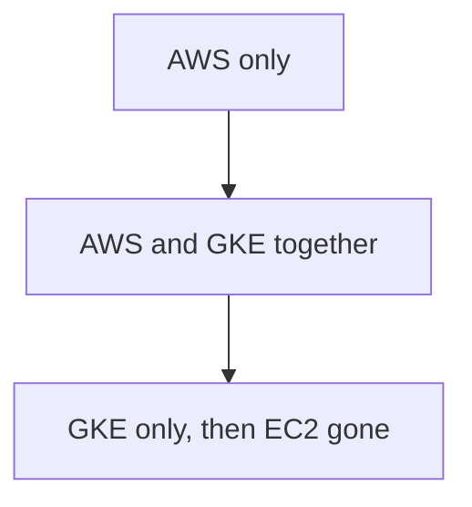

# {{ $frontmatter.title }} 관련

```component VPCard
{
  "title": "Docker > Article(s)",
  "desc": "Article(s)",
  "link": "/devops/docker/articles/README.md",
  "logo": "/images/ico-wind.svg",
  "background": "rgba(10,10,10,0.2)"
}
```

```component VPCard
{
  "title": "Kubernetes > Article(s)",
  "desc": "Article(s)",
  "link": "/devops/k8s/articles/README.md",
  "logo": "/images/ico-wind.svg",
  "background": "rgba(10,10,10,0.2)"
}
```

```component VPCard
{
  "title": "AWS > Article(s)",
  "desc": "Article(s)",
  "link": "/devops/aws/articles/README.md",
  "logo": "/images/ico-wind.svg",
  "background": "rgba(10,10,10,0.2)"
}
```

```component VPCard
{
  "title": "Google Cloud > Article(s)",
  "desc": "Article(s)",
  "link": "/devops/gcp/articles/README.md",
  "logo": "/images/ico-wind.svg",
  "background": "rgba(10,10,10,0.2)"
}
```

[[toc]]

---

<SiteInfo
  name="How to Migrate an Application from AWS to GKE [Full Book]"
  desc="This guided lab walks you through migrating a small payments app, with a React UI and Express API running on a single AWS EC2 instance, while PostgreSQL stays on AWS. You’ll move the UI and API to Goo"
  url="https://freecodecamp.org/news/how-to-migrate-an-application-from-aws-to-gke-full-book"
  logo="https://cdn.freecodecamp.org/universal/favicons/favicon.ico"
  preview="https://cdn.hashnode.com/uploads/covers/5e1e335a7a1d3fcc59028c64/8a1803ba-c9c9-496d-b2c4-58392cc655eb.png"/>

This guided lab walks you through migrating a small payments app, with a React UI and Express API running on a single AWS EC2 instance, while PostgreSQL stays on AWS.

You’ll move the UI and API to Google Kubernetes Engine without changing the public URL customers already use, gradually shifting traffic from AWS to GKE a few percent at a time.

By the end, you’ll have run the app locally, stood up AWS, built GKE in eight Terraform stages, tested the new environment, shifted production traffic to GKE, completed the cutover, and torn down what you no longer need.

The image below shows the middle of the migration, with both clouds live, customers still using one URL, and the database remaining on AWS.


Around that request path, three more systems do their jobs:


---

## Before You Start

### What You Need Installed

Install each tool when its chapter needs it. You don't need everything on day one.

| Chapter | Tools |
| --- | --- |
| 1 | Docker Desktop (or Docker Engine with Compose on Linux), Git, and `python3` |
| 4 | An AWS account, the AWS CLI (run `aws configure` once), Terraform 1.5 or newer, `rsync`, and an SSH key |
| 6 | Node.js 20 or newer on your laptop. The check scripts in <VPIcon icon="fas fa-folder-open"/>`scripts/` use `node` to read JSON |
| 10 | A GCP project with billing turned on, the `gcloud` CLI, and `kubectl` |
| 14 | A GitHub account and your own copy of this repository on GitHub |
| 19 | `kustomize` (install with `brew install kustomize` on a Mac, or see [<VPIcon icon="iconfont icon-k8s"/>kubectl.docs.kubernetes.io](https://kubectl.docs.kubernetes.io/installation/kustomize/)) |

On Windows, use Git Bash or WSL for every command in this book. The commands are written for a Bash shell.

### Skills You Need

Prior Kubernetes, Terraform, GCP, or load-balancer experience isn't required. Don't buy a domain. On AWS, you open `https://` plus the Elastic IP. The browser warns about a self-signed certificate. Click through it and you get the same ClearPay login as on your laptop. On GCP you add one <VPIcon icon="fas fa-folder-open"/>`/etc/hosts` line so `https://api.clearpay.test` points at the load balancer, unless you turn on Cloud DNS.

### What This Costs

AWS costs about $1.25 per day. GCP costs about $1.60 to $3 per day once it's up. A weekend run of the whole book costs a few dollars.

Neither environment should run for a month. If you stop for more than a couple of days, tear both down:

```sh
./scripts/teardown-gcp.sh
cd infra/aws/terraform && terraform destroy
```

Two files hold the detailed numbers: [<VPIcon icon="fas fa-folder-open"/>`infra/aws/`<VPIcon icon="fa-brands fa-markdown"/>`COST.md` (<VPIcon icon="iconfont icon-github"/>`Osomudeya/migrate-api-aws-gke-devops`)](https://github.com/Osomudeya/migrate-api-aws-gke-devops/blob/main/infra/aws/COST.md) and [<VPIcon icon="fas fa-folder-open"/>`infra/gcp/`<VPIcon icon="fa-brands fa-markdown"/>`COST.md` (<VPIcon icon="iconfont icon-github"/>`Osomudeya/migrate-api-aws-gke-devops`)](https://github.com/Osomudeya/migrate-api-aws-gke-devops/blob/main/infra/gcp/`<VPIcon icon="fa-brands fa-markdown"/>`COST.md). The book sends you to those two files and no other documents.

### How This Book Works

Clone the repository and run every command from its root folder unless a step says `cd` somewhere else:

```sh
git clone https://github.com/Osomudeya/migrate-api-aws-gke-devops.git
cd migrate-api-aws-gke-devops
```

The repository already holds the app, the Terraform, the Kubernetes files, the pipeline, and the scripts.

You won't write new code. Your work is to run each step, read what the system prints, and decide whether to continue.

This book reads like a story where you join a small payments company in week one, and every chapter is a task someone on the team hands you.

Each chapter opens with a time stamp and a scene, then follows the same loop:


#### Most Important Rule

Don't run a command you don't understand. If the book hasn't told you why yet, keep reading, because the "why" is the point.

This book has two kinds of steps.

The first simply asks whether the step worked, such as whether the file copied or the container started. If it did, continue.

The second asks you to think about what happened. Once the command finishes, read the output and understand what it means before moving to the next chapter.

#### The Chapters

Read the chapters in order and skip none. Chapter 1 doesn't ask you to install Kubernetes or open GCP. Those come later.

| Part | Chapters | What happens |
| --- | --- | --- |
| 1. Run ClearPay and Put It on AWS | 1–6 | You run the app on your laptop, deploy it to one AWS server, and write down how fast it is |
| 2. Plan the Move | 7–9 | You read the assignment, map what the app depends on, and read the GCP design |
| 3. Build Google Cloud With Terraform | 10–11 | You build GCP in eight Terraform stages, one at a time |
| 4. Get ClearPay Onto GKE Staging | 12–15 | The pipeline puts ClearPay on GKE staging, and the promotion gate checks it |
| 5. Make GKE Production-Ready | 16–18 | You review security, set up a dashboard, and break staging on purpose |
| 6. Move Customers to GKE | 19–23 | You deploy production and move traffic from 1 percent to 100 percent |
| 7. Finish the Migration | 24–28 | You prove the cutover, retire AWS, tear everything down, and write it up |

#### If Something Doesn't Work

Stay in that chapter. Use its *"If it fails"* steps. Don't skip ahead. A problem you carry forward gets harder to find, because the next chapter adds another cloud on top of it.

The job isn't to memorize Kubernetes or Terraform. It's to learn how to work through a real migration: understand what's running, make decisions based on what you find, verify the result, and know what to do when something breaks.

#### How Long This Takes

This might take more than one day. If you'll be away for more than a day or two, destroy the AWS and GCP resources so you're not billed for them while it's idle. The commands are in "What this costs" above.

### The Team

This lab starts as Zee, a junior DevOps engineer on the ClearPay team, week one. You play Zee.

- Maya is the engineering manager. She asks for evidence.
- Daniel is a senior engineer. He pairs with you on servers, Kubernetes, and capacity.
- Amara maintains the payments API. She cares about one thing: no customer is charged twice.
- Chris handles customer support. He hears first when transfers fail.

Your job is to move the payments API from one AWS EC2 server to GKE without a customer-visible outage, while PostgreSQL stays on AWS.

---

## Table of Contents

- [Part 1. How to Run ClearPay and Put It on AWS](#heading-part-1-how-to-run-clearpay-and-put-it-on-aws)
- [Part 2. How to Plan the Move](#heading-part-2-how-to-plan-the-move)
- [Part 3. How to Build Google Cloud With Terraform](#heading-part-3-how-to-build-google-cloud-with-terraform)
- [Part 4. How to Get ClearPay Onto GKE Staging](#heading-part-4-how-to-get-clearpay-onto-gke-staging)
- [Part 5. How to Make GKE Production-Ready](#heading-part-5-how-to-make-gke-production-ready)
- [Part 6. How to Move Customers to GKE](#heading-part-6-how-to-move-customers-to-gke)
- [Part 7. How to Finish the Migration](#heading-part-7-how-to-finish-the-migration)
- [What Comes After This Project](#heading-what-comes-after-this-project)
- [What You Should Have at the End](#heading-what-you-should-have-at-the-end)
- [How to Discuss This Project in an Interview](#heading-how-to-discuss-this-project-in-an-interview)

---

## Part 1. How to Run ClearPay and Put It on AWS


A migration needs a starting point you trust. In this part, you run ClearPay on your laptop, deploy it to AWS the way the company runs it today, and write down how fast it is. Every later chapter compares GKE against those numbers.

### Chapter 1. Run ClearPay on Your Laptop

*Week one, Monday, 9:05 a.m.*

Your laptop is new. The Wi-Fi password is on a sticky note. The first message in your inbox is from Maya, the engineering manager, and it's short.

Maya: "Get ClearPay running on your laptop first. Log in, send $20, and then we'll talk about moving the API to GKE."

The code is in the repository: <VPIcon icon="fas fa-flder-open"/>`api/`, `ui/`, and `db/`. Nothing is running yet.

::: important Why This Matters

Later chapters need a picture of a good login and a good $20 send. When something fails on AWS or GKE, you compare it with this.

:::

#### What You're About to Run

ClearPay has three parts, and each part has one job.

- The **UI** is what a customer sees and taps: the login page, the balance, and the Send button. UI stands for user interface.
- The **API** is the part that does the work. It has no screen. The UI sends it a message, such as "send $20 to Bob". The API checks the message, does the work, and sends back a reply, such as "done". API stands for application programming interface. Think of it as a door with rules. The UI asks in a fixed way, and the API answers in a fixed way.
- The **database** is where ClearPay writes everything down: every account, balance, and payment. PostgreSQL is the database program ClearPay uses.
- A **server** is a computer that stays on all day and waits for requests. The API runs on one.

A café works the same way. The menu is the UI. The waiter is the API. The kitchen and its records are the database. A customer never walks into the kitchen. The customer tells the waiter what they want.


This chapter runs all three on your laptop. Later chapters move the UI and the API to Google Cloud. The database stays on AWS.

#### Steps

Start Docker Desktop. Don't install Node or PostgreSQL for this chapter. They run inside the containers.

From the folder that holds <VPIcon icon="iconfont icon-yaml"/>`docker-compose.yml`:

```sh
docker compose up --build
```

The first build takes a couple of minutes. This terminal keeps printing logs and doesn't give you a prompt back until you press Ctrl+C. Leave it running.

Wait until all three of these lines appear. The names on the left may start with your folder name:

```plaintext
Container <folder>-postgres-1 Healthy
api-1       | {"message":"api_started", ...}
ui-1        |   ➜  Local:   http://localhost:5173/
```

`Healthy` means Postgres is up. `api_started` means the API is up. The `localhost:5173` line means the UI is up.

Open a second terminal in the same folder. Create two demo accounts:

```sh
docker compose exec api node db/seed.js
```

This runs the seed script directly. The API image has no npm, on purpose, because the security scan in Chapter 14 flags it.

Expected output:

```plaintext
seeded: alice@clearpay.dev (password: password123)
seeded: bob@clearpay.dev (password: password123)
```

If you see `skip (already exists): alice@clearpay.dev`, the accounts exist from an earlier run. That's fine.

**This is what's now running:**


#### Check

In the second terminal:

```sh
curl localhost:4000/health
```

Here's the expected output. Your `instance` value will be a container ID:

```json
{"status":"ok","served_by":{"platform":"aws","version":"1.0.0","instance":"14b8d5d767ea","commit":"local","rollback_active":false}}
```

`"status":"ok"` is the check. `served_by` names the platform that answered the request. It says `aws` on your laptop because <VPIcon icon="iconfont icon-yaml"/>`docker-compose.yml` sets `PLATFORM: aws`. Later, GKE answers with `gke`, and that one field tells you which cloud handled each request.

Now open [http://localhost:5173](http://localhost:5173) and sign in. Seed already created Alice, so don't register her:

- Email: `alice@clearpay.dev`
- Password: `password123`

Send $20 to `bob@clearpay.dev`. The transfer appears under Recent activity as `Sent` with a short ID, for example `Sent · a1b2c3d4`.


Look at two places on this dashboard. You'll watch them for the rest of the book:

1. Each line under Recent activity ends with `served by aws/1.0.0`. That's the platform and version of the API process that wrote the transfer. It's stored with the transfer in the database.
2. The black bar at the top says `All systems operational` when `/health/ready` succeeds. That means the API process is up and can reach Postgres. It says nothing about logins. A wrong password shows a red error on the form, while the bar keeps saying `All systems operational`.

After Chapter 5, you open the same dashboard on the AWS address. Same login, same two places.

#### If it Fails:

- `failed to connect to the docker API` or `docker.sock`: Docker Desktop isn't running. Start it, wait until it is ready, and run `docker compose up --build` again.
- `email already registered` on the Register page: Alice already exists. Go back to Sign in.
- `invalid credentials`: the password is the full string `password123`. If that still fails, run the seed command again. A `skip (already exists)` line means the account is there.
- `docker compose up` exits right away: run `docker compose logs api` in the second terminal. On a slow first boot the API can start before Postgres accepts connections. Run `docker compose up` again.
- Port `4000` or `5173` already in use: another program on your machine holds that port. Stop it, or change the port mapping in <VPIcon icon="iconfont icon-yaml"/>`docker-compose.yml`.

#### Decision

If the transfer went through, the application works. Continue.

If it didn't, fix it here, on the laptop. AWS and GKE are harder to debug. On this machine, the answer is one `docker compose logs` command away.

#### Done When:

- `docker compose up` runs without errors
- The seed reports two accounts, created or skipped
- You sent $20 in the UI and saw it under Recent activity

### Chapter 2. Read the Code That Matters

*Monday, 11:30 a.m.*

The $20 went through. You're still looking at the transfer line when a chair rolls up next to yours. Daniel, the senior engineer at the next desk, has his coffee and no hurry.

Daniel looks over at your screen. "You don't need to memorize every line. Know which file does which job, so you can open it fast during the migration."

::: important Why This Matters

Every later chapter touches one of these four files. Five minutes now saves you a search under pressure later.

:::

#### Steps

Open these files in this order:

1. <VPIcon icon="fas fa-flder-open"/>`api/src/index.js` starts the API and connects every route: health checks, `/api/info`, login, and transactions.
2. <VPIcon icon="fas fa-flder-open"/>`api/src/servedBy.js` is 17 lines long. It reads `PLATFORM`, `APP_VERSION`, and `ROLLBACK_ACTIVE` from environment variables. The dashboard uses it to print `served by aws/1.0.0`.
3. <VPIcon icon="fas fa-flder-open"/>`api/src/routes/transactions.js` handles sending money. Find the `idempotency_key` check near the top. It runs before anything else.
4. <VPIcon icon="fas fa-flder-open"/>`api/src/db.js` connects the API to Postgres. Find `DB_POOL_SIZE || '10'`.

Daniel stops you on the last file.

"A connection is an open line to the database. One API process can hold up to ten of those lines at the same time. Remember that number."

#### What You Now Know

```sh
index.js                 # starts the API and connects the routes
servedBy.js              # says which cloud answered (aws or gke)
routes/transactions.js   # sends money, checks the idempotency key first
db.js                    # talks to Postgres, up to 10 connections per process
```

<VPIcon icon="fa-brands fa-js"/>`servedBy.js` fills the dashboard line `served by aws/1.0.0`. That's which cloud answered, not who logged in.

Today there's one API process, so ten connections is the whole pool. On GKE, several copies of the API run at once. Kubernetes calls each copy a pod. Each pod gets its own pool of ten, and every pod shares the same database. Chapter 22 comes back to that math.

#### Done When:

- You can say, without looking, which file sets the connection limit and which file names the platform

### Chapter 3. Prove a Retry Never Charges Twice

*Monday, 2:10 p.m.*

After lunch, you get a message from someone you haven't met yet. Amara maintains the payments API. Maya told her you have ClearPay running on your laptop, so she skips the greeting.

Amara: "Send $20 twice with the same key. Alice's balance should drop by $20, not $40."

::: important Why This Matters

Alice sends $20 to Bob. She taps Send, and the screen freezes. She doesn't know if the payment worked, so she taps Send again.

:::

Without protection, the API sees two requests and takes $20 two times. Alice loses $40 for one payment.

The `idempotency_key` stops this. "Idempotent" means safe to repeat: doing it twice gives the same result as doing it once.

The key is a label the app puts on each payment, for example `round-a`.

1. The first request arrives with the label `round-a`. The API takes $20 and saves the label.
2. The second request arrives with the same label. The API sees `round-a` again. It knows this is the same payment, so it takes no money. It sends back the first result.

Same label means same payment.

This matters more during the migration. Sometimes the first tap goes to AWS and the retry goes to GKE. Those are two different servers, but they use one database. GKE looks in that database, finds `round-a`, and doesn't charge again. One shared database keeps the customer safe on both clouds.

Use `curl` for this chapter, not the Send money button. The UI gives every click a new key, so every click is a new transfer.

For a deeper walk-through of idempotency, see [<VPIcon icon="fas fa-globe"/>PayFlow: A Production-Grade Fintech System for Learning Real DevOps](https://osomudeya.gumroad.com/l/payflow).

#### Steps

Stay in the second terminal, in the folder with <VPIcon icon="iconfont icon-yaml"/>`docker-compose.yml`. Run one command at a time and read the output before the next one.

Log in as Alice. This stores her login token in a shell variable called `TOKEN`. A token is proof that Alice signed in. Later commands send it with `$TOKEN`.

```sh
TOKEN=$(curl -s -X POST localhost:4000/api/auth/login \
-H "Content-Type: application/json" \
-d '{"email":"alice@clearpay.dev","password":"password123"}' \
| python3 -c "import sys, json; print(json.load(sys.stdin)['token'])")
```

This prints nothing when it works. Run `echo $TOKEN` to confirm. You should see a long string.

Then read Alice's account. Write down the `balance_cents` number.

```sh
curl -s localhost:4000/api/accounts/me -H "Authorization: Bearer $TOKEN"
```

This is the expected shape. Your numbers and `id` will differ:

```json
{"account":{"id":"...","balance_cents":"94000","currency":"USD"},"served_by":{"platform":"aws","version":"1.0.0","instance":"...","commit":"local","rollback_active":false}}
```

`94000` means $940.00. If you haven't sent anything yet, you'll see `100000` ($1,000.00). If the command says `missing_token` or `invalid_token`, run step 1 again.

Now pick a label you haven't used yet:

```sh
LABEL=round-a
```

Send $20 to Bob. `2000` is $20.00 in cents.

```sh
curl -s -X POST localhost:4000/api/transactions \
-H "Authorization: Bearer $TOKEN" -H "Content-Type: application/json" \
-d "{\"to_email\":\"bob@clearpay.dev\",\"amount_cents\":2000,\"idempotency_key\":\"$LABEL\"}"
```

Look for `"replayed"` in the reply:

- `"replayed":false` means this send took $20. Continue.
- `"replayed":true` means this label was used before, probably in an earlier run. No money moved. Set `LABEL=round-b` and send again until you see `"replayed":false`.

Send the exact same request again. Don't change `LABEL`.

```sh
curl -s -X POST localhost:4000/api/transactions \
-H "Authorization: Bearer $TOKEN" -H "Content-Type: application/json" \
-d "{\"to_email\":\"bob@clearpay.dev\",\"amount_cents\":2000,\"idempotency_key\":\"$LABEL\"}"
```

Now you should see `"replayed":true`, and the transaction `id` matches the first send.

Read the account again:

```sh
curl -s localhost:4000/api/accounts/me -H "Authorization: Bearer $TOKEN"
```

#### Check

`balance_cents` is 2000 lower than the number you wrote down, not 4000 lower. If you started at `94000`, you now see `92000`.

#### If it Fails:

- `echo $TOKEN` is empty: run the login command again.
- The second send still shows `"replayed":false`: `LABEL` changed between the two sends. Run `echo $LABEL`, then send again.
- Both sends showed `"replayed":true`: the balance won't change. Pick a new `LABEL` and repeat steps 3 and 4.

#### Done When:

- One send returned `"replayed":false` and the next returned `"replayed":true` for the same label
- `balance_cents` fell by 2000, not 4000

### Chapter 4. Build the AWS Server With Terraform

*Tuesday, 9:15 a.m.*

Maya stops at your desk on her way to a meeting. Yesterday you told her that ClearPay runs on your laptop and that a retried payment charges only once.

Maya: "Good. Now, localhost isn't a baseline. Get ClearPay onto AWS and prove a customer can complete a transaction there. Then we can talk about leaving AWS. Daniel will work with you on this one."

Daniel rolls his chair over from the next desk.

Daniel: "One rule before you start. Don't skip `terraform plan`."

::: important Why This Matters

This book starts from the setup many small companies run: one Linux server with no Docker on it.

:::

systemd, the Linux service manager, starts the Node API when the server boots. nginx sits in front of it and handles HTTPS on port 443. PostgreSQL runs on Amazon RDS, the managed database service.

There's no AWS load balancer. A load balancer spreads traffic across several servers, and this setup has one. Adding one would add an hourly bill for no gain. The numbers are in <VPIcon icon="fas fa-folder-open"/>`infra/aws/`<VPIcon icon="fa-brands fa-makrdown"/>`COST.md`.

The file <VPIcon icon="fas fa-flder-open"/>`api/`<VPIcon icon="fa-brands fa-docker"/>`Dockerfile` exists, but only your laptop uses it. The AWS server never runs Docker.

Daniel: "The EC2 server won't have Docker. systemd starts Node on boot, next to nginx. That's the server you're inheriting."


The diagram above shows how a customer request reaches ClearPay on AWS. The Elastic IP provides a fixed public address for the EC2 server. Nginx handles HTTPS traffic on port 443, serves the frontend files, and forwards API requests to the Node.js process managed by systemd on port 4000. The API reads and writes payment data in PostgreSQL on Amazon RDS, which has no public endpoint at this stage.

Two AWS terms appear in this chapter:

- A VPC is the private network your servers sit in. AWS gives every account a default one. This lab uses it instead of building its own.
- A security group is AWS's firewall. It lists which ports may reach a server. This lab allows SSH from your IP only, HTTPS from anywhere, and Postgres only from the API server.

#### Steps

First confirm your laptop is ready. Each of these must work:

```sh
docker --version          # still needed later
aws sts get-caller-identity
terraform version         # 1.5 or newer
ssh-keygen -t ed25519 -f ~/.ssh/clearpay-deployer -N ""
```

`aws sts get-caller-identity` prints your AWS account. If it errors, run `aws configure` with an access key from an IAM user that can create EC2, RDS, VPCs, and CloudWatch alarms. An admin user on a throwaway account also works.

From the repository root:

```sh
cd infra/aws/terraform
cp terraform.tfvars.example terraform.tfvars
```

Open `terraform.tfvars` and change two values:

- `ssh_allowed_cidr`: your public IP address followed by `/32`. Find your IP with `curl ifconfig.me`.
- `ssh_public_key_path`: the path to your key's `.pub` file.

Then:

```sh
terraform init
terraform plan
terraform apply
```

Read the plan before you type `yes`. This first run should only create things: EC2, RDS, and security groups. If the plan says it will destroy anything, stop and don't apply.

This is what Terraform builds. The server is empty until Chapter 5:


The diagram shows the AWS infrastructure Terraform creates: an EC2 Ubuntu server with an Elastic IP, security groups controlling SSH and HTTPS access, an RDS PostgreSQL database accessible only from the API server, and a CloudWatch status check. Both resources sit inside the default VPC. The EC2 server is still empty. Chapter 5 deploys ClearPay to it.

::: note A note on cost

the Elastic IP costs about $0.12 per day even while the server runs, because AWS bills every public IPv4 address ([<VPIcon icon="fa-brands fa-aws"/>AWS public IPv4 charge](https://aws.amazon.com/blogs/aws/new-aws-public-ipv4-address-charge-public-ip-insights/)).

:::

#### Check

```sh
terraform output instance_public_ip
```

This prints a public IPv4 address. That is how you reach the server. You do not need a domain, so Route 53 stays off (`manage_dns = false`).

#### If it Fails:

- `Error: InvalidKeyPair.Duplicate`: a key pair named `clearpay-deployer` already exists in this AWS region from an earlier attempt. Delete it in the AWS console, or rename it in <VPIcon icon="fas fa-folder-open"/>`infra/aws/terraform/`<VPIcon icon="iconfont icon-terraform"/>`ec2.tf`.
- `Error: UnauthorizedOperation`: your AWS user lacks permission for one resource type. The error names the operation. Add that one permission instead of reaching for full admin.

#### Decision

The infrastructure exists. A server with nothing running on it isn't done yet. Continue to Chapter 5. #### Done When:

- `terraform apply` finished with no errors
- `terraform output instance_public_ip` prints a real IP

### Chapter 5. Deploy ClearPay to the AWS Server

*Tuesday, 1:40 p.m.*

Terraform apply finished before lunch. AWS now shows a server and a database, but nothing is serving customers yet.

Terraform built an empty server and a database. Nothing serves customers yet.

You open a terminal to start the deploy. Daniel pulls his chair over and sits down next to you.

Daniel: "Terraform finishing only tells us the server exists. Let's get the app on it and send a real request."

::: important Why This Matters

An empty server isn't a migration source. Chapter 6 asks whether a real customer request works on AWS. That question has no answer until the login page and the API are up.

:::

#### Steps

Start from the repository root. If you're still in <VPIcon icon="fas fa-folder-open"/>`infra/aws/terraform`, run `cd ../../..` first.

Start by installing Node, nginx, and certbot on the server:

```sh
cd infra/aws/deploy
INSTANCE_IP=$(terraform -chdir=../terraform output -raw instance_public_ip)
echo "$INSTANCE_IP"
# Write that IP down. A new terminal will not have INSTANCE_IP.

ssh -o StrictHostKeyChecking=accept-new \
-i ~/.ssh/clearpay-deployer ubuntu@$INSTANCE_IP 'bash -s' < bootstrap.sh
```

You should see `== ClearPay AWS bootstrap ==`, then a few minutes of `apt-get` output. <VPIcon icon="iconfont icon-shell"/>`bootstrap.sh` is short. Read it.

The step worked when the output ends with these lines:

```plaintext
== Bootstrap complete ==
Node: v20.20.2
Self-signed TLS is in /etc/letsencrypt/live/clearpay, use curl -k.
```

Your Node version may differ. Lines that start with `debconf: unable to initialize frontend` are harmless. They appear because the SSH session has no interactive screen. The rows of `+` and `*` come from OpenSSL creating the self-signed certificate.

If you see no output at all, SSH didn't connect. Your home IP may have changed since Chapter 4, so the security group still allows the old one. Check your IP with `curl -s ifconfig.me; echo`, put it plus `/32` in `terraform.tfvars` as `ssh_allowed_cidr`, run `terraform apply` in <VPIcon icon="fas fa-folder-open"/>`infra/aws/terraform`, and retry.

Next, write the <VPIcon icon="iconfont icon-dotenv"/>`.env` file the API needs and deploy the app. The database URL comes from Terraform. The JWT secret signs login tokens and is generated fresh:

```sh
DATABASE_URL=$(terraform -chdir=../terraform output -raw database_url)

cat > /tmp/clearpay.env <<EOF
DATABASE_URL=$DATABASE_URL
JWT_SECRET=$(openssl rand -hex 32)
PLATFORM=aws
APP_VERSION=1.0.0
GIT_COMMIT=$(git rev-parse --short HEAD 2>/dev/null || echo local)
ROLLBACK_ACTIVE=false
PORT=4000
EOF

./deploy.sh "$INSTANCE_IP" ~/.ssh/clearpay-deployer /tmp/clearpay.env
rm /tmp/clearpay.env
```

.<VPIcon icon="iconfont icon-shell"/>`deploy.sh` builds the React UI and copies it to <VPIcon icon="fas fa-folder-open"/>`/opt/clearpay-ui`. It copies the API to <VPIcon icon="fas fa-folder-open"/>`/opt/clearpay-api`, installs its packages, writes <VPIcon icon="iconfont icon-dotenv"/>`.env`, installs the systemd service and the nginx config from <VPIcon icon="fas fa-folder-open"/>`infra/aws/deploy/`, and restarts both.

Now load the database schema and seed Alice and Bob. These commands run on the server, not your laptop. RDS has no public endpoint yet (`publicly_accessible = false` in <VPIcon icon="fas fa-folder-open"/>`infra/aws/terraform/`<VPIcon icon="iconfont icon-terraform"/>`rds.tf`), so your laptop can't reach it.

Your laptop can't reach the database directly. It uses the EC2 server as a middleman:


The diagram above shows why your laptop can't connect directly to the private RDS database. SSH access to the EC2 server is allowed, and the server is allowed to connect to RDS within the AWS network. Direct access from your laptop to the database is blocked. You use the EC2 server as the entry point for database access.

Each command below starts with `ssh ... ubuntu@$INSTANCE_IP "..."`. That means: log in to the EC2 server and run the part in quotes there. So `psql` and the seed run on EC2, and EC2 talks to RDS for you. You see the result later in the browser: you log in as Alice, and EC2 reads her account from RDS.

```sh
scp -i ~/.ssh/clearpay-deployer ../../../db/schema.sql \
ubuntu@$INSTANCE_IP:/tmp/schema.sql

ssh -i ~/.ssh/clearpay-deployer ubuntu@$INSTANCE_IP \
"sudo apt-get install -y postgresql-client -qq && psql '$DATABASE_URL' -f /tmp/schema.sql"

ssh -i ~/.ssh/clearpay-deployer ubuntu@$INSTANCE_IP \
"cd /opt/clearpay-api && sudo -u clearpay npm run seed"
```

The seed is the same script from Chapter 1. This time it writes to RDS.

#### Check

```sh
ssh -i ~/.ssh/clearpay-deployer ubuntu@$INSTANCE_IP 'sudo systemctl is-active clearpay-api'
```

Expected output: `active`.

Then from your laptop:

```sh
curl -k https://$INSTANCE_IP/health
```

Look for `"status":"ok"` and `"platform":"aws"`. The `-k` flag tells curl to accept the self-signed certificate that <VPIcon icon="iconfont icon-shell"/>`bootstrap.sh` created.

Open `https://<your instance IP>` in a browser. Click through the "Not Secure" warning. That warning comes from the self-signed certificate. You should see the same ClearPay login as on your laptop. Sign in as Alice with `password123`. The dashboard shows her balance and `served by aws/1.0.0`.

Daniel: "The health check only tells us the app is running. Before we write down a baseline, I want to see a transfer go through on this IP."

Send $20 to Bob in the browser.

#### If it Fails:

- `systemctl is-active` returns `failed`: SSH in and run `sudo journalctl -u clearpay-api -n 50`. The usual cause is a `DATABASE_URL` that doesn't match RDS. Compare it with `terraform output database_url`, character by character.
- `seed_failed` with `SELF_SIGNED_CERT_IN_CHAIN`: `psql` already worked, so the database is fine. Newer versions of the Node `pg` library treat `sslmode=require` as full certificate checking. Copy the current <VPIcon icon="fas fa-flder-open"/>`api/src/pgConfig.js`, <VPIcon icon="fas fa-flder-open"/>`api/src/db.js`, and <VPIcon icon="fas fa-flder-open"/>`api/db/seed.js` onto the server, restart `clearpay-api`, and run only the seed command again. Don't run `schema.sql` again.
- nginx returns `502 Bad Gateway`: nginx is running but the API behind it is not. Check the systemd status above first.
- The browser shows `Cannot GET /`: nginx still has an old API-only config. Run `./deploy.sh "$INSTANCE_IP" ~/.ssh/clearpay-deployer` with no third argument. That keeps the <VPIcon icon="iconfont icon-dotenv"/>`.env` already on the server. Don't seed again.
- `invalid credentials` for Alice: the browser probably filled in a saved password. Clear the box, type `password123`, and try again.

#### Done When:

- `systemctl is-active clearpay-api` prints `active`
- `curl -k https://$INSTANCE_IP/health` returns `"status":"ok"`
- You sent $20 in the browser on the AWS address

### Chapter 6. Record the AWS Baseline

*Wednesday, 10:00 a.m.*

You message Maya: "health is ok, and Alice signed in on the Elastic IP." Her reply comes back in under a minute.

Maya: "Good. Now run the five checks against that IP. Send me the terminal output, not a screenshot."

A second message follows: "Then load-test it and send me the p95. I can't compare GKE against 'it works'."

::: important Why This Matters

This chapter gives you two things. You'll use both for the rest of the book.

:::

**1. A pass from the promotion gate.** The promotion gate is a short script. It tests five things every payment app must do: the app is running, it can reach the database, a user can log in, a repeated payment charges only once, and the balance drops by the right amount. If all five pass, the app works.

In Chapter 15 you run the same script on GKE. If GKE passes the same test AWS passed, GKE does the job, too.

**2. A scorecard.** The load test sends many requests at the same time, like many customers using the app at once. Then it writes down how fast the app answered and how many requests failed. That's how fast AWS is today. Later you run the same test on GKE and compare the two.

Think of timing a runner before they change shoes. Without the first time, the second time means nothing. This chapter records the first time.

The scripts in this chapter use Node on your laptop to read JSON. Install Node.js 20 or newer now if you haven't already.

#### Steps

Start from the repository root. If you're still in <VPIcon icon="fas fa-folder-open"/>`infra/aws/deploy`, run `cd ../../..` first.

Run the promotion gate against AWS:

```sh
export INSTANCE_IP=$(terraform -chdir=infra/aws/terraform output -raw instance_public_ip)

./scripts/promotion-gate.sh https://$INSTANCE_IP \
  alice@clearpay.dev password123 bob@clearpay.dev
```

Use `https://`. With `http://`, nginx redirects and the script looks like it hung.

The gate checks five things, in order:

1. The process is up (`/health`).
2. It can reach the database (`/health/ready`).
3. Alice can log in.
4. A replayed payment key returns `replayed=true`.
5. Alice's balance drops once.

```plaintext title="Expected output"
PASS: health endpoint returns ok
PASS: readiness endpoint confirms DB connectivity
PASS: login succeeds and returns a token
PASS: replaying an idempotency key returns replayed=true
PASS: balance debited exactly once (100 cents), not twice

5 passed, 0 failed

GATE PASSED: safe to promote to production.
```

The last line talks about production. There's no production to promote to yet. It's the same script you run on GKE later, where that line means what it says.

Now load-test AWS. The script logs in and hits `/api/accounts/me` and `/api/transactions`, which both query Postgres. Don't load-test `/health`. The API answers `/health` by itself, straight away. It never asks the database anything. A real customer request has to ask the database and wait for the answer, and that wait is most of the time:

```plaintext
/health                  laptop → API → reply                    (fast, no database)
/api/accounts/me         laptop → API → database → API → reply   (the real work)
```

Load-testing `/health` times only the fast half. Think of asking a shop worker "are you open?" versus "do you have this shoe in size 42?" Only the second question makes them walk to the storeroom.

```sh
./scripts/load-test.sh https://$INSTANCE_IP \
alice@clearpay.dev password123 10 30
```

The last two numbers are concurrency (10 requests at once) and duration (30 seconds).

#### Check

The script prints a scorecard. This is the one this lab printed:

```plaintext
== DB load test: https://184.194.120.157  concurrency=10  duration=30s ==
Endpoints: GET /api/accounts/me  GET /api/transactions


ok=372  failed=0

Migration Scorecard, this run

p50 latency:          673 ms
p95 latency:          745 ms
p99 latency:          1326 ms
Throughput:           12.4 req/s
4xx rate:             0.0 %
5xx rate:             0.0 %
Transaction success:  100.0 %
```

Your scorecard will differ. Your IP address, request counts, and milliseconds depend on where you are. The load test runs on your laptop, so every request travels from your home to AWS in `us-east-1` and back.

A reader close to that region sees much lower numbers than a reader on another continent. Neither is wrong. What matters is that you compare GKE against your own scorecard, measured from the same place.

The run passes when you see `failed=0`, `5xx rate` at `0.0 %`, and `Transaction success` at `100.0 %`.

- p95 latency means 95 percent of requests finished faster than this number. It shows what slow customers feel, which an average hides.
- `4xx` means the client sent a bad request, such as a missing token.
- `5xx` means the server failed.

You copy the whole scorecard into a notes file as printed, and send the same block to Maya. Her answer comes back fast: "Don't round it to look tidier. I will compare GKE to this page."

#### Set Your Limits Now

Write these two lines under the scorecard, with numbers:

```plaintext
Outage:   5xx rate above 1 % for more than 2 minutes in a row
Failure:  p95 more than 3 times your AWS p95 for more than 5 minutes in a row
```

The failure limit uses your own AWS p95, because every reader's baseline is different. With this lab's 745 ms, the limit is about 2,235 ms. These are example limits. Pick your own, but pick them now, before GKE exists. A limit you set after you see the GKE numbers is a limit you bent to fit them.

Start the cost ledger with one line:

```plaintext
Cost ledger, entry 1:  AWS about $1.25/day (infra/aws/COST.md)
```

#### If it Fails:

Stay here until all five checks pass. A problem you carry into the migration comes back later with two clouds involved, and is much harder to find.

- A check fails on readiness: the API can't reach RDS. Go back to Chapter 5's "If it fails" list.
- `node: command not found`: install Node.js on your laptop.

#### Decision

The gate passed. This EC2 server is the baseline. Every GKE number in this book gets compared against this scorecard.

A minute later Maya adds one more line: "Good. Those are my numbers now."

#### Done When:

- The gate printed `5 passed, 0 failed` against the AWS IP
- The load test printed `failed=0`, and the scorecard is in your notes
- Your outage and failure limits are written down with numbers

---

## Part 2. How to Plan the Move


Tell Maya the gate passed and send her the scorecard.

She writes back: "The next job is GKE. I need the API running there, and I need customers to keep sending money the whole time you move it. Leave Postgres on AWS. The database isn't in this assignment."

No cloud gets touched in this part. You read, map, and decide.

### Chapter 7. Read the Migration Assignment

*Wednesday, 4:00 p.m.*

Maya forwards the assignment with one line on top: "Read all of it before you open Terraform."

#### The Assignment: Migrate the ClearPay API from AWS EC2 to GKE.

ClearPay runs on one EC2 server. It works, but it has no autoscaling, no staged rollout, and a deploy process that lives in one person's head. You ran that process by hand in Chapter 5, so you know what it lacks.

The business wants the API on Kubernetes: a staging environment, automated deploys, and room to grow. Again, the database isn't part of this assignment.

#### Current Architecture

ClearPay lives in one AWS account, in the default VPC from Chapter 4: one EC2 server and one RDS database.

#### What Can't Change

- The database. Moving Postgres is a separate, later project.
- The API contract. The same paths return the same JSON: `/health`, `/api/auth/login`, `/api/transactions`. A browser or script that works on AWS must work on GKE with no changes.
- Customers see no lasting outage at any point.

#### Acceptance Criteria

Done means this, in order:

1. GKE serves all production traffic, and it stays that way. Errors and latency stay inside the limits you wrote in Chapter 6.
2. While AWS still exists, rollback to AWS still works.
3. Then you retire AWS, after GKE has proven itself.

#### What moves and what stays


The diagram shows the migration from AWS to GCP. The ClearPay UI and API move from the EC2 server to Google Kubernetes Engine (GKE), where staging and production run. PostgreSQL remains on Amazon RDS in AWS, so both environments use the same database during the migration.

The whole book follows one path:



The middle step is where the work happens. Both clouds run the same app, both talk to the same database, and traffic moves between them in small steps.

#### How Traffic Will Move

Today, customers type the Elastic IP and every request goes to AWS.

1. You put a Google load balancer in front, and customers switch to its address once. They keep using that address for the rest of the migration.
2. The load balancer then sends some requests to AWS and the rest to GKE. It starts with **100% AWS and 0% GKE**.
3. You raise the GKE share by hand with <VPIcon icon="fas fa-folder-open"/>`scripts/`<VPIcon icon="iconfont icon-shell"/>`shift-traffic.sh`, a few steps at a time, checking numbers after each step.
4. If something goes wrong on GKE, you send **100% of the traffic back to AWS** with `shift-traffic.sh 100 0`. The rollback takes seconds.


The diagram above shows how customers reach ClearPay through one public address while the UI and API run on both AWS and GKE during migration. Both environments connect to the same PostgreSQL database on Amazon RDS in AWS. Keeping the database in one place avoids migrating payment data alongside the application.

Why not use DNS to split traffic? DNS is the lookup that turns a name into an IP address. Laptops and internet providers cache the answer.

After you change a DNS record, some customers keep going to the old place for minutes or hours. A rollback that takes an hour isn't a rollback. The load balancer changes the split in seconds.

#### Rollback Requirement

At every stage of the shift, going back to 100 percent AWS must be fast and safe. Not a redeploy. Not a DNS change that takes an hour to spread. Chapter 20 tests exactly that, before the first shift.

#### What "Zero Downtime" Means Here

It doesn't mean zero failed requests, ever. No real system can promise that.

It means no customer sees a lasting outage. A few failed requests are allowed if they stay under the limits you wrote in Chapter 6. #### Why the API Moves First

If the API and the database move together and something breaks, the fault could be in either one, or in how they interact. Moving only the API keeps the question small: can this API run on GKE without hurting customers?

That's an answerable question. "Can you move everything at once safely?" is much harder to answer, and much worse to debug live.

#### Why the Database Stays on AWS

Chapter 13 shows what connecting across clouds involves. For now: PostgreSQL doesn't move in this project.

A future, separate project handles that, most likely with Google's Database Migration Service, continuous replication, and its own cutover. This project ends with the API on GKE and the database still on AWS. That's the plan, not an unfinished loose end.

#### Why Both Clouds Must Run at the Same Time

The rollback plan depends on it. You send a little traffic to GKE and keep AWS ready. If GKE fails, AWS takes everything back. That only works while AWS still exists.

#### Set a Migration Budget Before Touching GCP

**Do this now, before Chapter 9.** Write four numbers in your notes. They decide how much this move may cost you.

Plan your spending the way you plan money for a trip:

1. **What AWS costs today.** About $1.25 a day, from <VPIcon icon="fas fa-folder-open"/>`infra/aws/`<VPIcon icon="fa-brands fa-markdown"/>`COST.md`.
2. **What GCP will cost per day.** You don't know yet. Write "TBD" (to be decided). Chapter 9 works it out. <VPIcon icon="fas fa-folder-open"/>`infra/gcp/`<VPIcon icon="fa-brands fa-markdown"/>`COST.md` puts it at about $1.60 to $5 a day.
3. **What the move costs while both clouds run.** During the move you pay AWS and GCP at the same time. That is $1.25 plus the GCP daily cost, for every day of the move.
4. **Your budget.** The most you will spend on the whole move. Pick it now, before you spend anything.

**This lab's numbers:**

```plaintext
Current AWS cost:   $1.25/day
Expected GCP cost:  about $3/day (Chapter 9 checks this)
Dual-run cost:      $1.25 + $3 = $4.25/day while both run
Migration budget:   5 days × $4.25 = about $21. Round up to $25.
```

Keep a running total as you go. Chapters 19 to 25 add the real dual-run days. Chapter 28 asks one question: did you stay under your budget? If the move took longer, for example because of a rollback, the total shows exactly what that cost.

#### Migration phases


#### Done When:

- You can explain to Maya, in two sentences, what moves, what stays, and how you undo a bad step

### Chapter 8. Map What ClearPay Depends On

*Thursday, 9:00 a.m.*

Before anyone stands up GKE, the team needs a written map of what ClearPay depends on. This system has run by hand since Tuesday. Nothing on paper says what must keep working during the move.

Maya: "Before we stand up another cloud, write down what this system depends on."

::: important Why This Matters

A migration without a map moves the wrong thing, or misses something that breaks the day you switch. Answer each question below from the repository, not from memory.

:::

#### 1. Is the app ready for containers?

Yes. <VPIcon icon="fas fa-flder-open"/>`api/`<VPIcon icon="fa-brands fa-docker"/>`Dockerfile` has worked since Chapter 1. What changes is its role. On your laptop it was a convenience. On GKE it becomes the thing production runs.

#### 2. Where do the secrets live?

Open <VPIcon icon="fas fa-folder-open"/>`infra/aws/deploy/systemd/clearpay-api.service`. It loads `EnvironmentFile=/opt/clearpay-api/.env`. That file isn't in Git. It sits on the EC2 server, where <VPIcon icon="iconfont icon-shell"/>`deploy.sh` copied it in Chapter 5. Every secret the API needs is in one plain text file on one server. Note that. Don't open it to print secrets. GKE will read the same values from Google Secret Manager instead.

#### 3. What outside systems does it call?

One: PostgreSQL. The connection stays inside the AWS default VPC, and RDS has no public endpoint. There's no third-party API. Confirm that by reading <VPIcon icon="fas fa-flder-open"/>`api/src/`.

#### 4. Does the server remember users between requests?

No. Open <VPIcon icon="fas fa-flder-open"/>`api/src/index.js` and <VPIcon icon="fas fa-flder-open"/>`api/src/routes/transactions.js`. Each request carries a JWT (a signed login token), and all account data lives in Postgres. The server holds nothing in memory.

That's why AWS and GKE can split requests later. A user can log in on AWS and send money on GKE, because both clouds check the same token secret and read the same database.

#### 5. Can a retry charge twice?

No. Chapter 3 proved the idempotency key works. It must keep working when a first try lands on AWS and the retry lands on GKE.

#### The Map

Write these five answers in your notes:

```plaintext
Container ready:   yes, api/Dockerfile
Secrets:           one .env file on the EC2 server
Outside systems:   PostgreSQL only
Server state:      none, JWT + database
Retry safety:      idempotency key, proven in Chapter 3
```

#### What Actually Needs to Move

Only the UI and the API: off the EC2 server, onto GKE. Postgres stays on AWS.

Browsers and scripts still hit the same URLs and get the same JSON back. A retry still must not take money twice. Those rules don't change.

#### Done when

- All five answers are written down, each pointing at a file

### Chapter 9. Understand the GCP Design

*Thursday, 2:30 p.m.*

The Terraform for Google Cloud is already written. Somebody made two big decisions in it before you joined. Maya wants to know whether you can defend them. She writes in the team channel.

Maya: "Open <VPIcon icon="fas fa-folder-open"/>`infra/gcp/`<VPIcon icon="fa-brands fa-markdown"/>`COST.md` and <VPIcon icon="fas fa-folder-open"/>`infra/gcp/terraform/03-gke`. Then tell me why this repo uses GKE Standard, not Autopilot. I need a reason I can defend."

Daniel, who sits at the next desk, has <VPIcon icon="fas fa-folder-open"/>`infra/gcp/terraform/03-gke/`<VPIcon icon="iconfont icon-terraform"/>`main.tf` open. He points at a block named `primary`. It's the node pool: the group of virtual machines GKE runs the app on. This one holds one to three `e2-medium` machines.

Daniel: "If we keep these machines, how many copies of the API can run on them at once?"

This chapter doesn't run Terraform. The files are already written. You read the decisions in them.

#### Standard or Autopilot

GKE is Google's managed Kubernetes. It runs in two modes:

- **Standard**: you choose the virtual machines, grouped in a node pool. Google bills those machines whether the app is busy or idle.
- **Autopilot**: Google hides the machines. You say how much CPU and memory each container needs, and Google bills that.

This repo uses Standard. The reason isn't cost. It keeps node pools, machine sizes, and autoscaling visible, and those are what this book teaches. Autopilot would hide them.

Work out both costs yourself. Standard bills the machines. One `e2-medium` running all day is about $1.44 in <VPIcon icon="fas fa-folder-open"/>`infra/gcp/`<VPIcon icon="fa-brands fa-markdown"/>`COST.md`, plus Cloud NAT.

Autopilot bills the CPU and memory each pod reserves. `k8s/base/deployment.yaml` reserves `250m` CPU (a quarter of one CPU core) and `256Mi` of memory per API pod. Using the Autopilot rates in <VPIcon icon="fas fa-folder-open"/>`infra/gcp/`<VPIcon icon="fa-brands fa-markdown"/>`COST.md`, three API pods cost roughly:

```plaintext
0.25 vCPU × 3 × $0.0445/hour × 24  ≈  $0.80 / day
0.25 GiB  × 3 × $0.0049/hour × 24  ≈  $0.09 / day
```

That's about $0.89 a day for three API pods, before the UI pods. Autopilot can cost less than one Standard machine. The lab still uses Standard so you can see the node pool.

Tell Maya both numbers and the reason.

#### How Many API Processes

AWS runs one API process. On GKE, a HorizontalPodAutoscaler (HPA) adds or removes API pods based on CPU use. Each pod is one API process with its own pool of ten database connections.

This lab's cluster is three small `e2-medium` machines. The production HPA in <VPIcon icon="fas fa-folder-open"/>`k8s/overlays/production/`<VPIcon icon="iconfont icon-yaml"/>`patch-hpa.yaml` runs between 1 and 3 API pods, because three machines of that size can't fit more alongside GKE's own system pods.

Answer Daniel: "One to three API pods on GKE, plus one on AWS while both run. Each can open ten connections."

A company with bigger machines would set a higher ceiling, such as 3 to 8 pods. Chapter 22 shows why that ceiling needs checking against the database limit before traffic moves.

#### A Designed Network

On AWS, this lab used the default VPC that AWS created for you. Nobody designed it.

On GCP, <VPIcon icon="fas fa-folder-open"/>`infra/gcp/terraform/02-network` builds its own VPC with a named subnet and Cloud NAT. The cluster's machines get private addresses only. They reach the internet, and later the AWS database, through Cloud NAT, which gives all of them one shared public IP.

#### Region

`01-foundation/variables.tf` sets the region to `us-east4`, the Google region closest to AWS's `us-east-1`. Every database query from GKE crosses between the two clouds, so a short distance keeps that trip short. If your AWS setup isn't in `us-east-1`, change this before you build anything.

#### The Map

The left side is what exists. The right side is what Part 3 builds.


The diagram above maps the migration from AWS to GCP. Customers use one public address, managed by the GCP load balancer, which splits traffic between the existing AWS EC2 server and GKE. GKE runs the UI and API in private nodes, with Cloud NAT providing outbound internet access. Both environments connect to the same PostgreSQL database on AWS. Traffic shifts gradually to GKE while the database stays in place.

You'll meet three public IP addresses, in this order:

1. The Elastic IP. That's the EC2 server. Customers use it today.
2. The GKE Gateway IP. The load balancer sends GKE's share of traffic to it. Customers never type it.
3. The load balancer IP from `08-edge`. Customers switch to this address once, and the traffic split happens behind it.

#### If You Need to Pause AWS

Part 3 doesn't need AWS running every minute. AWS is needed again in Chapter 11 (to copy the database URL into Secret Manager) and Chapter 13 (to open the database to GKE).

Don't stop the EC2 server and leave RDS running. RDS is most of the daily AWS bill, a stopped RDS restarts itself after seven days, and the Elastic IP bills either way.

If you continue within a day or two, leave AWS up. If you stop for several days, destroy it:

```sh
cd infra/aws/terraform && terraform destroy
```

To come back, run `terraform apply` in that folder and repeat Chapter 5. You get a new Elastic IP and a new `DATABASE_URL`. Your Chapter 6 scorecard still counts as the baseline.

#### Done When:

- You told Maya the Standard and Autopilot daily numbers and why the lab uses Standard
- You told Daniel how many API processes can run, and how many connections each can open

---

## Part 3. How to Build Google Cloud With Terraform


There's a working AWS app and a scorecard. Google Cloud isn't set up yet. There's no network, no cluster, and no registry until you build them.

The UI and the API will run on that cluster later. Postgres stays on AWS.  
So the order is: build an empty place in GCP first, then put the app there, then teach the app how to reach RDS across the internet.

This part is only the empty place. Customers don't move yet.

### Chapter 10. Set Up `gcloud` and Pick Your Project

*Friday, 8:45 a.m.*

Google Cloud is a blank page. Before you build anything, your laptop needs to know which project to build in, and who you are.

Get `gcloud`, `kubectl`, and Terraform pointed at the right Google project, with billing on.

#### Steps

`gcloud` is the Google Cloud command-line tool. Install it, then close the terminal and open a new one.

On a Mac:

```sh
brew install --cask google-cloud-sdk
```

On Windows, download the installer from [<VPIcon icon="fa-brands fa-google"/>Install the Google Cloud CLI](https://cloud.google.com/sdk/docs/install), tick the box that adds `gcloud` to PATH, and reopen Git Bash. On Linux, follow the Linux tab on the same page. `gcloud version` should print a version.

If `kubectl version --client` fails after `gcloud` works, install `kubectl` and the plugin it uses to log in to GKE:

```sh
gcloud components install kubectl
gcloud components install gke-gcloud-auth-plugin
```

The plugin must be on your PATH. If a later `kubectl get nodes` says `gke-gcloud-auth-plugin not found`, run this and open a new terminal:

```sh
echo 'export PATH="$(gcloud info --format="value(installation.sdk_root)")/bin:$PATH"' >> ~/.zshrc
```

That line is for zsh, the default Mac shell. On Linux with Bash, change `~/.zshrc` to `~/.bashrc`. On Windows, the installer usually handles PATH. Reopen Git Bash after the install.

Now log in and pick the project:

```sh
gcloud auth login --update-adc
gcloud projects list
gcloud config set project YOUR_PROJECT_ID
gcloud billing projects describe YOUR_PROJECT_ID
terraform version
kubectl version --client
```

`--update-adc` matters. Plain `gcloud auth login` only lets `gcloud` use your account. Terraform is a separate program that looks for a file called Application Default Credentials. The flag writes that file in the same browser login. On the Google page, click Allow and don't close the tab early.

#### Which ID to Use

`gcloud projects list` prints two columns that look alike:

- `NAME` is a label, and many projects share the default label `My First Project`.
- `PROJECT_ID` is unique, for example `my-first-project-123456`.

Copy the `PROJECT_ID`, never the name. Paste it wherever the commands say `YOUR_PROJECT_ID`.

If you have several projects, pick one with billing on. Run `gcloud billing projects describe` with each ID until the output includes `billingEnabled: true`.

You can also find the ID in the [Google Cloud Console](https://console.cloud.google.com): click the project name at the top of the page and read the ID column.

#### Check

```sh
gcloud config get-value project
```

This prints your Project ID. If it prints `[None]`, run the `gcloud config set project` command again.

#### If it Fails:

- Terraform later says `could not find default credentials`: you logged in without the flag. Run:

```sh
gcloud auth application-default login
```

- That command says `cloud-platform scope is required but not consented`: the browser closed before you clicked Allow. Run `gcloud auth login --update-adc` again and click Allow.

Today is only a `gcloud` login. The name `api.clearpay.test` shows up later, when Stage 8 builds the load balancer. Skip it until then.

#### Done When:

- `gcloud config get-value project` prints your Project ID
- `gcloud billing projects describe` shows `billingEnabled: true`
- `kubectl version --client` prints a version

Message Maya: "gcloud is logged in. The project is set. Billing is on. Ready to start GCP."

Maya: "Build one stage at a time. Tell me when each one is verified. If you run all eight at once and the third one breaks, you won't know which one to fix."

### Chapter 11. Build GCP in Eight Terraform Stages

*Friday, 10:30 a.m., to Monday of week two*

GCP is built in eight Terraform stages. Each stage creates one layer of the destination environment.

Run them in order. After each stage, verify the result before moving to the next.

Build the Google side of the migration: APIs, network, cluster, image registry, identities, secrets, error alerting, and the public load balancer.

#### Why Eight Stages?

The Terraform lives in eight folders, `01-foundation` through `08-edge`. Each folder has its own state file and reads only the earlier stages it needs. If `03-gke` fails, the problem is in the cluster, not somewhere in one 1,500-line file.

This isn't "run Terraform eight times". The work is to build eight things and prove each one exists before the next one needs it.

State stays local on your laptop, which is fine for one person. A team would move each stage's state to a Google Cloud Storage bucket before a second person runs `apply`.


The diagram above shows how Terraform builds GCP infrastructure in eight stages. It enables the required APIs, creates the network and private GKE cluster with Cloud NAT, then sets up the image registry, identities, secrets, error monitoring, and public load balancer. Cloud NAT provides outbound connectivity for private nodes, including access to AWS RDS later in the migration.

#### How Every Stage Runs

Each stage uses the same three commands inside its folder:

```sh
terraform init
terraform plan
terraform apply
```

Read the plan before you apply. Every stage below lists the plan count to expect, for example `Plan: 7 to add, 0 to change, 0 to destroy`. If the count differs, or the plan wants to destroy something, stop and read it before typing `yes`.

`terraform apply` asks `Do you want to perform these actions?`. Type `yes` and press Enter.

Folder paths below start from the repository root. If you're already inside <VPIcon icon="fas fa-folder-open"/>`infra/gcp/terraform/0X-...`, use `cd ../0Y-...` to move to the next stage.

For the "In the console" checks: pick your project at the top of the page, and set the region to `us-east4` when a page has a region menu. An empty list often means the menu is still on `us-central1`.

#### Stage 1: Turn on the Google APIs (`01-foundation`)

Google Cloud services are off by default in a new project. This stage turns on ten of them: GKE, Artifact Registry, Secret Manager, IAM, logging, and others. If you skip it, `03-gke` fails later with a permission error that points nowhere useful.

```sh
cd infra/gcp/terraform/01-foundation
cp terraform.tfvars.example terraform.tfvars
```

If `terraform.tfvars` already exists with your Project ID, skip the copy. A second copy overwrites your edit.

Open `terraform.tfvars` and replace `clearpay-migration-demo` with your Project ID. Then run:

```sh
terraform init
terraform plan
terraform apply
```

Expected plan: `google_project_service` ten times, and no cluster.

```plaintext
Plan: 10 to add, 0 to change, 0 to destroy.

Changes to Outputs:
  + project_id = "YOUR_PROJECT_ID"
  + region     = "us-east4"
```

If the plan prints `clearpay-migration-demo`, fix `terraform.tfvars` first. Secret Manager and Service Networking can sit on `Still creating` for about half a minute during apply.

Check:

```sh
gcloud services list --enabled --filter='config.name:container.googleapis.com'
```

```plaintext
NAME                      TITLE
container.googleapis.com  Kubernetes Engine API
```

If this prints nothing, the API isn't on for the project `gcloud` is looking at. Don't go to Stage 2 yet. Check these three causes, in order:

1. `gcloud` **points at a different project.** Run `gcloud config get-value project`. It must print the same Project ID you put in `terraform.tfvars`. If it doesn't, run `gcloud config set project YOUR_PROJECT_ID` and check again.
2. **The apply didn't finish.** Run `terraform plan` in `01-foundation` again. A finished stage prints `No changes`. If the plan still wants to add resources, run `terraform apply` and type `yes`.
3. **Google hasn't caught up yet.** A newly enabled API can take a minute to show in the list. Wait one minute and run the check again.

Message Maya: "the first stage applied, and Kubernetes Engine API shows as enabled."

Maya: "Good. Network next. Nothing else."

#### Stage 2: Build the Network (`02-network`)

A VPC is a private network inside your Google project. Think of it as the neighborhood the cluster will live in, and the subnet as one street in it. This stage creates:

- `clearpay-vpc`, the private network
- `clearpay-gke-subnet`, the address range the cluster's machines use, with two extra ranges named `pods` and `services` reserved for Stage 3
- `clearpay-router` and `clearpay-nat`, the Cloud NAT setup
- `clearpay-nat-ip`, the one public IP that all cluster machines share when they call out
- two firewall rules so machines inside can talk to each other and Google's health checks can reach them


This folder has no `terraform.tfvars`. It reads your Project ID from Stage 1's state file.

```sh
cd infra/gcp/terraform/02-network
```

Run:

```sh
terraform init
terraform plan
terraform apply
```

Expected plan:

```plaintext
Plan: 7 to add, 0 to change, 0 to destroy.
```

Expected end of apply:

```plaintext
Apply complete! Resources: 7 added, 0 changed, 0 destroyed.

Outputs:

nat_ip_address = "x.x.x.x"
network_name = "clearpay-vpc"
subnet_name = "clearpay-gke-subnet"
```

Check:

```sh
gcloud compute networks describe clearpay-vpc
terraform output nat_ip_address
```

Look for `name: clearpay-vpc`, a `subnetworks` line ending in `clearpay-gke-subnet`, and `autoCreateSubnetworks: false`. That last line means this network was designed, not generated.

Write the NAT IP down. Chapter 13 opens the AWS database to exactly this address.

In the console: [<VPIcon icon="fa-brands fa-google"/>VPC networks](https://console.cloud.google.com/networking/networks/list) shows `clearpay-vpc`. [<VPIcon icon="fa-brands fa-google"/>Cloud NAT](https://console.cloud.google.com/net-services/nat/list) shows `clearpay-nat` on `clearpay-router`. [<VPIcon icon="fa-brands fa-google"/>IP addresses](https://console.cloud.google.com/networking/addresses/list) shows `clearpay-nat-ip`.


If the plan can't read `../01-foundation/terraform.tfstate`, Stage 1 isn't done.

Message Maya: "`clearpay-vpc` and Cloud NAT exist. The NAT IP is in your notes."

Daniel sees the NAT IP in your notes.

Daniel: "Every call our pods make to the outside world leaves from that one address. That includes calls to the database on AWS. Later we tell the AWS database to accept connections from this address and nothing else."

That happens in Chapter 13. Keep the NAT IP in your notes until then.

#### Stage 3: Create the GKE Cluster (`03-gke`)

This stage creates a Standard cluster named `clearpay` in zone `us-east4-a`, with a node pool named `primary` of one to three `e2-medium` machines. The machines have private IPs only and use Cloud NAT to reach out. The control plane, Google's managed API server for the cluster, has a public endpoint so `kubectl` on your laptop can reach it.

GKE first creates a default node pool, then Terraform deletes it and creates `primary`, which you control.

```sh
cd infra/gcp/terraform/03-gke
```

Run:

```sh
terraform init
terraform plan
terraform apply
```

Expected plan: the cluster and the `primary` node pool.

```plaintext
Plan: 2 to add, 0 to change, 0 to destroy.
```

The apply sits on `Still creating` for seven to ten minutes. Don't press Ctrl+C.

```plaintext
Apply complete! Resources: 2 added, 0 changed, 0 destroyed.

Outputs:

cluster_name = "clearpay"
get_credentials_command = "gcloud container clusters get-credentials clearpay --zone us-east4-a --project YOUR_PROJECT_ID"
```

`cluster_endpoint` prints `<sensitive>`. You don't need it.

Point `kubectl` at the new cluster:

```sh
$(terraform output -raw get_credentials_command)
```

A good run prints `kubeconfig entry generated for clearpay`.

Check:

```sh
kubectl get nodes
```

```plaintext
NAME                                 STATUS   ROLES    AGE   VERSION
gke-clearpay-primary-........        Ready    <none>   2m    v1.xx
```

`Ready` means the machine is on and joined the cluster. ClearPay isn't on it yet.

If the apply mentions `container.googleapis.com`, go back to Stage 1. If it mentions the subnet or the `pods` or `services` ranges, go back to Stage 2. Don't edit `03-gke` to hide those errors.

If `kubectl` says `gke-gcloud-auth-plugin not found`, the cluster is fine. Don't destroy it. Install the plugin and fix PATH for this terminal:

```sh
gcloud components install gke-gcloud-auth-plugin
export PATH="$(gcloud info --format='value(installation.sdk_root)')/bin:$PATH"
kubectl get nodes
```

In the console: [<VPIcon icon="fa-brands fa-google"/>Kubernetes clusters](https://console.cloud.google.com/kubernetes/list/overview) shows `clearpay` running. [<VPIcon icon="fa-brands fa-google"/>VM instances](https://console.cloud.google.com/compute/instances) shows a `gke-clearpay-primary-` machine with an internal IP and no external IP.


Message Maya: "the cluster is up. One node is Ready. Nothing of ours runs on it yet."

The apply took nine minutes. You watched every one of them.

#### Stage 4: Create the Image Registry (`04-registry`)

A container image is a packaged copy of the app. GKE downloads images from a registry. This stage creates a private Docker registry in Artifact Registry, named `clearpay`, in `us-east4`. It stays empty until the pipeline pushes to it in Chapter 14. ```sh
cd infra/gcp/terraform/04-registry
```

Run:

```sh
terraform init
terraform plan
terraform apply
```

The two resources are the registry and a rule that lets the cluster's machines pull images from it.

```plaintext
Plan: 2 to add, 0 to change, 0 to destroy.
```

```plaintext
Apply complete! Resources: 2 added, 0 changed, 0 destroyed.

Outputs:

repository_url = "us-east4-docker.pkg.dev/YOUR_PROJECT_ID/clearpay"
```

Check:

```sh
gcloud artifacts repositories describe clearpay --location=us-east4
```

Look for `format: DOCKER`, a `name` ending in `/repositories/clearpay`, and `Repository Size: 0.000MB`. An empty registry is correct today. You'll also see `SCANNING_DISABLED`. The pipeline scans images with Trivy instead, in Chapter 14. Message Maya: "the image registry exists. It's empty."

#### Stage 5: Create Identities with No Key Files (`05-identity`)

Two things will need Google permissions later: the ClearPay pods on GKE, and GitHub Actions when it pushes images and deploys.

The old way is to download a service account key file. A key file is a password on disk. If it leaks, anyone can use it. This lab never creates one.

Instead, this stage creates three Google service accounts (identities with permissions) and lets named callers borrow them for short periods:

- `clearpay-api-staging`, borrowed by pods in the `staging` namespace
- `clearpay-api-production`, borrowed by pods in the `production` namespace
- `clearpay-ci`, borrowed by GitHub Actions through a Workload Identity pool named `clearpay-github-pool`

Workload Identity is the Google feature that links a Kubernetes service account, or a GitHub repository, to a Google service account without a key.

Think of each service account as a badge. Nothing wears a badge today. Later, Google lets a named pod or a named repository wear one for a short time, and no key file ever exists.

Namespaces are separate areas inside one cluster. Staging and production share the cluster's machines but not their identities, so a staging pod can't read production's secrets. A real company would usually run separate clusters, often in separate projects. This lab uses one cluster to keep the bill small.


```sh
cd infra/gcp/terraform/05-identity
cp terraform.tfvars.example terraform.tfvars
```

The only value in the file is `github_repo`. If you already have your GitHub copy of this repository, put its `owner/name` there now, with no `.git` at the end. If not, leave `YOUR_GITHUB_USER/YOUR_REPO`. Chapter 14 tells you when to set it and apply this stage again.

Run:

```sh
terraform init
terraform plan
terraform apply
```

Expected plan:

```plaintext
Plan: 10 to add, 0 to change, 0 to destroy.
```

The ten are the three service accounts, the GitHub pool and its provider, and the permission links between them.

```plaintext
Apply complete! Resources: 10 added, 0 changed, 0 destroyed.

Outputs:

ci_service_account_email = "clearpay-ci@YOUR_PROJECT_ID.iam.gserviceaccount.com"
service_account_emails = {
  "production" = "clearpay-api-production@YOUR_PROJECT_ID.iam.gserviceaccount.com"
  "staging" = "clearpay-api-staging@YOUR_PROJECT_ID.iam.gserviceaccount.com"
}
```

Check:

```sh
gcloud iam service-accounts list --filter='email~clearpay-'
```

Look for three emails: `clearpay-api-staging`, `clearpay-api-production`, and `clearpay-ci`.

In the console: [<VPIcon icon="fa-brands fa-google"/>Service accounts](https://console.cloud.google.com/iam-admin/serviceaccounts) lists the three. [<VPIcon icon="fa-brands fa-google"/>Workload Identity Federation](https://console.cloud.google.com/iam-admin/workload-identity-pools) shows `clearpay-github-pool` with provider `clearpay-github-provider`.

**If apply fails** with `Error 409: Requested entity already exists` on the pool, you ran this stage before. Google keeps a deleted pool for 30 days and blocks its name. Restore it with `gcloud iam workload-identity-pools undelete clearpay-github-pool --location=global`,  
then run `terraform import google_iam_workload_identity_pool.github projects/YOUR_PROJECT_ID/locations/global/workloadIdentityPools/clearpay-github-pool` and apply again.

If the same error then names the provider, restore it with `gcloud iam workload-identity-pools providers undelete clearpay-github-provider --workload-identity-pool=clearpay-github-pool --location=global`,  
then run `terraform import google_iam_workload_identity_pool_provider.github projects/YOUR_PROJECT_ID/locations/global/workloadIdentityPools/clearpay-github-pool/providers/clearpay-github-provider` and apply again.

Message Maya: "three service accounts exist. Nothing uses them yet."

Maya: "No key files?"

"None."

#### Stage 6: Create the Secrets (`06-secrets`)

ClearPay on GKE needs two secrets: the database URL and the JWT signing key. Both already exist on AWS. This stage creates four secrets in Secret Manager, one pair per namespace:

- `clearpay-staging-jwt-secret`
- `clearpay-staging-database-url`
- `clearpay-production-jwt-secret`
- `clearpay-production-database-url`

The staging service account can read only the staging pair. The production service account can read only the production pair.

Think of each secret as a locked drawer. Each badge from Stage 5 opens only its own drawers.

This lab puts the same values in both pairs. Both environments use the same RDS, and a login on AWS must still work when the next request lands on GKE. A real company would give each environment its own values.

Terraform creates the secrets with a placeholder value, `REPLACE_ME`. Terraform is allowed to create the secrets but not to invent their values. So the order is: apply first, then copy the real values in by hand.

```sh
cd infra/gcp/terraform/06-secrets
```

Run:

```sh
terraform init
terraform plan
terraform apply
```

Terraform creates fourteen resources:

- four secrets
- four first versions
- four access rules for the API service accounts
- two rules that let the pipeline's `clearpay-ci` account read the staging pair

```plaintext
Plan: 14 to add, 0 to change, 0 to destroy.
```

```plaintext
Apply complete! Resources: 14 added, 0 changed, 0 destroyed.
```

Now copy the AWS values in. AWS must be running.

Run these from the repository root, the top folder of the project, not from `06-secrets` and not from <VPIcon icon="fas fa-folder-open"/>`infra/aws/terraform`. You're still in `06-secrets`, so go up four folders first:

```sh
cd ../../../..
```

`ls` should now show `api`, `infra`, `k8s`, and `scripts`.

You don't need to move into the AWS folder. `terraform -chdir=infra/aws/terraform` reads the AWS values from where you stand. Each command pipes a value straight into Secret Manager, so nothing prints on screen.

The database URL, once for each namespace:

```sh
terraform -chdir=infra/aws/terraform output -raw database_url \
  | gcloud secrets versions add clearpay-staging-database-url --data-file=-
terraform -chdir=infra/aws/terraform output -raw database_url \
  | gcloud secrets versions add clearpay-production-database-url --data-file=-
```

A good run prints `Created version [2]` and doesn't print the URL.

The JWT secret, read from the <VPIcon icon="iconfont icon-dotenv"/>`.env` file on the AWS server:

```sh
INSTANCE_IP=$(terraform -chdir=infra/aws/terraform output -raw instance_public_ip)
ssh -i ~/.ssh/clearpay-deployer ubuntu@$INSTANCE_IP \
  "sudo grep '^JWT_SECRET=' /opt/clearpay-api/.env | cut -d= -f2-" \
  | gcloud secrets versions add clearpay-staging-jwt-secret --data-file=-
ssh -i ~/.ssh/clearpay-deployer ubuntu@$INSTANCE_IP \
  "sudo grep '^JWT_SECRET=' /opt/clearpay-api/.env | cut -d= -f2-" \
  | gcloud secrets versions add clearpay-production-jwt-secret --data-file=-
```

A later `terraform apply` in this folder won't put `REPLACE_ME` back. The Terraform file tells it to leave the value alone after the first apply.

Check:

```sh
gcloud secrets list --filter='name~clearpay-'
```

Then prove no secret still holds the placeholder. This loop prints `ok` or `STILL_PLACEHOLDER` and never prints a secret:

```sh
for s in clearpay-staging-database-url clearpay-staging-jwt-secret \
         clearpay-production-database-url clearpay-production-jwt-secret; do
  val=$(gcloud secrets versions access latest --secret="$s")
  if [ "$val" = "REPLACE_ME" ]; then echo "STILL_PLACEHOLDER $s"; else echo "ok $s"; fi
done
```

Look for four `ok` lines. If one says `STILL_PLACEHOLDER`, run its copy command again.

In the console: [<VPIcon icon="fa-brands fa-google"/>Secret Manager](https://console.cloud.google.com/security/secret-manager) lists the four secrets, each with version 2 as the latest. Don't click "Show secret value" on a shared screen.


Message Maya: "the four secrets hold the AWS values. Nothing was printed on screen or pasted into a chat."

#### Stage 7: Count API Errors (`07-observability`)

Every time something happens in the API, it writes a short note called a log line. A login writes one. A payment writes one. When something goes wrong, the note says `"level":"error"`. A failed payment writes this:

```plaintext
{"level":"error","message":"transaction_failed","timestamp":"2026-09-29T10:15:02.000Z","error":"..."}
```

On GKE, Google Cloud collects every one of these notes. This stage builds two things on top of them:

1. **A counter**, named `clearpay-api-error-count`. It goes up by one each time an error note appears.
2. **An alarm**, named `ClearPay API - elevated error rate`. It switches on when the counter goes up more than five times in five minutes. One error can be bad luck. Five in five minutes means something is broken.

The alarm has no phone number or email attached yet. When it switches on, the Google Cloud console shows it, but nobody gets a message. You can add an email later in the console.

The counter stays at zero for now, because ClearPay doesn't run on GKE yet. Zero is the correct result today.

```sh
cd infra/gcp/terraform/07-observability
```

Run:

```sh
terraform init
terraform plan
terraform apply
```

Expected plan:

```plaintext
Plan: 2 to add, 0 to change, 0 to destroy.
```

```plaintext
Apply complete! Resources: 2 added, 0 changed, 0 destroyed.

Outputs:

log_metric_name = "clearpay-api-error-count"
```

If apply stops with `Error 404: Cannot find metric(s) that match type`, nothing is broken. Google needs a few minutes to register a brand-new counter before an alarm can watch it. The counter was created. Wait five minutes and run `terraform apply` again. This time the plan shows `1 to add`, only the alarm.

Check:

```sh
gcloud logging metrics describe clearpay-api-error-count
```

Look for `name: clearpay-api-error-count` and a filter that mentions `clearpay-api` and `jsonPayload.level="error"`.

Message Maya: "the error counter exists and reads zero. No app runs on GKE yet."

Maya: "Last one. This is the address customers will use, so take your time."

#### Stage 8. Build the Public Load Balancer (`08-edge`)

Stages 1 to 7 built the house. This stage builds the front door: the address customers keep for the rest of the migration. It's a Google global load balancer with a traffic dial behind it: a percentage to AWS, the rest to GKE. Today it sends 100 percent to AWS.

This stage creates:

- `clearpay-api-ip`, the public address customers will use
- a self-signed certificate so HTTPS works
- the traffic split, set to AWS 100, GKE 0
- `clearpay-gke-edge-ip`, a second IP for GKE's side. The load balancer uses it. Customers never do.

The diagram below shows how the GCP load balancer directs customer traffic between AWS and GKE using configurable traffic percentages. Customers connect through one public IP. AWS receives traffic through its Elastic IP, while GKE receives traffic through a separate edge IP that customers never access directly. Both environments connect to the same PostgreSQL database on AWS. The GKE cluster is empty at this stage.


```sh
cd infra/gcp/terraform/08-edge
cp terraform.tfvars.example terraform.tfvars
```

Skip the copy if the file exists. Put your Elastic IP in `aws_backend_ip`. Get it from a second terminal at the repository root:

```sh
terraform -chdir=infra/aws/terraform output -raw instance_public_ip
```

Keep the weights at 100 and 0:

```plaintext
aws_traffic_weight = 100
gke_traffic_weight = 0
```

Run:

```sh
terraform init
terraform plan
terraform apply
```

The apply takes about two minutes.

```plaintext
Plan: 17 to add, 0 to change, 0 to destroy.
```

```plaintext
Apply complete! Resources: 17 added, 0 changed, 0 destroyed.

Outputs:

current_traffic_split = "AWS: 100% / GKE: 0%"
static_ip_address = "x.x.x.x"
gke_edge_ip_address = "y.y.y.y"
hosts_file_line = "x.x.x.x api.clearpay.test"
```

Write both IPs down. `static_ip_address` is the customer address. `gke_edge_ip_address` is not.

#### Give the Address a Name

You don't own a domain, so you point the name `api.clearpay.test` at the load balancer in your computer's hosts file.

You're already in `08-edge` after the apply, so skip the `cd` line below. Run it only if you opened a new terminal at the repository root:

```sh
cd infra/gcp/terraform/08-edge
LINE=$(terraform output -raw hosts_file_line)
echo "LINE is: [$LINE]"
```

If `LINE` is empty, stop. If it looks like `x.x.x.x api.clearpay.test`, add it to the hosts file.

On a Mac:

```sh
echo "$LINE" | sudo tee -a /etc/hosts
sudo dscacheutil -flushcache
sudo killall -HUP mDNSResponder
```

On Linux, run only the first line. On Windows, add the same IP and `api.clearpay.test` to `C:\Windows\System32\drivers\etc\hosts` in an editor opened as Administrator.

Don't run `sudo cd`. `cd` is built into the shell, so `sudo` can't change your folder.

Confirm the line is there:

```sh
grep api.clearpay.test /etc/hosts
```

The name ends in `.test` on purpose. `.test` is reserved for testing, so Chrome lets you click through a self-signed certificate warning. Don't change `lab_hostname` to a `.dev` name. Chrome forces strict HTTPS on every `.dev` site and hides the button to continue.

#### Check

```sh
curl -k https://api.clearpay.test/health
```

Expected output:

```plaintext
{"status":"ok","served_by":{"platform":"aws","version":"1.0.0","instance":"ip-172-31-64-73","commit":"504e0cd","rollback_active":false}}
```

Your `instance` and `commit` values will differ. `"platform":"aws"` is the check. The request went to the new Google address, and the load balancer passed it to AWS, because the weights are 100 and 0. A new Google load balancer can take a few minutes to start. If you don't see the JSON yet, you may see one of these first:

- `Connection reset`. The load balancer is still starting. Wait a minute and run the same curl again.
- A Google page titled `404 Not Found`. The load balancer answered but hasn't reached AWS yet. Confirm AWS itself is up:

```sh
curl -k https://YOUR_ELASTIC_IP/health
```

If AWS answers, wait a few minutes and try `api.clearpay.test` again. Stage 8 is done even if this is still slow. Chapter 20 checks it again.

When the JSON appears, open [https://api.clearpay.test](https://api.clearpay.test) in a browser. In Chrome, click Advanced, then "Proceed to api.clearpay.test (unsafe)". You see the ClearPay login, served by AWS through the new address. If the browser says `NXDOMAIN`, the hosts line is missing or the cache wasn't flushed.

**In the console:** [<VPIcon icon="fa-brands fa-google"/>IP addresses](https://console.cloud.google.com/networking/addresses/list) shows `clearpay-api-ip` and `clearpay-gke-edge-ip`. [<VPIcon icon="fa-brands fa-google"/>Load balancing](https://console.cloud.google.com/net-services/loadbalancing/list/loadBalancers) shows `clearpay-migration-forwarding-rule` with your Elastic IP as a backend.

 

#### Done When:

- Stage 1: `container.googleapis.com` is enabled
- Stage 2: `terraform output nat_ip_address` prints an IP, and you wrote it down
- Stage 3: `kubectl get nodes` shows at least one `Ready` node
- Stage 4: the `clearpay` registry exists
- Stage 5: three `clearpay-` service accounts exist
- Stage 6: the loop prints four `ok` lines
- Stage 7: the error metric exists
- Stage 8: <VPIcon icon="fas fa-folder-open"/>`/etc/hosts` has `api.clearpay.test`, and weights are 100 / 0

Tell Maya: "all eight stages are verified. Weights are 100 and 0. Nothing runs on GKE yet."

Daniel: "The cluster is empty. Next we put ClearPay on it."

---

## Part 4. How to Get ClearPay Onto GKE Staging


Maya stops by to look at the new address in your browser. She reads the dashboard line and smiles.

Maya: "Nice work on the front door. But look, it still says `aws`. Customers can reach the new address, and every request still lands on the old server. The cluster on GKE is empty, so nobody can send $20 there yet."

She points at your terminal.

Maya: "Next step is to get ClearPay onto that cluster. One thing I care about: let the pipeline do it, not a person typing commands. A pipeline does it the same way every time, and we can see exactly what it did."

`https://api.clearpay.test` already works in your browser, so it's easy to think ClearPay is on GKE. It's not. That address is Google's new front door, the load balancer from Stage 8. With the weights at 100 and 0, the front door sends every request to AWS. The `served by aws/1.0.0` line on the dashboard proves it. The GKE cluster itself is still empty.

```plaintext
Browser → api.clearpay.test (Google load balancer) → 100% → AWS EC2 → RDS
                                                  →   0% → GKE (empty)
```

In this part the pipeline puts ClearPay on GKE staging, and the promotion gate from Chapter 6 decides whether staging is good enough. Staging is a private copy of the app inside the cluster. No customer reaches it.

### Chapter 12. Check the API Image

*Week two, Tuesday, 9:00 a.m.*

The cluster is built and empty. Before anything goes on it, Daniel pulls the API Dockerfile up on your screen.

Daniel: "We're about to put this on a cluster. Show me the container doesn't run as root."

Prove the API image is small, holds no secrets, and does not run as `root`.

::: important Why This Matters

A process that runs as `root` inside a container has more power than it needs if an attacker breaks in. Production images should run as a regular user.

:::

#### Steps

Open <VPIcon icon="fas fa-flder-open"/>`api/`<VPIcon icon="fa-brands fa-docker"/>`Dockerfile`. It has two stages:

1. The first stage, `FROM node:22-slim AS deps`, installs only production packages with `npm install --omit=dev`.
2. The second stage starts again from `node:22-slim`. It applies Debian security updates and deletes npm and yarn, because the running API only needs `node src/index.js`. It creates `appuser` with user ID 1001 and copies in `node_modules`, `src`, and `db`. The last lines switch to `USER appuser`.

Notice what the image doesn't contain: `DATABASE_URL` and `JWT_SECRET`. Those arrive at run time from Secret Manager.

Docker Desktop must be running. From the repository root:

```sh
docker build -t clearpay-api:test ./api
docker run --rm clearpay-api:test whoami
```

#### Check

The second command prints:

```plaintext
appuser
```

#### If it Fails:

- It prints `root`: the `USER appuser` line is missing. Fix <VPIcon icon="fas fa-flder-open"/>`api/`<VPIcon icon="fa-brands fa-docker"/>`Dockerfile` and run both commands again.
- Docker can't connect: start Docker Desktop and retry. The cluster is fine.

#### Done When:

- `whoami` prints `appuser`

### Chapter 13. Prepare the Cluster for ClearPay

*Tuesday, 11:00 a.m.*

The image check is done. You open GitHub, ready to run the pipeline. Daniel looks at your screen and shakes his head.

Daniel: "The first deploy will fail twice, for reasons that have nothing to do with the pipeline. Fix those first."

Before the first deploy, the cluster needs two things it doesn't have yet:

1. A way for pods to read secrets from Secret Manager.
2. A network path to the database on AWS.

Without the first, Kubernetes rejects the staging files. Without the second, the pods start but never become ready.

#### Part A. Turn on the Secret Manager Add-ons

Daniel: "The pods should read the Secret Manager values from Stage 6. If they don't, write down why they still use a file."

The staging and production files in <VPIcon icon="fas fa-folder-open"/>`k8s/overlays/` read the database URL and JWT secret from Secret Manager. They use two GKE add-ons:

- The Secret Manager CSI driver mounts secrets as files inside the pod.
- Secret Sync copies them into a normal Kubernetes Secret named `clearpay-api-secrets`. The Deployment loads that Secret into the API's environment variables.
    
    

The pod proves who it is through Workload Identity, using the service account from Stage 5. No key file exists anywhere. The API code doesn't change. It still reads plain environment variables, as it does on AWS.

Turn on both add-ons. `gcloud` needs two separate commands, and each takes a few minutes:

```sh
gcloud container clusters update clearpay --zone us-east4-a \
  --enable-secret-manager
gcloud container clusters update clearpay --zone us-east4-a \
  --enable-secret-sync
```

These run here, not in `03-gke`, so the cluster stage stays small and you see the moment secret access is added.

Leave `PROJECT_ID` as it is in <VPIcon icon="fas fa-folder-open"/>`k8s/overlays/staging/secretproviderclass.yaml` and `patch-serviceaccount.yaml`. The pipeline replaces it with your real Project ID at deploy time. Don't type your ID into those files.

#### Part B. Open the AWS Database to GKE

Don't describe this as "connecting GKE to the database". That phrasing suggests the database moves too, and it doesn't. This step lets GKE reach and use the real, unmoved AWS database, safely.

The cluster's machines have no public IP. Their outbound traffic leaves through Cloud NAT with one public address, the NAT IP from Stage 2. RDS will accept connections from exactly that address on port 5432, and the connection string already requires TLS (`sslmode=require`).

```plaintext
GKE Pod  (clearpay-api)
   │
   ▼
Private node  (no public IP)
   │
   ▼
Cloud NAT  (clearpay-nat-ip)
   │
   │  public egress, one /32
   ▼
AWS security group  (additional_db_ingress_cidrs)
   │  port 5432 + SSL
   ▼
RDS PostgreSQL 16
```

This is one of three ways to connect two clouds:

| Option | Setup | Ongoing | What it is |
| --- | --- | --- | --- |
| Public endpoint + IP allowlist | A few Terraform variables | $0 extra (normal internet egress) | RDS gets a public IP. The security group allows only the Cloud NAT `/32`. TLS is required. |
| Cloud VPN (site-to-site) | Hours: gateways on both clouds | About $36 per month on GCP plus about $36 per month on AWS per tunnel ([<VPIcon icon="fa-brands fa-google"/>GCP VPN pricing](https://cloud.google.com/vpc/network-pricing#vpn)) | A private path. RDS has no public endpoint. Not in this repository. |
| Partner Cross-Cloud Interconnect for AWS | Real provisioning lead time | Fixed 10 or 100 Gbps tiers ([<VPIcon icon="fa-brands fa-google"/>Cross-Cloud Interconnect](https://cloud.google.com/network-connectivity/docs/interconnect/concepts/cross-cloud)) | A dedicated private link for heavy traffic. Not in this repository. |

To compare them for your own system:

```plaintext
(expected monthly GB) × (price per GB on that path) + fixed monthly cost of that option
```

ClearPay sends small queries, so a VPN would cost more each month than the data is worth. This lab uses the allowlist. A busier system might choose differently.

Get the NAT IP:

```sh
cd infra/gcp/terraform/02-network
terraform output nat_ip_address
```

Put it in <VPIcon icon="fas fa-folder-open"/>`infra/aws/terraform/terraform.tfvars`:

```plaintext
db_publicly_accessible      = true
additional_db_ingress_cidrs = ["<the NAT IP>/32"]
```

Then apply the AWS stack:

```sh
cd infra/aws/terraform
terraform plan
terraform apply
```

The plan adds a new security group rule for the NAT IP and makes RDS publicly reachable. It must not remove the rule that lets the EC2 server reach RDS. Those are two separate rules in Terraform: `aws_security_group_rule.db_from_nat` for GKE and `aws_security_group_rule.db_from_api` for EC2. #### Check

AWS must still reach its database. From the repository root:

```sh
export INSTANCE_IP=$(terraform -chdir=infra/aws/terraform output -raw instance_public_ip)
curl -k https://$INSTANCE_IP/health/ready
```

```plaintext
{"status":"ready", ... "platform":"aws" ...}
```

If this prints `not_ready`, or the AWS login page says `internal error`, the database stopped accepting the EC2 server. Stop here and read the Terraform plan again. Fix AWS before you touch GKE, because AWS still serves every customer.

#### Check Before You Go On

Chapter 14 pushes code and starts the pipeline. If any step above was skipped, the pipeline fails two chapters later with an error that doesn't say which step you missed. Run this check now instead. It prints `ok` or `MISSING` for each thing the pipeline needs. Run it from the repository root:

```sh
export INSTANCE_IP=$(terraform -chdir=infra/aws/terraform output -raw instance_public_ip)
NAT_IP=$(terraform -chdir=infra/gcp/terraform/02-network output -raw nat_ip_address)
DB_HOST=$(terraform -chdir=infra/aws/terraform output -raw db_endpoint | cut -d: -f1)

grep -q '^db_publicly_accessible *= *true' infra/aws/terraform/terraform.tfvars \
  && echo "ok   RDS public setting" \
  || echo "MISSING db_publicly_accessible = true in infra/aws/terraform/terraform.tfvars"
grep -q "$NAT_IP/32" infra/aws/terraform/terraform.tfvars \
  && echo "ok   NAT IP in the allowlist" \
  || echo "MISSING $NAT_IP/32 in additional_db_ingress_cidrs"
kubectl get csidriver secrets-store-gke.csi.k8s.io >/dev/null 2>&1 \
  && echo "ok   Secret Manager driver" \
  || echo "MISSING Secret Manager driver: run the two gcloud commands in Part A"
kubectl get crd secretsyncs.secret-sync.gke.io >/dev/null 2>&1 \
  && echo "ok   Secret Sync" \
  || echo "MISSING Secret Sync: run the two gcloud commands in Part A"
curl -sk https://$INSTANCE_IP/health/ready | grep -q '"status":"ready"' \
  && echo "ok   AWS still reaches its database" \
  || echo "MISSING AWS cannot reach its database: read the Terraform plan again"
```

The last check tests the real path from GKE to the database. It starts a small throwaway pod, asks the database port if it's accepting connections, and deletes the pod. The first run takes about a minute, because Kubernetes downloads the image:

```sh
kubectl run dbcheck --rm -i --restart=Never --image=postgres:16 -- \
  pg_isready -h "$DB_HOST" -p 5432 -t 10 \
  && echo "ok   GKE reaches the database" \
  || echo "MISSING GKE cannot reach the database"
```

You need six `ok` lines and no `MISSING`. Each `MISSING` line names the fix. Apply it, then run the check again. Don't start Chapter 14 until all six print `ok`.

If the last line says `MISSING` but the first two say `ok`, RDS may still be applying the change. Wait two minutes and run that command again.

#### Done When:

- Both `gcloud container clusters update` commands finished
- RDS allows the NAT IP, and `curl -k https://$INSTANCE_IP/health/ready` still prints `ready`
- The check above printed six `ok` lines and no `MISSING`

### Chapter 14. Build the CI/CD Pipeline

*Tuesday, 3:00 p.m.*

The cluster is ready for its first deploy. Maya reads the team channel and adds one rule.

Maya: "From now on, let's not run `kubectl apply` on staging by hand. The pipeline should build the image, scan it, push it, and deploy it, the same way every time."

The workflow file is already written: `.github/workflows/deploy.yml`. Your job is to understand it, connect it to Google Cloud, and watch it deploy staging.

#### Why a Pipeline?

When a person deploys by hand, each deploy is slightly different. Someone skips the scan because it's late. Someone deploys from a laptop with uncommitted changes. When something breaks, nobody can say what ran.

A pipeline removes those differences. Every image comes from a commit, passes the same scan, and reaches the cluster through the same steps. The promotion gate in Chapter 15 means something because it checks an image built that way.

#### How the Pipeline Works

The workflow has two jobs:


Open `.github/workflows/deploy.yml` in your [repository (<VPIcon icon="iconfont icon-github"/>`Osomudeya/migrate-api-aws-gke-devops`)](https://github.com/Osomudeya/migrate-api-aws-gke-devops/blob/main/.github/workflows/deploy.yml) and keep it open alongside this diagram. The diagram maps the workflow's two jobs and their sequence. The file contains the actual GitHub Actions configuration. Follow both together as you read through the triggers, permissions, image build and scan, staging deployment, and production promotion.

Read the file top to bottom with this map.

**Triggers:** `on: push: branches: [main]` runs Job 1 on every push to `main`. `workflow_dispatch` adds a "Run workflow" button in GitHub with one checkbox, `promote_to_production`. Job 1 runs only when that box is off (`if: ${{ !inputs.promote_to_production }}`). Job 2 runs only when it's on. A push can never reach production by itself.

**Permissions:** `id-token: write` lets the job ask GitHub for a short-lived OIDC token, a signed statement that says "this run belongs to repository X". Google checks that statement against the pool from Stage 5 and hands back temporary credentials for `clearpay-ci`. No key file sits in GitHub secrets, so there's no key to leak.

**Image tag:** The tag is the short commit SHA from `git rev-parse --short HEAD`. Each image points to exactly one commit. The pipeline also pushes a moving tag, `staging-latest`, but deploys use the SHA.

**Scan:** Trivy is an open-source scanner that checks the packages inside an image against lists of known vulnerabilities. Each known vulnerability has an ID like `CVE-2026-29786`. The workflow sets:

- `severity: CRITICAL,HIGH`, so only serious findings count
- `ignore-unfixed: true`, so a finding with no patch available yet doesn't block the build
- `exit-code: "1"`, so any remaining finding fails the job

Together they mean: fail if a serious vulnerability has a fix and this image doesn't have it. Nothing gets pushed if the scan fails.

**Push:** The job tags each image with the full registry path, `us-east4-docker.pkg.dev/<project>/clearpay/api:<sha>`, and pushes it. `clearpay-ci` has `artifactregistry.writer` from Stage 5, so the push works.

**Deploy to staging:** The step works inside <VPIcon icon="fas fa-folder-open"/>`k8s/overlays/staging`:

1. It writes the two staging secrets from Secret Manager into `secrets.staging.env` on the runner. `umask 077` makes the file readable only by the runner's user. The file is gitignored and dies with the runner.
2. `sed` replaces the `PROJECT_ID` placeholder in `patch-serviceaccount.yaml` and `secretproviderclass.yaml` with your real Project ID.
3. `kustomize edit set image` points the overlay at the image with this commit's SHA.
4. `kubectl apply -k .` sends the overlay to the cluster.
5. `kubectl rollout status` waits up to 180 seconds for the API and UI pods to become ready. If they never do, the job fails.

`clearpay-ci` has `container.developer`, which lets it deploy workloads but not change the cluster itself.

**Promote to production:** Job 2 is the only way the pipeline touches production:

- `environment: production` pauses the job until a named reviewer clicks Approve in GitHub.
- It doesn't build anything. It reads the image string that staging is running right now and deploys that exact image to production.

That rule is called "build once, promote the same artifact". The image that passed the Chapter 15 gate is byte for byte the image customers get. A rebuild could pull a newer package and ship something nobody tested.

Kustomize, used in both deploy steps, is the tool behind `kubectl apply -k`. It takes the shared files in `k8s/base/` and applies small environment-specific changes from <VPIcon icon="fas fa-folder-open"/>`k8s/overlays/staging/` or <VPIcon icon="fas fa-folder-open"/>`k8s/overlays/production/`, called overlays. Staging and production share one base and differ only where they must.

#### Steps

First, put this repository on GitHub under your own account, with `main` as the default branch.

Then tell Google which repository may use `clearpay-ci`. Open <VPIcon icon="fas fa-folder-open"/>`infra/gcp/terraform/05-identity/terraform.tfvars` and set `github_repo` to your repository's `owner/name`, for example `Osomudeya/migrate-api-aws-gke-devops`. Don't paste the full `https://github.com/...` address, and no `.git` at the end. Apply Stage 5 again:

```sh
cd infra/gcp/terraform/05-identity
terraform plan
terraform apply
```

The plan changes the pool's attribute condition and the `clearpay-ci` link. It doesn't touch the cluster. If you already set the real name in Chapter 11, the plan shows no changes.

On GitHub, open your repository and click Settings. In the left menu, click Secrets and variables, then Actions. Open the Variables tab and click New repository variable for each of these three. Use the Repository section, not Environment.

| Name | Value |
| --- | --- |
| `GCP_PROJECT_ID` | your GCP Project ID |
| `GCP_WORKLOAD_IDENTITY_PROVIDER` | the output of `terraform -chdir=infra/gcp/terraform/05-identity output -raw github_actions_workload_identity_provider` |
| `GCP_CI_SERVICE_ACCOUNT` | the output of `terraform -chdir=infra/gcp/terraform/05-identity output -raw ci_service_account_email` |

These are variables, not secrets. None of them is a password. The pipeline needs no GitHub secrets at all.

When you copy the output of the two `terraform output -raw` commands, don't copy a `%` at the end. On a Mac, the terminal shows `%` when output has no line break after it. It's not part of the value. The provider value must end in `clearpay-github-provider`, and the service account must end in `.iam.gserviceaccount.com`.

Then, still in Settings, click Environments, then New environment. Name it `production` and click Configure environment. Tick Required reviewers, search for your own GitHub name, select it, and click Save protection rules.

Why: Job 2 is the only path to production. A required reviewer makes GitHub stop that job and wait until a person clicks Approve, so nothing reaches customers by accident. Job 2 waits for that approval in Chapter 19. You'll see a Manage environment secrets button on this page. Don't click it. The `production` environment needs no secrets, because the pipeline gets its Google access through Workload Identity, not a stored password. If your repository already holds secrets from other projects, leave them where they are.

If GitHub doesn't offer **Required reviewers**, your repository may be private on a free plan. Make the repository public for this lab, or skip the reviewer. Without one, the production job runs as soon as you trigger it.

Next, check before you push. A pipeline that fails costs three minutes and gives a long log. A check costs ten seconds. First run the check from the end of Chapter 13 again. All six lines must print `ok`. Then check the repository name you gave Google:

```sh
REPO=$(grep '^github_repo' infra/gcp/terraform/05-identity/terraform.tfvars | cut -d'"' -f2)
case "$REPO" in
  https*|*.git|YOUR_GITHUB_USER/*) echo "MISSING github_repo must be owner/name. It is: $REPO" ;;
  */*) echo "ok   github_repo $REPO" ;;
  *)   echo "MISSING github_repo must be owner/name. It is: $REPO" ;;
esac
```

It must print `ok` and your own `owner/name`.

Now, trigger the pipeline:

```sh
git commit --allow-empty -m "trigger pipeline"
git push
```

#### Check

Open the **Actions** tab and click the running workflow. Watch the steps of `build-scan-push` finish one after another, each with a check mark: build, **Scan API image**, **Scan UI image**, **Authenticate to GCP**, push, **Deploy to staging**.

If a step turns red, find it here. Each one ends by telling you to re-run the workflow:

| Red step | Go to |
| --- | --- |
| **Scan API image** or **Scan UI image** | "If the scan fails" |
| **Authenticate to GCP** | "If Authenticate to GCP fails" |
| **Deploy to staging** | "If Deploy to staging fails" |

To re-run after a fix, open the **Actions** tab, click the failed run, and click **Re-run all jobs** at the top right. You don't need to push again.

The second job, **promote-to-production**, shows a gray circle with a slash. That's correct. GitHub skips it on every push. It only runs when you start it by hand in Chapter 19. When **Deploy to staging** passes, check the cluster:

```sh
kubectl -n staging get pods
```

The API and UI pods show `Running` with `READY 1/1`.

Staging has no public address, and the load balancer still sends every customer to AWS. Don't open a browser for staging. Chapter 15 reaches it through a private tunnel.

#### If the Scan Fails

Never change `exit-code: "1"` to `"0"`. That turns the security gate off.

The Dockerfiles are already patched, so the scan should pass. A new security hole can turn it red later. Open the red job. Trivy prints a table. Find the **Target** column and match it:

| Target column | What it means | What to do |
| --- | --- | --- |
| The operating system, like `debian 12.x`, with a version in the Fixed column | The base image is behind | Rebuild. If it stays red, move `FROM node:22-slim` to the newest `22.x-slim` tag on [<VPIcon icon="fa-brands fa-docker"/>Docker Hub](https://hub.docker.com/_/node/tags?name=slim). |
| `usr/local/lib/node_modules/npm` | npm ships the package | The Dockerfile deletes npm. Check that the delete line is still there. |
| `app/node_modules` or `package-lock.json` | One of ClearPay's packages is behind | Bump it in <VPIcon icon="fas fa-flder-open"/>`api/package.json` or `ui/package.json` |
| Alpine packages, in **Scan UI image**, with a Fixed version | The UI base image is behind | Add `RUN apk upgrade --no-cache` to the nginx stage of `ui/Dockerfile.prod` |

After any Dockerfile change, rebuild locally and confirm the user is still `appuser`:

```sh
docker build -t clearpay-api:test ./api
docker run --rm clearpay-api:test whoami
```

Commit, push to `main`, and watch Actions again.

#### If Authenticate to GCP Fails

The error looks like this:

```plaintext
The given credential is rejected by the attribute condition.
```

Google accepted the GitHub token and then rejected it. Stage 5 names a different repository, often the placeholder `YOUR_GITHUB_USER/YOUR_REPO`. The value must be exactly `owner/name`, like `Osomudeya/migrate-api-aws-gke-devops`. A full URL doesn't match, and neither does another person's repository. Repeat step 2 above with your exact `owner/name`. Then retry without changing the workflow:

```sh
git commit --allow-empty -m "retry pipeline after WIF repo lock"
git push
```

#### If Deploy to Staging Fails

Two messages mean the same thing: `error: timed out waiting for the condition` and `error: deployment "clearpay-api" exceeded its progress deadline`. The files applied, but the pods never became ready. Ask the cluster why:

```sh
kubectl -n staging get pods
kubectl -n staging describe pod -l app=clearpay-api
```

Then match what you see. The first two rows appear in the job log. The rest appear in the pod output:

| What you see | What it means | What to do |
| --- | --- | --- |
| `no matches for kind "SecretProviderClass"` or `"SecretSync"` | The Secret Manager add-ons are off | Run the two `gcloud` commands from Chapter 13, Part A. Re-run the workflow. |
| `Permission denied` on `gcloud secrets versions access` | The pipeline account can't read the staging secrets | Apply Stage 6 again (fix A below) |
| `ImagePullBackOff` with `403 Forbidden` | The cluster's machines can't read the registry | Apply Stage 4 again, then restart the pods (fix B below) |
| `Insufficient cpu` | The cluster is growing, or it's full | Run `kubectl get nodes`. Fewer than three machines: wait a few minutes. Three machines: scale staging to one API pod (fix C below). |
| `FailedMount` with `driver ... not found`, or `secret "clearpay-api-secrets" not found` | A new machine is still starting, or Secret Sync hasn't written the secret yet | Wait two minutes. The pod retries on its own. Check with `kubectl -n staging get secret clearpay-api-secrets`. |
| `Running` but `READY 0/1`, with `Connection terminated due to connection timeout` or `Readiness probe failed` | The pod can't reach PostgreSQL | Run the check at the end of Chapter 13. The `MISSING` line shows what's not done. Chapter 13, Part B is the usual cause. The pods become ready on their own at the next health check. |

**Fix A. Give the pipeline access to the staging secrets:**

```sh
cd infra/gcp/terraform/06-secrets
terraform plan
terraform apply
```

**Fix B. Let the cluster read the registry.** The machines pull images as the default Compute Engine service account, which needs `artifactregistry.reader`. The plan adds that one rule:

```sh
cd infra/gcp/terraform/04-registry
terraform plan
terraform apply
```

Then restart the staging pods and wait:

```sh
kubectl -n staging rollout restart deployment/clearpay-api deployment/clearpay-ui
kubectl -n staging rollout status deployment/clearpay-api --timeout=180s
kubectl -n staging rollout status deployment/clearpay-ui --timeout=180s
```

**Fix C. Run one API pod in staging:** The small lab cluster can't fit two. Scale down, then re-run the workflow:

```sh
kubectl -n staging scale deployment/clearpay-api --replicas=1
```

To read the API's logs without printing secrets:

```sh
kubectl -n staging logs deployment/clearpay-api --tail=20
```

#### Done When:

- You can explain what each of the two jobs in `deploy.yml` does
- The `production` environment exists with you as required reviewer
- **Deploy to staging** passed
- `kubectl -n staging get pods` shows the API and UI `Running`, `READY 1/1`

The pipeline stops there. It doesn't run the promotion gate. You do, in Chapter 15. ### Chapter 15. Check Staging and Run the Promotion Gate

*Week two, Wednesday, 10:00 a.m.*

The pipeline finished without an error at 6:40 last night. You took a screenshot. Nobody at ClearPay cares about the screenshot.

Daniel stops at your desk and looks at the passing pipeline.

Daniel: "So GKE is healthy?"

You answer: "The pods are healthy. That doesn't prove a customer can send twenty dollars."

Maya has read the thread. She adds a line.

Maya: "Customers don't get this build until the promotion script passes. Running pods aren't enough for me."

::: important Why This Matters

Kubernetes reports a pod as ready when its health check answers. That says the process is up and can reach the database. It says nothing about logins, payments, or double charges. The promotion gate checks those.

:::

The promotion gate is a script that you run on your laptop. The pipeline doesn't run it. It's also not the gray **promote-to-production** job you saw in GitHub. That job comes later, in Chapter 19, and only after this gate passes.

#### How Staging Runs


```plaintext
GKE cluster "clearpay"   zone us-east4-a
│
├── namespace staging
│     Service clearpay-api :80
│     └── API pods   (HPA 1–3)
│
└── namespace production   (created in Chapter 19)
      Gateway clearpay-gke-edge   ← clearpay-gke-edge-ip
      HTTPRoute → Service :80
      └── API pods   (HPA 1–3)
            each pod: DB_POOL_SIZE=10
```

Daniel looks at the same diagram.

"How many API processes can production run?"

"Up to three on this cluster. That's the HPA ceiling in `patch-hpa.yaml`."

"And how many database connections can each one open?"

"Ten. Same as `db.js` on Monday."

"So what could the database see?"

You stop. 30 from GKE. Plus 10 from AWS while both are live. On a cluster that could scale to 8 pods, it would be 80 from GKE alone.

"That's the number I asked you to remember," Daniel says.

Three files are worth opening now:

- `k8s/base/deployment.yaml`: the health checks call `/health/ready`, and each API pod reserves `250m` CPU and `256Mi` memory.
- `k8s/base/networkpolicy.yaml`: limits which pods may talk to the API.
- <VPIcon icon="fas fa-folder-open"/>`k8s/overlays/staging/patch-deployment.yaml`: staging's replica count and rollout settings.

#### Step 1. Check the Database Path from GKE

Run a one-line Node script inside a staging API pod. It opens a database connection and prints `connected`:

```sh
kubectl -n staging exec deployment/clearpay-api -- node -e \
  "require('./src/db').checkConnection().then(() => { console.log('connected'); process.exit(0); }).catch(e => { console.error(e); process.exit(1); })"
```

```plaintext
connected
```

#### Step 2. Check the Secrets Arrived

Kubernetes holds the synced Secret with two keys. `describe` lists key names and sizes, not values:

```sh
kubectl -n staging get secret clearpay-api-secrets
kubectl -n staging describe secret clearpay-api-secrets
```

The API process has the value, checked without printing it:

```sh
kubectl -n staging exec deployment/clearpay-api -- node -e 'if (!process.env.DATABASE_URL) process.exit(1); console.log("DATABASE_URL is set")'
```

```plaintext
DATABASE_URL is set
```

The script is in single quotes on purpose. The default Mac shell, zsh, treats a `!` inside double quotes as a history command and stops with `zsh: event not found`.

The CSI mount shows the secret files by name:

```sh
kubectl -n staging exec deployment/clearpay-api -- ls /mnt/secrets-store
```

Look for `DATABASE_URL` and `JWT_SECRET`.

#### Step 3. Run the Promotion Gate

Staging is private. `kubectl port-forward` opens a tunnel so `localhost:8080` on your laptop reaches the staging API. The `&` keeps the tunnel running in the background. From the repository root:

```sh
kubectl -n staging port-forward svc/clearpay-api 8080:80 &
```

Wait for this line before you continue:

```plaintext
Forwarding from 127.0.0.1:8080 -> 4000
```

Amara is already on the thread: "Run the replay. I want to see one debit."

Run the same gate you ran against AWS in Chapter 6. The four arguments are the tunnel URL, Alice's email, her password, and Bob's email:

```sh
./scripts/promotion-gate.sh http://localhost:8080 \
  alice@clearpay.dev password123 bob@clearpay.dev
```

```plaintext
PASS: health endpoint returns ok
PASS: readiness endpoint confirms DB connectivity
PASS: login succeeds and returns a token
PASS: replaying an idempotency key returns replayed=true
PASS: balance debited exactly once (100 cents), not twice

5 passed, 0 failed

GATE PASSED: safe to promote to production.
```

Stop the tunnel with `kill %1`.

Alice exists on GKE without a new seed because GKE reads the same RDS database as AWS.

#### Step 4. Confirm Customers Are Still on AWS

Staging has no public address:

```sh
kubectl -n staging get svc clearpay-api
```

```plaintext
NAME           TYPE        CLUSTER-IP     EXTERNAL-IP   PORT(S)   AGE
clearpay-api   ClusterIP   10.x.x.x       <none>        80/TCP    12m
```

`ClusterIP` with `<none>` means only the cluster can reach it.

The customer address still answers from AWS:

```sh
export INSTANCE_IP=$(terraform -chdir=infra/aws/terraform output -raw instance_public_ip)
curl -sk https://$INSTANCE_IP/health
```

```plaintext
{"status":"ok","served_by":{"platform":"aws",...}}
```

If you see `gke` here, stop. If the curl fails, AWS is down, which is a different problem from GKE taking traffic.

So both clouds are running, but only AWS is open to customers. Staging runs on its own inside GKE. The gate isn't what keeps it running. It only tests it, through your tunnel, which is the only door in.

```plaintext
Browser  →  api.clearpay.test  →  100 percent  →  AWS EC2  (serves everyone)

GKE staging  ←  your tunnel (port-forward)  ←  the gate and the load test
GKE production  (does not exist yet, Chapter 19)
```

Customers reach GKE only after Chapter 21, when the front door starts sending it real traffic.

#### If it Fails

Don't promote this build.

- `Unexpected end of JSON input` or `Connection refused`: the script ran before the tunnel was listening. If `Forwarding from 127.0.0.1:8080` is already in the terminal, run only the script again. Don't start a second port-forward.
- Health passes but ready fails: the pod can't reach PostgreSQL. Go back to Chapter 13, Part B.
- Login fails: check the values you typed against the seed: `alice@clearpay.dev`, `password123`, `bob@clearpay.dev`.
- `checkConnection` prints a TLS or timeout error: same as ready failing. Chapter 13, Part B.
- The `ls` shows no files, or the pod is stuck in `ContainerCreating`: run `kubectl -n staging describe pod <pod-name>` and look for a Secret Manager permission error. The annotation on the staging `clearpay-api` service account must match the staging email from Stage 5, character for character. That's the email Stage 6 allowed to read the secrets.

Fix the cause, push through the pipeline if the code or files changed, and run the gate again.

#### Decision

Maya: "Are we ready?"

"The gate passed. Health, readiness, login, replay, and one debit. Amara's replay check passed. Customers are still on AWS."

Maya: "Then we can talk about production. Not before."

She looks at the terminal again. "Staging works. Now tell me whether we should keep sending GKE to that same Postgres over the internet."

#### Done When:

- `checkConnection` prints `connected` from a staging pod
- `DATABASE_URL is set`, and `/mnt/secrets-store` lists both secret names
- The gate prints `5 passed, 0 failed` through the tunnel
- Staging is `ClusterIP` with no external IP, and the Elastic IP still answers `aws`

This is the checkpoint. Staging passed its gate, and GKE reaches the real database.

Next you prove it's safe, then prove it under load, before any customer traffic moves.

---

## Part 5. How to Make GKE Production-Ready


Staging works. The promotion gate proved five things: the app runs, it reaches the database, a user can log in, a repeated payment charges once, and the balance drops by the right amount. That's a good result. It's not the same as being safe for customers.

Think of a new car that passed its first test drive. It starts and it turns. Before anyone rides in it, you still ask three more questions. Are the doors locked? Can you see the dashboard? What happens on a steep hill, or when a tire goes flat?

This part asks the same three questions about ClearPay:

| Question | Chapter | What you check |
| --- | --- | --- |
| Is anything exposed? | 16 | Who can read the secrets. Whether the database connection is encrypted. Whether each account has only the permissions it needs. |
| Can we see what's happening? | 17 (optional) | A practice dashboard on your laptop that shows how fast the app answers and how many requests fail. It teaches the tools. During the traffic shift you watch with command-line checks. |
| What happens under pressure? | 18 | Many requests at once, like a busy afternoon. A pod that dies in the middle of work. A restart while customers are using the app. |

These questions come now, on purpose. Customers are still on AWS, so if something breaks in this part, nobody notices and nobody loses money. Fixing it here costs you an hour. Fixing it after customers arrive costs you their trust, and every fix happens while people are watching.

### Chapter 16. Run the Security Review

*Wednesday, 2:00 p.m.*

After lunch, Maya sends the next task. She has read the pipeline log.

Maya: "Before any customer touches GKE, I want a security check. I don't want to find a secret sitting in a file after launch."

::: important Why This Matters

Every earlier check asked "does it work?". This one asks "what's exposed?". For a payments API, a review after launch comes too late.

:::

#### Check 1. Traffic to the Database is Encrypted

The database connection crosses the public internet between clouds. Confirm the live staging process requires TLS, without printing the URL:

```sh
kubectl -n staging exec deployment/clearpay-api -- node -e "const u=process.env.DATABASE_URL||''; console.log(u.includes('sslmode=require') ? 'sslmode=require is set' : 'sslmode=require missing')"
```

```plaintext
sslmode=require is set
```

#### Check 2. Secret Rotation is Understood

`api/src/routes/auth.js` issues login tokens that last `12h`. If you rotate `JWT_SECRET`, every token signed with the old one stops working, and users must log in again. For this lab that is acceptable. Write that sentence in your notes as the rotation policy. Don't automate rotation here.

#### Check 3. Audit Logs Exist

Google Cloud records who read secrets and who changed permissions, separate from the app's own logs. Confirm those audit entries exist:

```sh
gcloud logging read 'protoPayload.serviceName=("secretmanager.googleapis.com" OR "iam.googleapis.com")' --limit=5 --freshness=7d --format='table(timestamp,protoPayload.methodName)'
```

Look for method names that mention `SecretManager` or `iam`. Seeing only `iam` names, such as `SetIAMPolicy`, is fine. That proves Google is recording permission changes. The timestamps will differ.

#### Check 4. Each Identity Has Only What it Needs

Staging's account reads staging secrets. Production's account reads production secrets. The pipeline pushes images and deploys, and can't change the cluster.

```sh
PROJECT_ID=$(gcloud config get-value project)
gcloud secrets get-iam-policy clearpay-staging-database-url
gcloud secrets get-iam-policy clearpay-production-database-url
gcloud projects get-iam-policy "$PROJECT_ID" --flatten='bindings[].members' --filter='bindings.members:serviceAccount:clearpay-ci@' --format='table(bindings.role)'
```

What to look for:

- The staging secret lists `clearpay-api-staging` and `clearpay-ci`. The pipeline reads the staging pair during deploys.
- The production secret lists `clearpay-api-production` only.
- `clearpay-ci` has two project roles: `artifactregistry.writer` and `container.developer`.

If a production secret lists a staging account, or the pipeline has a role like `owner` or `editor`, stop and fix it in Stage 5 or Stage 6. #### Done When:

- All four checks are written in your notes with the output you saw, not "probably fine"

### Chapter 17. Watch ClearPay With Prometheus and Grafana (Optional)

*Thursday, 9:30 a.m.*

The security review is done. Daniel reads your notes, then turns his chair toward you.

Daniel: "Once we start moving traffic, I want to watch a graph instead of guessing. What will you look at?"

::: important Why This Matters

**Note that this chapter is optional.** It doesn't touch AWS or GKE, and no later chapter needs it. Skip to Chapter 18 if you want. Do it if you want to learn how Prometheus and Grafana work.

:::

The API exposes numbers at `/metrics`: request counts, latency, and database pool use. Prometheus collects those numbers every few seconds. Grafana draws them.

This chapter runs Prometheus and Grafana on your laptop with Docker Compose, pointed at the Chapter 1 API. It proves the dashboard works. It doesn't watch GKE or AWS. Those target files exist in `observability/targets/` as `.example` files, but this lab doesn't use them. During the traffic shift, the command-line checks in Chapters 21 and 22 are the source of truth.

Google Cloud has its own error counter from Stage 7. That's a Cloud Logging metric in GCP, separate from this Grafana.

```plaintext
Now     localhost:4000  →  Prometheus  →  Grafana :3000
Later   AWS, GKE, load balancer  (observability/targets/*.example, optional)
```

#### Steps

Prometheus reads `host.docker.internal:4000`, which is the Chapter 1 API. If `curl http://localhost:4000/health` fails, start it:

```sh
docker compose up -d api postgres
```

Then start the monitoring stack:

```sh
cd observability
docker compose up
```

Open [http://localhost:3000](http://localhost:3000). Anonymous admin access is on for this laptop-only stack. Open the **ClearPay - Migration Dashboard**.

#### Check

Send the local API a few requests:

```sh
curl http://localhost:4000/health
```

The **Request latency p95 by env** panel shows a series named `local`. An empty panel means Prometheus can't reach port 4000. #### Done When:

- The dashboard shows a `local` series

### Chapter 18. Load-Test and Break Staging on Purpose

*Thursday, 1:00 p.m.*

Staging passed its gate, and you feel done. Daniel puts your Chapter 6 scorecard and the gate results side by side on his screen.

Daniel: "The gate only tested one login. What happens when twenty requests arrive at once, or when a pod dies?"

Run the Chapter 6 load test against staging, put the two scorecards side by side, then kill a pod and restart the Deployment while load is running.

::: important Why This Matters

Customers will hit GKE with many requests at once, and Kubernetes will restart pods during updates and machine repairs. You want to see both happen now, with no customer involved.

:::

The system under test runs on the normal node pool from Stage 3. If you ever run the load generator in the cloud, a cheap Spot VM is a good fit for it, since it can be interrupted without harm. The system you measure should never run on Spot, because an interruption would ruin the numbers.

#### Step 1. Load-Test Staging

Use two terminals, both at the repository root.

**Terminal A** holds the tunnel for this whole chapter. Leave it running:

```sh
kubectl -n staging port-forward svc/clearpay-api 8080:80
```

Look for `Forwarding from 127.0.0.1:8080`.

**Terminal B**: first confirm you reach GKE and that Postgres answers:

```sh
curl -s http://localhost:8080/health
curl -s http://localhost:8080/health/ready
```

`health` must include `"platform":"gke"`. `ready` must include `"status":"ready"`.

Then run the load test with 20 concurrent requests for 30 seconds:

```sh
./scripts/load-test.sh http://localhost:8080 \
  alice@clearpay.dev password123 20 30
```

Copy the scorecard into your notes, next to the AWS one. This lab's numbers:

```plaintext
                AWS (Chapter 6)   GKE staging (this chapter)
p95 latency:    745 ms            655 ms
Error rate:     0.0 %             0.0 %
Recovery time
after pod kill: n/a               (fill in after Step 3)
```

AWS ran with 10 concurrent requests and `ok=372`. GKE ran with 20 concurrent requests, `ok=686`, `failed=0`, and 22.9 requests per second.

GKE's p95 is a little lower than AWS's here. That might surprise you. Most of both numbers is the trip from your laptop to the cloud, and that trip is about the same size for both. Every database query on GKE also crosses from Google's `us-east4` to AWS's `us-east-1` through Cloud NAT, but that adds only a small part on top.

The two runs used different concurrency, 10 and 20, so treat the numbers as close, not as a race. The line that needs to stay clean is `failed=0`. Keep both latency numbers in mind. They come back at the end of the book.

#### Step 2. Read the `served by` Lines

Open the ClearPay dashboard on `api.clearpay.test` and look at Recent activity. Expect mostly `aws` lines and one or two `gke` lines. This lab looked like this:

```plaintext
-$1.00  served by aws/1.0.0        ← a send you made in the browser
-$1.00  served by gke/0.0.0-unset  ← the promotion gate from Chapter 15
-$5.00  served by aws/1.0.0        ← an older send
```

Each line names the process that wrote that transfer. Both clouds write to the same database, and the UI reads every row. Why so few `gke` lines?

- Your browser sends go to AWS, because the front door still sends 100 percent of traffic there.
- Only the promotion gate wrote through GKE, with a $1.00 payment through the tunnel. The load test only reads data, so it adds no lines.

A `gke` line doesn't mean the load balancer sent your page to GKE. It means a GKE pod handled that transfer.

The two names come from environment variables. `aws/1.0.0` comes from the EC2 <VPIcon icon="iconfont icon-dotenv"/>`.env` file. `gke/0.0.0-unset` comes from `k8s/base/deployment.yaml`, where `APP_VERSION` is a placeholder the pipeline doesn't change. The placeholder is expected, not a crash.

The black bar at the top shows the process answering right now. Recent activity shows history.

#### Step 3. Kill a Pod and Time the Recovery

Delete one API pod and time how long Kubernetes takes to replace it:

```sh
kubectl -n staging get pods -l app=clearpay-api
POD=$(kubectl -n staging get pod -l app=clearpay-api -o jsonpath='{.items[0].metadata.name}')
echo "deleting $POD"
START=$(date +%s)
kubectl -n staging delete pod "$POD"
kubectl -n staging wait --for=condition=Ready pod -l app=clearpay-api --timeout=120s
echo "recovery $(( $(date +%s) - START )) s"
kubectl -n staging get pods -l app=clearpay-api
```

`kubectl delete pod` waits until the old pod is gone, including a 5-second `preStop` pause in `k8s/base/deployment.yaml`. That pause lets in-flight requests finish before the process stops. The `recovery` line is the time from the delete until the new pod is ready. An earlier run of this lab printed `42 s`. Yours will differ. Write your number in the table above.

If `wait` times out, run `kubectl -n staging get pods` and `kubectl -n staging describe pod` on the new pod name.

The Terminal A tunnel may drop when the pod it points at is deleted. If Terminal A exits, start the port-forward again before Step 4. #### Step 4. Restart the Deployment Under Load

This step needs one change to <VPIcon icon="fas fa-folder-open"/>`scripts/load-test.sh`. Without it, `failed=` reads 0 even when requests die. The script only counts requests that get an answer. When the pod restarts, the tunnel drops, requests get no answer, and the script stops that worker without counting a failure.

Open <VPIcon icon="fas fa-folder-open"/>`scripts/load-test.sh` in your editor. Replace the whole `hit()` function with this one. Two things are new: `2>/dev/null || true` on the curl line, and the `if` line at the end.

```sh
hit() {
  local path="$1" out code secs
  out=$(curl "${CURL_OPTS[@]}" -o /dev/null -w '%{http_code} %{time_total}' \
    -H "Authorization: Bearer $TOKEN" \
    "$BASE_URL$path" 2>/dev/null || true)
  code="${out%% *}"
  secs="${out##* }"
  echo "$code" >> "$CODES"
  node -e "process.stdout.write(String(Math.round(Number(process.argv[1]) * 1000)) + '\n')" "$secs" >> "$TIMES"
  if [ "$code" = "000" ]; then sleep 0.5; fi
}
```

`000` is what curl reports when it got no answer. The short pause stops a failing worker from looping thousands of times a second.

Now run the load test in Terminal B. It runs for 40 seconds, so the restart fits inside it:

```sh
./scripts/load-test.sh http://localhost:8080 \
  alice@clearpay.dev password123 5 40
```

Before you press Enter on that command, type the restart commands in a third terminal and leave them ready. Within three seconds of starting the load test, press Enter in the third terminal:

```sh
kubectl -n staging rollout restart deployment/clearpay-api
kubectl -n staging rollout status deployment/clearpay-api
kubectl -n staging get events --sort-by=.lastTimestamp | tail
```

The events show old pods stopping and new pods starting, one at a time.

Staging lets one pod go down before its replacement starts (`maxUnavailable: 1` and `maxSurge: 0` in <VPIcon icon="fas fa-folder-open"/>`k8s/overlays/staging/patch-deployment.yaml`). The small lab cluster has no room for an extra pod. So requests fail for a short time during this restart, and `failed=` above 0 is normal. Write down the count. Terminal A may print `lost connection to pod`. Stop it with Ctrl+C and start the tunnel again after the test.

Production is safer. Its base setting starts a new pod before an old one stops (`maxSurge: 1` and `maxUnavailable: 0`).

#### Decision

Pass: `failed=0` on the 30-second test, the replacement pod became ready after the delete, and `rollout status` finished. GKE's p95 being higher than AWS is still a pass on this path, as long as it stays under 3 times your AWS p95, the failure limit you wrote in Chapter 6. Fail: 5xx errors in the 30-second test, a login `internal_error`, or a new pod that never becomes ready. Fix staging, push through the pipeline, and run this chapter again.

#### Done When:

- Both scorecards are in your notes side by side
- Pod recovery is timed
- The rolling restart finished while load was running, and you wrote down `failed=`

Stop the port-forward in Terminal A with Ctrl+C.

This is the checkpoint. GKE survived load and a pod kill. Every check so far happened with no customer in the path.

That changes now.

---

## Part 6. How to Move Customers to GKE


This is the part where customers can land on GKE. Both clouds can serve a request. Every step from here asks one question: what evidence lets you move more traffic?

### Chapter 19. Deploy Production and the GKE Gateway

*Week three, Monday, 9:00 a.m.*

This is the week customers can land on GKE. Nobody says it out loud. The office is a little quieter than usual.

So far, GKE only holds staging. Staging is a private copy that you reach through a tunnel. Customers will use a separate copy called production. This chapter builds that copy, and it connects the address customers will call.

Two things are missing:

1. **The production namespace.** A namespace is a separate area inside the cluster. Staging has one. Production doesn't have one yet, so no production pods exist. You will create it and put the same image in it that passed the staging gate.
2. **Something behind the GKE edge IP.** In Stage 8 you reserved a public address for GKE, called the edge IP. It works like a phone number you reserved but never connected: it rings, and nobody picks up. You will connect it to a Gateway. The Gateway answers each request and passes it to the production pods.

When you finish, GKE can answer real requests. You still don't move any traffic. The front door keeps sending 100 percent of customers to AWS until Chapter 21. ::: important Why This Matters

The load balancer can only send traffic to GKE if something on GKE answers. That something is a Gateway: a Kubernetes object that tells Google to build a load balancer in front of a Service. Here it listens on `clearpay-gke-edge-ip` and forwards to the production API and UI.

:::


The `08-edge` load balancer reaches both clouds through Internet NEGs (network endpoint groups that point at an outside IP address). This type has no health checks. If a backend goes down, the load balancer keeps sending it traffic, and customers get 502 errors. Your protection is `synthetic-health.sh`, the decision gates, and `rollback.sh`.

#### Step 1. Turn on the Gateway API

The cluster from Stage 3 doesn't have it on:

```sh
gcloud container clusters update clearpay --zone us-east4-a \
  --gateway-api=standard
```

Wait until it finishes, then:

```sh
kubectl get gatewayclass
```

Look for `gke-l7-global-external-managed`. That's the class `k8s/gateway/gke-gateway.yaml` uses.

#### Step 2. Make Room on the Node Pool

The three `e2-medium` machines have about 940m of CPU each after GKE's own system pods. Staging and production together don't fit. Scale staging down to make room. Its images stay in Artifact Registry, and the gate result stays in your notes.

First write down the exact images staging runs. Production must run these same strings:

```sh
kubectl -n staging get deploy clearpay-api \
  -o jsonpath='{.spec.template.spec.containers[0].image}{"\n"}'
kubectl -n staging get deploy clearpay-ui \
  -o jsonpath='{.spec.template.spec.containers[0].image}{"\n"}'
```

Then scale staging to zero:

```sh
kubectl -n staging scale deploy/clearpay-api --replicas=0
kubectl -n staging scale deploy/clearpay-ui --replicas=0
```

Don't push to `main` during the traffic shift. A push redeploys staging at full size and takes the CPU back.

If production API pods stay `Pending` with `Insufficient cpu` later, staging is still holding CPU. Don't raise the node pool's maximum unless you accept the cost of another machine.

#### Step 3. Deploy Production

Use the pipeline. It's the path Chapter 14 built for this moment.

**With the pipeline:**

1. On GitHub, open Actions, then Build, scan, and deploy in the left list. Start from this workflow page, not from a finished run. If you're looking at a single run, click the back arrow next to its name. The `promote-to-production` job on that old run shows "This job was skipped", and it stays skipped. You need a new run.
2. Click Run workflow. Keep the branch on `main`, tick promote_to_production, and click Run workflow.
3. The `promote-to-production` job waits with "Waiting for review". Click Review deployments, tick `production`, and click Approve and deploy.
4. Watch Find the currently-deployed staging images and Deploy those exact images to production finish with a check mark.

The job reads the image strings from the staging Deployment, even though staging now runs zero pods, and deploys those exact images.

By hand, if the pipeline isn't set up:

These are the same steps the job runs. `PROJECT_ID` in the files is a placeholder, so replace it the way the pipeline does. On a Mac, `sed -i` needs an empty `''` after it:

```sh
cd k8s/overlays/production
PROJECT_ID=$(gcloud config get-value project)
sed -i '' "s/@PROJECT_ID.iam/@${PROJECT_ID}.iam/" patch-serviceaccount.yaml
sed -i '' "s#projects/PROJECT_ID/#projects/${PROJECT_ID}/#" secretproviderclass.yaml
```

On Linux, drop the `''` after `-i`.

Point the overlay at the two images you wrote down in Step 2. Never use `latest`:

```sh
kustomize edit set image \
  REGION-docker.pkg.dev/PROJECT_ID/clearpay/api=STAGING_API_IMAGE
kustomize edit set image \
  REGION-docker.pkg.dev/PROJECT_ID/clearpay/ui=STAGING_UI_IMAGE
kubectl apply -k .
kubectl -n production rollout status deployment/clearpay-api --timeout=180s
kubectl -n production rollout status deployment/clearpay-ui --timeout=180s
```

Replace `STAGING_API_IMAGE` and `STAGING_UI_IMAGE` with the full strings from Step 2, in the form `us-east4-docker.pkg.dev/.../api:<tag>`.

Don't commit the files after `sed` and `kustomize edit`. They now contain your Project ID and a real tag. Run `git checkout k8s/overlays/production` from the repository root to undo them after the deploy.

#### Check Production

Return to the repository root. Wait until the pods are ready:

```sh
kubectl -n production get pods
```

API and UI pods show `Running` and `READY 1/1`. Then check the database from a production pod, not staging:

```sh
kubectl -n production exec deployment/clearpay-api -- node -e \
  "require('./src/db').checkConnection().then(() => { console.log('connected'); process.exit(0); }).catch(e => { console.error(e); process.exit(1); })"
```

```plaintext
connected
```

#### Step 4. Apply the GKE Gateway

Stage 8 reserved `clearpay-gke-edge-ip` and the certificate `clearpay-gke-edge-cert`. Now give them something to serve:

```sh
kubectl apply -f k8s/gateway/gke-gateway.yaml
kubectl apply -f k8s/gateway/httproute-production.yaml
kubectl apply -f k8s/gateway/healthcheck-api.yaml
kubectl -n production get gateway clearpay-gke-edge
```

Wait until `PROGRAMMED` shows `True`. That can take a few minutes while Google builds the load balancer.

The three files do three jobs:

- `gke-gateway.yaml` creates the Gateway on the reserved IP with the certificate.
- `httproute-production.yaml` sends requests to the production Service.
- `healthcheck-api.yaml` tells Google to health-check `/health`. Without it, Google checks `/`, the API answers 404, and requests fail with `no healthy upstream`.

#### Check the Gateway

Call GKE directly through its edge IP. `--resolve` makes curl send the hostname on the certificate while connecting to the GKE IP:

```sh
HOST=$(terraform -chdir=infra/gcp/terraform/08-edge output -raw public_hostname)
EDGE=$(terraform -chdir=infra/gcp/terraform/08-edge output -raw gke_edge_ip_address)
curl -k --resolve "$HOST:443:$EDGE" "https://$HOST/health"
```

Look for `"platform":"gke"`. If curl prints `no healthy upstream`, wait a minute and retry. The health check needs time to mark the pods healthy.

Without `--resolve`, the same hostname still goes to AWS, because weights are 100 / 0. #### Done When:

- `kubectl get gatewayclass` lists `gke-l7-global-external-managed`
- Production API and UI pods are `Running`, `READY 1/1`, with the staging image tags
- `checkConnection` prints `connected` from a production pod
- The Gateway shows `PROGRAMMED` `True`, and the edge IP returns `"platform":"gke"`

### Chapter 20. Walk the Pre-Cutover Checklist

*Monday, 3:00 p.m.*

Production is up. Maya stops at your desk with her laptop under her arm.

Maya: "Before we move traffic, tell me exactly how we put customers back on AWS. Then show me it works."

#### Why the Rollback Drill Matters

`scripts/rollback.sh` does two things, in order:

1. It runs `shift-traffic.sh 100 0`, which sends all traffic back to AWS in seconds.
2. It connects to the AWS server over SSH, sets `ROLLBACK_ACTIVE=true` in its <VPIcon icon="iconfont icon-dotenv"/>`.env`, and restarts the API. The UI then shows the rollback banner.

The dashboard has two different messages, on purpose:

- **The new-version message** is a small pop-up in the bottom right corner. It says "Noticed a change: this request ran on gke/... (previously aws/...)" and fades after five seconds. It appears when a different version answers.
- **The rollback banner** is a red-tinted strip across the top of the dashboard. It says "Rolled back to AWS, traffic has been restored while the GKE issue is investigated." It stays until you clear the flag.

Anyone looking at the app can tell "a new version shipped" apart from "something broke and we recovered".

The first time you run a rollback shouldn't be during a real incident, with customers failing, hoping the SSH key works. Run it now while nothing is wrong. Weights are already 100 / 0, so the traffic step changes nothing. The SSH step and the banner are what you test.

#### The Checklist

Tick each line with a command you ran, not from memory. Use your own Elastic IP and hostname.

Only four lines need a command now: **GKE healthy**, **Rollback tested**, **AWS healthy**, and **Synthetic test running**. The other five use results you already have, so read them and tick them. Chapters 21 and 22 don't repeat this checklist. They reuse only the synthetic test, which you leave running in its own terminal.

```plaintext
Pre-Cutover Checklist

[ ] GKE healthy
    kubectl -n production get pods
    (all Running, READY)

[ ] Database healthy
    the production checkConnection from Chapter 19 prints connected

[ ] Monitoring up (optional, only if you did Chapter 17)
    Grafana at http://localhost:3000 loads.
    It does not watch GKE. Do not block on an empty GKE series.

[ ] Rollback tested
    YOUR_ELASTIC_IP is your AWS server's public IP. Get it with:
    terraform -chdir=infra/aws/terraform output -raw instance_public_ip
    ./scripts/rollback.sh YOUR_ELASTIC_IP ~/.ssh/clearpay-deployer
    Open https://YOUR_ELASTIC_IP, log in, and look for the red strip
    at the top of the dashboard ("Rolled back to AWS ..."). Then clear it:
    ./scripts/clear-rollback-flag.sh YOUR_ELASTIC_IP ~/.ssh/clearpay-deployer

[ ] AWS healthy
    ./scripts/promotion-gate.sh https://YOUR_ELASTIC_IP \
      alice@clearpay.dev password123 bob@clearpay.dev
    5 passed, 0 failed

[ ] Synthetic test running
    ./scripts/synthetic-health.sh https://YOUR_PUBLIC_HOSTNAME
    Leave it running in its own terminal for the whole shift.
    YOUR_PUBLIC_HOSTNAME is api.clearpay.test. From the repository root, confirm with:
    terraform -chdir=infra/gcp/terraform/08-edge output -raw public_hostname
    It prints one line per second: time, status code, latency.

[ ] Limits confirmed
    Chapter 6 limits, plus the Chapter 18 table:
    AWS p95 745 ms, GKE staging p95 655 ms, both 0.0 % errors, plus your pod recovery time from Chapter 18

[ ] Security review passed
    Chapter 16, all four checks written down

[ ] Cost ledger current
    infra/aws/COST.md and infra/gcp/`<VPIcon icon="fa-brands fa-markdown"/>`COST.md, both clouds now billing
```

#### What the Rollback Drill Prints

The traffic weights are already 100 / 0, so step 1 changes nothing. Step 2 is the real test. It ends like this:

```plaintext
== Traffic split updated ==
"AWS: 100% / GKE: 0%"

== Step 2: flagging AWS as the active rollback target ==
AWS ROLLBACK_ACTIVE=true, service restarted.

== Rollback complete ==
```

The last lines of the script name old chapter numbers. Ignore them. The steps for a real rollback are in Chapter 23. If step 2 stops with `ssh: connect to host ... port 22: Operation timed out`, your home IP has changed and the AWS firewall still allows the old one. Get your IP with `curl -s ifconfig.me; echo`. Put it plus `/32` in `ssh_allowed_cidr` in <VPIcon icon="fas fa-folder-open"/>`infra/aws/terraform/terraform.tfvars`. Run `terraform apply` in <VPIcon icon="fas fa-folder-open"/>`infra/aws/terraform`, then run the script again.

#### Decision

Every line ticked, and the GKE edge IP returns `"platform":"gke"`: go to Chapter 21. Anything unticked: stop here. Don't run `./scripts/shift-traffic.sh 99 1` while the GKE edge IP is empty. One percent of customers would hit an address with nothing behind it.

Tell Maya: "Rollback is one script. It moves traffic in seconds and shows a banner. I ran it five minutes ago."

#### Done When:

- Every checklist line is ticked with output you saw

### Chapter 21. Send 1 Percent of Traffic to GKE

*Tuesday, 10:00 a.m.*

The whole team is on one call. Chris has the support inbox open on his second screen. Amara has the transactions table open on hers. Daniel sits next to you with the load balancer page open.

Maya: "One percent to GKE. Watch the errors and the transfers. If they look wrong, send everything back."

#### Why 1 Percent?

One percent of requests. A request is one message from a browser to the API: a login, a balance check, a payment. Out of every 100 requests, about 99 go to AWS and about 1 goes to GKE. The load balancer picks for each request, not for each customer. So one customer can land on both clouds in a single visit.

One percent is enough to find a broken contract, such as a different JSON shape, a missing route, or a login that fails on one side. It's far too small to test capacity. Chapter 22 handles capacity.

#### Steps

```sh
./scripts/shift-traffic.sh 99 1
```

The script re-applies `08-edge` with new weights on the load balancer's URL map. There's no DNS change and no deploy.

Now copy the same weights into <VPIcon icon="fas fa-folder-open"/>`infra/gcp/terraform/08-edge/terraform.tfvars`:

```plaintext
aws_traffic_weight = 99
gke_traffic_weight = 1
```

The script passes the weights as command-line values. The next plain `terraform apply` in `08-edge` reads the file. If the file still says 100 and 0, that apply would quietly move traffic back.

Confirm the file and the live state match:

```sh
grep traffic_weight infra/gcp/terraform/08-edge/terraform.tfvars
terraform -chdir=infra/gcp/terraform/08-edge output current_traffic_split
```

You should see `aws_traffic_weight = 99`, `gke_traffic_weight = 1`, and `"AWS: 99% / GKE: 1%"`. If the file still says 100 and 0, fix it now.

#### Check: Did Any Request Reach GKE?

At 1 percent, almost every request still goes to AWS. Forty requests in a row that all say `aws` is normal. Loop until one says `gke`:

```sh
HOST=$(terraform -chdir=infra/gcp/terraform/08-edge output -raw public_hostname)
IP=$(terraform -chdir=infra/gcp/terraform/08-edge output -raw static_ip_address)
while true; do
  curl -sk --resolve "$HOST:443:$IP" "https://$HOST/health"
  echo
  sleep 0.2
done
```

Stop with Ctrl+C when you see `"platform":"gke"`. One run in this lab took 200 requests: 197 `aws` and 3 `gke`.

To confirm GKE is still answering without waiting on chance, call its edge IP directly. This isn't a customer request:

```sh
HOST=$(terraform -chdir=infra/gcp/terraform/08-edge output -raw public_hostname)
EDGE=$(terraform -chdir=infra/gcp/terraform/08-edge output -raw gke_edge_ip_address)
curl -sk --resolve "$HOST:443:$EDGE" "https://$HOST/health"
```

Look for `"status":"ok"` and `"platform":"gke"`. This lab printed:

```plaintext
{"status":"ok","served_by":{"platform":"gke","version":"0.0.0-unset","instance":"clearpay-api-6f9448c857-mj2j6","commit":"unset","rollback_active":false}}
```

Your `instance` will differ. If `platform` says `aws`, or the curl fails, GKE isn't answering. Don't raise the weight.

#### Check: Does a Login Work Through the Public Address?

From now on, one customer can land on AWS for one request and on GKE for the next. Both must accept the same request and give the same reply. If they differ, you want to find out now, at 1 percent, not later at 50 percent. Send a login through the public address:

```sh
HOST=$(terraform -chdir=infra/gcp/terraform/08-edge output -raw public_hostname)
IP=$(terraform -chdir=infra/gcp/terraform/08-edge output -raw static_ip_address)
curl -sk --resolve "$HOST:443:$IP" \
  -H 'Content-Type: application/json' \
  -d '{"email":"alice@clearpay.dev","password":"password123"}' \
  "https://$HOST/api/auth/login"
```

Look for `"token"` and `"user"` in the reply. If you see `internal_error`, stop and don't raise the weight.

#### Check: Use the App Like a Customer

Open [https://api.clearpay.test](https://api.clearpay.test) and click through the certificate warning. Log in, check the balance, and send a small amount. Each new line under Recent activity says `served by aws/1.0.0` or `served by gke/0.0.0-unset`. Only the newest line tells you about this request. Older lines keep the stamp from when they were written.

The black bar at the top will say AWS almost every time at 1 percent. Watch new activity lines and the loop, not the bar.

Glance at the `synthetic-health.sh` terminal. Every line should show status `200`.

#### Decision

- The loop showed `gke` at least once, login returns a token, and synthetic health shows only `200`: go to Chapter 22.
- Anything else: stop and investigate. Don't raise the weight. If customers are affected, run `rollback.sh` and go to Chapter 23.
#### Done When:

- Weights are 99 / 1 in both the file and `current_traffic_split`
- The loop printed `"platform":"gke"` at least once
- Login through the public address returns a token

### Chapter 22. Raise Traffic to 100 Percent

*Tuesday, 11:30 a.m., to Wednesday afternoon*

One percent worked. That means 1 out of every 100 requests went to GKE. Now you turn the dial up, a little at a time. Nothing does it for you. You raise it by hand, and you look at the numbers before every step.

Check the same three things each time:

- **The scorecard:** how fast the app answers, and how many requests fail.
- **The replica count:** how many copies of the API are running.
- **The connection math:** whether the database still has room for every connection.


```plaintext
99 / 1     AWS ████████████████████░    GKE ░
90 / 10    AWS ██████████████████░░     GKE ██
75 / 25    AWS ███████████████░░░░░     GKE █████
50 / 50    AWS ██████████░░░░░░░░░░     GKE ██████████
25 / 75    AWS █████░░░░░░░░░░░░░░░     GKE ███████████████
10 / 90    AWS ██░░░░░░░░░░░░░░░░░░     GKE ██████████████████
 0 / 100   AWS                          GKE ████████████████████
```

#### Before 50 / 50: Do the Connection Math

Daniel, who is on the call, cuts in before you go to the halfway mark. "How many database connections can hit RDS if GKE scales all the way up while AWS is still live?"

Each API process can open up to `DB_POOL_SIZE` connections, ten by default. The pool opens them as load needs them, so the number stays low when traffic is light. At full load, every process can hold its full ten. The database has a hard limit, `max_connections`. When the total passes it, new connections are refused, requests wait, and customers see timeouts.

Get your database's limit. This runs `psql` on the AWS server, which already has it from Chapter 5:

```sh
export INSTANCE_IP=$(terraform -chdir=infra/aws/terraform output -raw instance_public_ip)
DATABASE_URL=$(terraform -chdir=infra/aws/terraform output -raw database_url)
ssh -i ~/.ssh/clearpay-deployer ubuntu@$INSTANCE_IP "psql '$DATABASE_URL' -c 'SHOW max_connections;'"
```

Get GKE's ceiling from `maxReplicas` in <VPIcon icon="fas fa-folder-open"/>`k8s/overlays/production/patch-hpa.yaml`. Then fill in this table with your numbers:

```plaintext
RDS max_connections:          ___
AWS, 1 process × 10:          10
GKE, maxReplicas × 10:        ___
Worst case, both at once:     10 + ___ = ___
```

This lab's filled-in table, so you can check yours:

```plaintext
RDS max_connections:          81
AWS, 1 process × 10:          10
GKE, maxReplicas × 10:        30    (3 pods × 10)
Worst case, both at once:     10 + 30 = 40
```

40 is under 81, so there's room to raise the traffic. Your `max_connections` may differ if your RDS instance is a different size. What matters is that your worst case stays below it.

Now run the same math for a bigger setup. A company with larger machines might run the HPA from 3 to 8 pods: 10 + 80 = 90 connections, against a small RDS instance that allows about 87. Neither setting is wrong on its own. The pool size was set in the API code, and the pod ceiling was set in a Kubernetes file, by different people at different times. They only collide when both clouds run at full load at the same time, which is the exact situation a gradual migration creates.

If your worst case is above your `max_connections`, stop and read the fix options in Chapter 23 before you raise the weight.

#### Steps

Every stage has the same four moves. Do all four, then repeat with the next pair of numbers.

1. **Shift:** Run `./scripts/shift-traffic.sh` with the new pair. The first number is the share for AWS, and the second is the share for GKE.
2. **Save:** Put the same two numbers in `terraform.tfvars` in `08-edge`.
3. **Check:** Run the six checks in the next section. No single script does all of them. You use a few commands, plus two scripts: `synthetic-health.sh`, which is already running, and `load-test.sh`.
4. **Decide:** Every check passes: go to the next stage. Any check fails: stop.

The stages, in order:

| Stage | Command | AWS gets | GKE gets |
| --- | --- | --- | --- |
| 1 | `./scripts/shift-traffic.sh 90 10` | 90 % | 10 % |
| 2 | `./scripts/shift-traffic.sh 75 25` | 75 % | 25 % |
| 3 | `./scripts/shift-traffic.sh 50 50` | 50 % | 50 % |
| 4 | `./scripts/shift-traffic.sh 25 75` | 25 % | 75 % |
| 5 | `./scripts/shift-traffic.sh 10 90` | 10 % | 90 % |
| 6 | `./scripts/shift-traffic.sh 0 100` | 0 % | 100 % |

Run one row at a time, and never run them all together.

#### Checks at Every Stage

**1. The dial moved.** The script's printout is Terraform's setting, not proof. Confirm the file matches:

```sh
grep traffic_weight infra/gcp/terraform/08-edge/terraform.tfvars
terraform -chdir=infra/gcp/terraform/08-edge output current_traffic_split
```

**2. Real requests follow the dial.** Wait three minutes after the shift, then count who answers:

```sh
HOST=$(terraform -chdir=infra/gcp/terraform/08-edge output -raw public_hostname)
IP=$(terraform -chdir=infra/gcp/terraform/08-edge output -raw static_ip_address)

for i in $(seq 1 40); do
  curl -sk --resolve "$HOST:443:$IP" "https://$HOST/health"
  echo
done | tee /tmp/clearpay-health.txt

grep -c '"platform":"aws"' /tmp/clearpay-health.txt
grep -c '"platform":"gke"' /tmp/clearpay-health.txt
```

The GKE count should rise as its weight rises. Forty requests are a rough sample, not a percentage proof. Google also takes a few minutes to apply a new split everywhere, so counting too early shows the old split. This lab saw:

```plaintext
90 / 10   80 requests:  75 aws,  5 gke
50 / 50   40 requests:  34 aws,  6 gke
25 / 75   40 requests:  17 aws, 23 gke
10 / 90   40 requests:   8 aws, 31 gke
 0 / 100  40 requests, 1 minute later:    3 aws, 37 gke
 0 / 100  40 requests, 90 seconds later:  0 aws, 40 gke
```

If the counts still don't follow the dial after ten minutes, ask Google which split it holds:

```sh
gcloud compute url-maps describe clearpay-migration-map | grep -B2 -A2 weight
```

At 0 / 100, the `clearpay-gke-backend` line shows `weight: 100`, and the AWS line shows no weight at all, because Google leaves out a zero. If the weights differ from your file, run `terraform apply` again in `08-edge`.

**3. GKE is healthy.**

```sh
kubectl -n production get pods -l app=clearpay-api
kubectl -n production get hpa clearpay-api
```

Pods are `Running` and ready. The HPA line shows current CPU against the 70 percent target, and the current replica count. This lab stayed at 1 replica and 4 to 7 percent CPU through 25 / 75. **4. Logins still work.** Run the Chapter 21 login curl again at every stage. A contract problem can appear only under a certain mix of traffic. Five failures in a row means stop, not raise.

**5. Errors stay inside your limits.** The `synthetic-health.sh` terminal should show only `200`. If a line shows anything else, stop and don't raise.

**6. The UI.** Log in on [https://api.clearpay.test](https://api.clearpay.test), send money, and read the newest `served by` line.

#### The Decision at Every Stage

Maya asks the same question each time: "Are we ready for the next step?"

Answer with evidence: "The dial matches the file and GKE's share of requests rose. Pods are healthy, login works, and synthetic health is all 200. The worst-case connection count fits under the database limit."

If any check fails, don't raise. If customers are affected, go to Chapter 23 now.

#### Done When:

- Weights are 0 / 100 in the file and in `current_traffic_split`
- 40 requests in a row return `"platform":"gke"`
- The connection math is written down with your own numbers
- Synthetic health showed no sustained errors during any stage

### Chapter 23. When the Numbers Go Bad

*Wednesday, 4:12 p.m.*

The last shift is done. Every customer is now on GKE, and the health check keeps printing 200, which means all is well. The support inbox has been quiet for the past hour. Amara checks the transactions table one more time.

"It looks boring," she says. Which is the best thing she could say.

You wait for someone to call it a successful migration.

Daniel is still looking at the deployment. He counts the API copies running in GKE, then looks at the database metrics.

*"Can I tell you about the worst afternoon at my last job?"*

Chris turns his chair around.

Daniel leans back.

"It was another migration for a different company, same basic problem though. We were moving customers from one cloud to another, and we'd reached about half of them by Friday afternoon. Traffic started climbing, so the new environment began adding more copies of the API."

He pauses for a moment.

"The old environment was still running too. It was serving the customers we hadn't moved yet."

You look at the deployment on the screen.

"So both environments were using the database?" "Yes. And every copy of the API needed database connections."

He points at the database on the diagram.

"That was where we got into trouble." Daniel reaches for a pen.

"Think about a restaurant with a fixed number of seats. The restaurant has enough seats for a certain number of people, but the number of seats doesn't change because more people arrive."


He draws two groups on the whiteboard.

"AWS was one group. GKE was the other. Both groups were using the same restaurant."

He added another group beside GKE.

"Then traffic increased. GKE added more copies of the API, and each new copy needed database connections. The old AWS copies were still holding their connections too."

He puts the pen down.

"The database had a limit. We kept increasing the number of connections going into it."

"What happened when you reached the limit?" you ask.

"Requests started waiting for connections. Then they started timing out."

He looks at you.

"The application itself wasn't obviously broken. If the pods were running and health checks were passing, the problem was capacity. We had more demand for database connections than the database could provide."

Chris looks back at the deployment.

"So you were watching the new environment, but the database was dealing with both environments."

"Exactly."

Daniel looks at the diagram again.

"That was the part we missed. We calculated what the new environment needed. We didn't calculate what the database needed while both environments were running."

He sits back down.

"We eventually moved the traffic back to the old environment and recovered. But the incident stayed with me."

You look at the GKE deployment. "What would you do differently now?"

"I'd work through the numbers before moving traffic."

Daniel turns his laptop toward you.

"Your lab is safe. You ran 3 copies against a database limit of 81 connections, and the workload never came close to exhausting it."

He opens another set of notes.

"My incident was different. We had up to 8 copies, and the database allowed 87 connections."

He looks at you. "So let's use those numbers."

You pull your chair closer. Daniel continues.

"I'm going to give you the events in the order they happened. You're on call. Don't assume you know the ending. Tell me what you would check and what you think is happening as each event comes in."

He opens a terminal.

The drill begins with 8 API copies available across the 2 environments and a database connection limit of 87. This time, the numbers are going to matter.

**Do you run anything in this chapter?** Read it once, like a story with a lesson. Your lab had no incident, so there's nothing to fix. If you want proof that you're in the clear, run the two commands in Step 2 and compare them with "Your own cluster". If the logs show no errors and the HPA is at 1 replica, you're done. Go on to Chapter 24. #### What it Looks Like

The first few minutes after the 50 / 50 shift look normal. Then the response times begin to creep up.

Amara notices it first in the team channel.

"A couple of transfers just timed out."

Daniel opens the production dashboard. The API has scaled to seven replicas, and the p95 latency is climbing.

Chris posts two customer reports about slow transfers.

Daniel looks at the graph again. "Is this affecting every request?"

"Not yet," Chris says. "A few transfers so far."

Amara checks the payment records. "Let's make sure those timeouts didn't result in duplicate charges."

Daniel looks at the database metrics. "Could be the database."

You don't know yet.

Nothing in the logs says, "The database is out of connections." The first signal is simply that requests are taking longer than they were a few minutes ago.

No error message says "the database is out of connections". All you see first is the slowest responses (p95 latency) getting slower. The status bar in the app (ui/src/components/StatusRibbon.jsx) switches to "Degraded. Investigating" only after several health checks fail in a row, so one slow request doesn't trigger it.

#### What You Know

Traffic is on both clouds. Latency is worse than the AWS baseline. The status bar flipped after several failed checks, not one blip.

#### What You Don't Know Yet

Whether this is the load balancer, the pods, the database, or a bad deploy. So don't assume. Gather info first.

#### Step 1. Stop Shifting

Don't run `shift-traffic.sh` toward GKE again until you understand what happened. Write down the time you noticed.

Record what you see before you do anything else: the actual error messages, the actual replica count, and the actual timestamp.

Every hour spent diagnosing at a stalled percentage is also an hour of dual-run cost. Add it to the cost ledger. Don't let it drop out of the running total because everyone's attention is elsewhere.

#### Step 2. Gather Evidence

Read the API's errors:

```sh
kubectl -n production logs deployment/clearpay-api --tail=100 | grep error
```

Look for words about the database: connection errors, "too many connections", or a timeout while waiting for a client from the pool. A 5xx error with no database words points somewhere else, such as the Gateway or a bad deploy.

Check how many pods Kubernetes is running:

```sh
kubectl -n production get hpa clearpay-api
```

Compare `REPLICAS` with `maxReplicas`. A climbing count means load went up. That's a clue, not yet a cause.

Then fill in the Chapter 22 table with the live numbers:

```plaintext
RDS max_connections:          87
AWS, 1 process × 10:          10
GKE, 7 replicas × 10:         70
Right now:                    80, close to the limit
GKE at maxReplicas 8:         80, worst case 90, over the limit
```

#### Your Own Cluster at 50 / 50

Run the same two commands on your cluster before you assume you're in Daniel's story. This lab at AWS 50 / GKE 50 showed:

```plaintext
HPA:       cpu 4%/70%, MINPODS 1, MAXPODS 3, REPLICAS 1
pods:      1 Running
logs:      no error lines in the last 100
RDS:       max_connections=81
           two sessions on database clearpay
status:    not Degraded
```

Worst case here is up to 40, under 81. Don't run `rollback.sh` unless your numbers are worse than your Chapter 6 limits.

If your HPA is still at 1 and the logs are quiet, write that down. That's the evidence. Stay with it.

#### How the Failure Builds


AWS alone would never hit this. GKE alone would never hit this. It happens only while both run at full load, and the migration plan keeps both running on purpose.

Tell Daniel: "Replica count climbed. The pool math puts us near the database limit. This is capacity, not Kubernetes."

#### Step 3. Roll Back

Maya: "What do you recommend?"

Compare the numbers with the limits you wrote in Chapter 6. Don't invent a new limit now.

"Put customers back on AWS. Errors are past our limit, customers are affected, and rollback is tested."

Maya: "Okay. Do it."

```sh
./scripts/rollback.sh <aws-instance-ip> ~/.ssh/clearpay-deployer
```


The diagram above shows two actions performed by `rollback.sh`. First, `shift-traffic.sh` `100 0` sends all customer traffic back to AWS and removes traffic from GKE. Second, the script connects to the AWS EC2 server over SSH, sets `ROLLBACK_ACTIVE=true` in the API's environment file, and restarts the API service. The API then reports AWS as the active platform and enables the distinct “Rolled back to AWS” banner in the ClearPay UI. These steps restore traffic and make the rollback visible to the operator.

Set `terraform.tfvars` in `08-edge` back to 100 and 0 so a later apply doesn't undo the rollback.

#### Step 4. Confirm the Rollback Worked

```sh
curl -k https://api.clearpay.test/api/info
```

`platform` reads `aws` and `rollback_active` reads `true`. Refresh the UI: the red "Rolled back to AWS" banner appears, and the status bar goes back to `All systems operational` once enough health checks pass.


Then check each of these from evidence, not assumptions:

- Requests stopped failing ([synthetic-health.sh](http://synthetic-health.sh) shows 200 again)
- Latency is back near the Chapter 6 AWS numbers
- The database is consistent: a transfer from just before the rollback shows exactly one debit, not zero and not two

Amara: "I don't care that traffic is back on AWS. Did the transfer happen once?"

Answer from the database, through the transaction history, not from the load balancer. The idempotency key from Chapter 3 is what makes a retried transfer safe here, even when the first try went to GKE and the retry went to AWS.

Write down one number for the incident review: the minutes from "noticed" to "traffic back on AWS".

#### Step 5. Fix the Cause

Daniel: "What will you change so that number can't happen again?"

There are four real options, each with a cost:

- **Lower** `DB_POOL_SIZE` **per pod:** Fewer connections per process. Cheap and fast. Each pod can serve fewer database queries at the same time.
- **Lower the HPA's** `maxReplicas` in <VPIcon icon="fas fa-folder-open"/>`k8s/overlays/production/patch-hpa.yaml`. Caps the total. GKE can no longer scale as far under a real traffic spike.
- **Raise RDS** `max_connections` with a custom parameter group. Each connection uses database memory, and a small instance like `db.t3.micro` can fail to start if you set it too high. Check AWS's guidance for your instance size first.
- **Put a connection pooler in front of Postgres**, such as PgBouncer or RDS Proxy. Many app connections share a few database connections. The best long-term fix, and the most work to set up.

This book doesn't pick one for you. Write down which one you chose and what you gave up.

For the smallest real change, lower the pool size. The math with 6 per pod: 8 × 6 = 48 from GKE, plus 10 from AWS, is 58. That fits under 87 even at the full ceiling.

In an emergency you can set it live:

```sh
kubectl -n production set env deployment/clearpay-api DB_POOL_SIZE=6
```

A live change leaves no record, and the next deploy erases it. Make the real change through the pipeline: set `DB_POOL_SIZE` in `k8s/base/deployment.yaml`, commit, and push to `main`. The pipeline builds, scans, and deploys staging. Load-test staging hard enough to push the HPA to its ceiling, using Chapter 18's steps with higher concurrency. A fix that only passes under light load proves nothing. Then run the promotion gate, and promote with the Chapter 19 pipeline job.

#### Step 6. Resume

Maya: "Are we ready for 10 percent?"

"Yes. The API is healthy, synthetic checks are clean, errors are within the limit, the pool math holds at the ceiling, and rollback is tested."

Daniel: "Agreed."

Maya: "Your call."

Clear the rollback flag first:

```sh
./scripts/clear-rollback-flag.sh <aws-instance-ip> ~/.ssh/clearpay-deployer
```

Refresh the UI. The rollback banner is gone. Leaving the flag on would keep the banner showing after recovery, which trains people to ignore it.

Then repeat Chapters 21 and 22 from the start:

```sh
./scripts/shift-traffic.sh 99 1
# observe, compare, record, decide

./scripts/shift-traffic.sh 90 10
# observe, compare, record, decide

./scripts/shift-traffic.sh 75 25
./scripts/shift-traffic.sh 50 50
./scripts/shift-traffic.sh 25 75
./scripts/shift-traffic.sh 10 90
./scripts/shift-traffic.sh 0 100
```

Watch the HPA and the error lines closely at the stage where the incident happened last time. That stage is where the fix proves itself.

Add a line to the cost ledger. A second pass through the shift means more hours with both clouds billing. Keep that cost visible instead of folding it into one "migration cost" number.

#### The Skills Behind This Chapter

![The incident response flow starts by observing latency, the status bar, and error logs. You form a hypothesis that AWS and GKE together are exhausting PostgreSQL connections, then test the combined replica count and connection pool sizes against the database limit. You record the live numbers as evidence. If customers are affected, stop shifting traffic and roll back. Fix the cause through the deployment pipeline and test the fix at maximum expected load. Resume the migration only after the evidence supports it.](https://cdn.hashnode.com/uploads/covers/698d563262d4ce66226a844a/e0c6ec10-3f2b-4689-93a6-80539e82d727.png)

The diagram above shows the incident response process from observation to recovery. Start by checking latency, the status bar, and error logs. Form a hypothesis, test it against the database connection limit, and use live measurements as evidence. If customers are affected, stop shifting traffic and roll back. Fix the cause through the pipeline, test under maximum expected load, and resume the migration only when the evidence supports it.

An incident isn't a hunt for the answer. It's the work of reducing uncertainty until you can make a safe decision. If customers are failing, the safe decision is to stop and roll back. If they aren't, the safe decision is to keep watching. Don't roll back because a number looks odd, and don't keep shifting because the pods look healthy.

This is the checkpoint. GKE is serving 100 percent.

AWS is a priced safety net now, not a leftover you forgot.

---

## Part 7. How to Finish the Migration


GKE serves every customer. AWS still runs, and still bills, as a safety net. This part turns the cutover into evidence, puts a date on the safety net, and removes what you no longer need.

### Chapter 24. Prove the Cutover With Numbers

*Thursday, 9:00 a.m.*

Maya has a meeting with the company leaders at ten. She stops at your desk with her laptop open to an empty page.

Maya: "The leaders weren't on any of our calls, and they'll ask one thing: did customers notice the move? I need a short summary I can put on the screen. How many requests went through, how many failed, how fast the app answers compared with AWS, and whether anyone saw an outage. Can you have it before ten?"

You nod. Every number she asked for comes from two scripts you already know.

#### Steps

Run the two checks that produce hard numbers against the public address, now at 100 percent GKE:

```sh
HOST=$(terraform -chdir=infra/gcp/terraform/08-edge output -raw public_hostname)
./scripts/promotion-gate.sh "https://$HOST" \
  alice@clearpay.dev password123 bob@clearpay.dev
```

Then run `load-test.sh` against `https://$HOST` with the Chapter 6 settings, and copy the scorecard. Add the counts from your Chapter 22 loops and the `synthetic-health.sh` log.

#### The Evidence

Below is this lab's table. Yours will have different numbers:

```plaintext
Production requests (counted checks, not a full dashboard total):
  40 /health one minute after 0 / 100:  3 aws, 37 gke
  40 /health ninety seconds later:      0 aws, 40 gke
  load-test.sh 10 × 20s:                ok=310  failed=0
  promotion-gate.sh:                    5 passed, 0 failed
Successful requests:                 310 + 40 + 5 in those runs
Failed requests:                     0
5xx errors:                          0.0 %
p95 latency (GKE, 100%):             647 ms
  Chapter 6 AWS baseline was 164 ms.
  Chapter 18 GKE staging (port-forward) was 1157 ms.
Sustained customer-visible outage:   0 seconds
```

Local Prometheus didn't watch GKE, so this table uses counted checks. Don't invent a dashboard total you never measured.

Check the table against the limits you wrote in Chapter 6, before GKE existed:

- Outage limit: no stretch of 5xx errors above your limit. This lab had zero failed requests.
- Failure limit: p95 under your ceiling. This lab's 647 ms is under the example ceiling of 1500 ms, so it passes.

Passing isn't the whole story. 647 ms is about four times the AWS 164 ms. Customers never saw an outage, but every request got slower. Write that down plainly instead of hiding it. The last section of this book explains why.

#### Why the Table Doesn't Say "Zero failed requests, ever"

No real system running for hours, across traffic shifts and a possible rollback, can honestly promise that. Claiming it would weaken the one claim that matters: no sustained outage a customer could see.

A few failed requests inside the limit you set in advance is the honest version of "this went well". The standard is controlled and measured, not perfect.

#### Done When:

- Every line in your table holds a number you measured
- Each line is checked against your Chapter 6 limits, including any that failed

### Chapter 25. Run on GKE and Set a Date for AWS

*Friday, 10:00 a.m.*

Maya comes back from her meeting with a question from the leaders.

Maya: "So what changed for the customer?"

You look at the numbers. Traffic is 100 percent GKE. Transfers succeed. Synthetic checks all pass. PostgreSQL is still on AWS. The EC2 server serves nobody.

"The address stayed the same and nobody saw an outage."

Maya: "Then this system is yours now. And I want a calendar date for turning off the old server."

#### Step 1. Watch it Run

Let production run for a real window before you commit to anything. For a real company that means days, not the minutes after the last shift.

This lab's 100 percent window lasted minutes, with a 5/5 gate and `failed=0`. Write that down. A weekend lab isn't a week of production.

#### Step 2. Check the Alert

Stage 7 created the alert policy `ClearPay API - elevated error rate`, which fires on more than five error lines in five minutes. It has no notification channel, so nobody gets told when it fires. An alert that reaches nobody isn't an alert.

For a real system, add a notification channel in Cloud Monitoring and trigger a test on staging, never by sending errors to customers. For this lab, write down the gap: the policy exists, and nobody gets paged.

#### Step 3. Review Capacity

Look at the HPA over the window:

```sh
kubectl -n production get hpa clearpay-api
```

This lab stayed at 1 replica and 4 to 7 percent CPU, even at 15.5 requests per second during the 100 percent load test. One pod was enough. Three `e2-medium` machines for one API pod is more than this traffic needs.

Google offers Committed Use Discounts (CUDs): a lower price in exchange for promising to use a set amount of machine capacity for one or three years.

Commit only after you have a stable usage history. A commitment based on the architecture you planned, instead of the usage you measured, is a guess with a contract attached. This lab bought none, because a few hours of GKE isn't a usage history.

#### Step 4. Write the Handover

Write this for someone who wasn't part of the migration. This lab's version:

```plaintext
Logs:       kubectl -n production logs deployment/clearpay-api
Dashboard:  http://localhost:3000 if observability/docker-compose.yml
            is up. GKE series may be empty.
Alert:      Cloud Monitoring "ClearPay API - elevated error rate"
            No notification channel.
Rollback:   scripts/rollback.sh, only while EC2 still exists.
Hostname:   terraform output public_hostname
            terraform output static_ip_address
            (yours, not a hostname copied from this book)
```

#### Step 5. Put a Date on AWS

`scripts/rollback.sh` works only while the EC2 server exists, and the server bills every day it exists. Decide how long it stays, write down why, and price it:

```plaintext
AWS daily cost:              ~$1.25/day (infra/aws/COST.md)
Retention window:            ___ days
Decommission date:           ___
Total safety-margin cost:    ___ days × $1.25 = $___
```

This lab used 0 extra days and retired AWS compute the same day 100 percent GKE was proven, because it's a teardown lab.

A real company might keep AWS for one or two weeks. A shorter window saves money. A longer one buys more confidence. The mistake is leaving it open as "keep it around just in case", which costs money every day and never gets revisited.

Write the decommission rules before the date arrives, so the decision doesn't get made under deadline pressure:

- a set number of days at 100 percent GKE with no rollback
- no alert fired for a GKE-caused problem in that window
- a named person signs off

**This lab's rules:** weights 0 / 100, gate 5/5, load test `failed=0`, HPA at 1, no rollback.

Last, check that nothing else still points at the Elastic IP directly: bookmarks, hardcoded URLs in other systems, or outside uptime monitors set up before the load balancer existed.

#### Done When:

- You watched production for a written, real time window
- The alert gap is written down
- Capacity is reviewed and the CUD decision is written down
- The handover note exists
- The retention window, decommission date, cost, and rules are written down

### Chapter 26. Retire the AWS Server

*Friday, 3:00 p.m.*

The date has arrived, and the rules from Chapter 25 are met. Remove the EC2 server and keep the database. It was never part of this migration.

#### Steps

Perform your final check, from the repository root. GKE must pass the gate on the public address:

```sh
HOST=$(terraform -chdir=infra/gcp/terraform/08-edge output -raw public_hostname)
./scripts/promotion-gate.sh "https://$HOST" \
  alice@clearpay.dev password123 bob@clearpay.dev
```

Then confirm that Terraform tracks the server you mean to remove:

```sh
cd infra/aws/terraform
terraform state show aws_instance.api   # confirm you have the right resource
```

Next, return to the repository root with `cd ../../..`, then remove the AWS compute resources only:

```sh
./scripts/teardown-aws-compute.sh
# Pass --yes to add -auto-approve after you have read a plan once.
```

After this step, rollback to AWS is gone. That's the point of the decision you made in Chapter 25. #### Read the Destroy Plan

The script destroys only these:

- the EC2 instance
- the Elastic IP
- the security group rule that let the API reach the database
- the API security group
- the SSH key pair
- the CloudWatch alarm

RDS stays.

The database rule is its own Terraform resource, `aws_security_group_rule.db_from_api`, and the script removes it first. If that rule lived inside the database security group, AWS would refuse to delete the API security group while the database still referenced it.

A full `terraform destroy` in <VPIcon icon="fas fa-folder-open"/>`infra/aws/terraform` would also delete PostgreSQL. Don't use it here.

#### Clean Up Credentials

- The SSH key pair in AWS is gone with the script. Delete the local private key `~/.ssh/clearpay-deployer` if you used it only for this server.
- Remove anything else that pointed at the old server, such as saved hosts or scripts with the old IP.
- Remove any CI/CD secrets or variables that referenced the old server.

#### Update the Diagram


The dual-cloud diagram from Chapter 7 is now wrong. The new picture is GKE alone behind the load balancer, with the database still on AWS, as Chapter 7 said the project would end.

#### Done When:

- The gate passed on the public address before the teardown
- AWS compute is destroyed, and RDS still exists
- The local deploy key is removed or kept on purpose
- Your architecture diagram matches what runs

### Chapter 27. Tear Down GCP and the Database

*Friday, 5:30 p.m.*

The office is emptying out. Two clouds are still billing you by the hour.

This is a lab. Once your notes are complete, remove everything that still bills: the Gateway load balancer, the GKE machines, Cloud NAT, the registry, and the RDS database.

Before tearing anything down, complete the migration record in Chapter 28. It asks you to document the final architecture, migration results, performance numbers, and total cost. If you still need evidence from the running system, collect it now. Once you destroy the infrastructure, those live measurements will no longer be available.

#### Steps

From the repository root:

```sh
./scripts/teardown-gcp.sh
# Pass --yes to skip the prompt and -auto-approve each stage.
```

**The script:**

1. Deletes the Gateway and the production and staging workloads. Kubernetes creates Google load balancer pieces for the Gateway, and Terraform doesn't know about them. Deleting the Gateway first lets Google remove them. Skip this and Terraform can get stuck on resources it didn't create.
2. Runs `terraform destroy` in reverse stage order: `08-edge` → `07-observability` → `06-secrets` → `05-identity` → `04-registry` → `03-gke` → `02-network` → `01-foundation`. Later stages depend on earlier ones, so they come down first.

Type `yes` at the script's prompt, then read and confirm each Terraform plan.

Namespaces can sit in `Terminating` for a few minutes. The script waits up to 180 seconds for each delete, then moves on. Destroying the cluster removes them anyway.

Then remove the database. The migration ended with it on AWS on purpose, but a lab shouldn't keep paying about $0.80 per day for it:

```sh
cd infra/aws/terraform
terraform destroy
```

Last, delete the `api.clearpay.test` line from <VPIcon icon="fas fa-folder-open"/>`/etc/hosts`.

The book never created or deletes your GCP project. Don't delete a project unless it held only this lab.

#### Done When:

- `kubectl get ns` no longer shows `staging` or `production`, or the cluster is gone
- Every <VPIcon icon="fas fa-folder-open"/>`infra/gcp/terraform/0*-*` stage is destroyed
- `terraform destroy` finished in <VPIcon icon="fas fa-folder-open"/>`infra/aws/terraform`
- GCP and AWS billing show nothing from this lab still running

This is the checkpoint. The work is over.

Write down what actually happened, including the bill, before you forget.

### Chapter 28. Write the Migration Record

*Week four, Monday, 9:00 a.m.*

Write down what happened, the architecture, the bill, and what you would change, before the details fade.

#### Part 1. The Architecture Record

**Before:**

```plaintext
User → nginx (TLS) → systemd-managed Node process → RDS Postgres
```

One EC2 server, one database, a default network nobody designed, secrets in a plain <VPIcon icon="iconfont icon-dotenv"/>`.env` file, no autoscaling, and a deploy process run by hand.

**During the migration:**


**After:**


Then one short paragraph for each model:

- **Traffic**: weighted backends on a global external Application Load Balancer, changed by `shift-traffic.sh`. Not DNS, because cached DNS answers would have made rollback slow.
- **Deploys**: GitHub Actions builds, scans, and deploys every commit to staging. Production gets the exact staging image, only after the promotion gate and a reviewer's approval.
- **Database**: never moved. The same RDS instance from Chapter 4 stayed the single source of truth the whole time.
- **Security**: Workload Identity for both the pods and the pipeline. No downloaded service account key existed at any point. Secrets come from Secret Manager.
- **Observability**: the API's own JSON logs and `/metrics` endpoint, the same on AWS and GKE, plus a log-based error metric in Cloud Logging.
- **Rollback**: one script that moves the traffic weight and sets a flag on AWS, tested before the first shift.

#### Part 2. The Postmortem

The four of you go through the notes together. Maya opens with the question everyone half expects.

Maya: "Was Kubernetes the problem?"

"Not really. It did what we told it to do. The thing to watch was the database. Every copy of the API can open ten connections, GKE can run several copies, and AWS was still serving customers at the same time. Add those up and you get close to the database's limit.

On this small cluster we topped out at forty connections against eighty-one, so nothing broke. On a cluster that scales to eight copies, the same sum goes over the limit."

Daniel nods. "That's what I missed at my last company. All the numbers were there, and nobody put them side by side. You did it before any traffic moved."

Amara: "And the payments? Was every transfer charged once?"

"Yes. The idempotency key from Chapter 3 held through every shift. We even replayed a payment at 100 percent GKE, and there was no second charge."

Maya closes her laptop. "So what would we do differently next time?"

Write these sections:

**What worked:**

- Idempotency keys, built in before GKE existed, made it safe for a customer's retry to land on a different cloud than the first try.
- The staged Terraform meant each failure pointed at one stage.
- The pipeline meant production ran the exact image that passed the gate.
- Rollback was tested in Chapter 20, before it was ever needed.

**What went wrong in this lab:**

- Local Prometheus never watched GKE, so Chapter 24 used counted checks instead of a dashboard total.
- The alert policy has no notification channel.
- The small node pool couldn't run the pod counts a real company would use, so the connection-limit risk was checked on paper, not seen live.
- GKE's p95 was about four times AWS's.

**The root cause:** Two reasonable settings, `DB_POOL_SIZE=10` and the HPA's `maxReplicas`, were chosen in different places. Nobody checked their product against the database limit until the migration ran both clouds at once. The fix isn't complicated once you find it. Finding it takes treating Chapter 23 as a real investigation instead of skipping ahead to an answer.

**Decisions and their trade-offs:**

- GKE Standard over Autopilot: full control of node pools and autoscaling, at the cost of having to understand and size them. This lab paid for three mostly idle machines. Autopilot might have hidden this connection-limit risk inside its own scheduling, for better or worse.
- Two environments instead of five: less to build and pay for, at the cost of staging sharing the production database. Fine at this scale, not for every company.
- A public database endpoint with an IP allowlist instead of a VPN: no setup time and no monthly VPN bill. The cost is that RDS has a public endpoint, even if it accepts only one IP and requires TLS.
- Leaving the database on AWS: a simpler, safer migration, at the cost of every query crossing between clouds.

So what would change in a second migration? Before any traffic moves, compute the worst-case connection count across every environment that shares the database. Compare it with the real limit. Make it a checklist item, not a live discovery.

#### Part 3. The Cost Postmortem

This lab's version:

**Budget:** about $25 for five days of GCP usage.

**Actual dual-run:** about $4.30 total, $1.25 AWS + $3.05 GCP. The GCP $3.05 was covered by free-trial credit, so the actual GCP charge was $0. The migration stayed on schedule. No incident, rollback, or second shift was needed.

**The cluster was over-provisioned:** three GKE nodes supported one API pod, with CPU at 4–7%.

Standard GKE was chosen for the teaching value. Autopilot would have been cheaper for this workload.

No CUD was purchased.

**Conclusion:** The migration stayed well within budget, but the GKE setup used more capacity than the workload needed.

Fill in your own numbers from your cloud bills. This book can't do that part for you, and a guessed number would be the same false precision this whole project avoided.

#### Done When:

- The before, during, and after diagrams match what ran
- The postmortem states the root cause clearly
- The cost postmortem holds your real numbers

---

## What Comes After This Project


### What Question This Project Leaves Open

Chapter 13 flagged it and moved on, on purpose: at what point does keeping PostgreSQL in AWS cost more, in risk and in engineering time, than migrating it? The cross-cloud trip, the dependency on two providers, and the connection-pool pressure from Chapter 23 all sit on the same side of that scale.

Put two numbers from your notes side by side:

```plaintext
AWS, Chapter 6:             p95 164 ms
GKE at 100%, Chapter 24:    p95 647 ms
```

The API moved and customers never saw an outage. But every request got about four times slower.

The code didn't change. The load test did not change. What changed is distance. On AWS, the API and the database sat in the same data center. On GKE, every query leaves Google's `us-east4`, goes out through Cloud NAT, crosses the internet to AWS's `us-east-1`, and comes back. A single transfer runs several queries, so it pays that trip several times. The Google load balancer adds one more hop in front.

Maya reads the table. "Why is it slower?"

"The database stayed on AWS. Every query crosses between clouds."

"Was that a mistake?"

"No. Chapter 7 made the call to move the API alone, because moving two things at once would have made any failure much harder to trace. A problem could have come from the API, the network, or the database move itself. But the call has a price, and now we can measure it."

Maya: "Then that's the next project."

This project doesn't answer the open question. It was never supposed to. The next project moves PostgreSQL to Google Cloud, most likely with Google's Database Migration Service, which copies data continuously so the final switch takes minutes instead of hours. It will use the same method as this book: a baseline first, a written limit, small steps, a tested rollback, and evidence at every stage. When it's done, run the same load test and compare the same two numbers.

Again, that's a separate project, with its own book. This one ends here: ClearPay's API on GKE, its database still on AWS, exactly as Chapter 7 said it would.

---

## What You Should Have at the End

- Working fintech API and minimal customer UI (`api/`, `ui/`)
- AWS deployment (`infra/aws/`)
- GCP architecture, staged Terraform (`infra/gcp/terraform/`)
- Docker images and a CI/CD pipeline that builds, scans, deploys staging, and promotes the tested image (`.github/workflows/deploy.yml`)
- Kubernetes manifests, two-environment Kustomize overlays (`k8s/base/`, <VPIcon icon="fas fa-folder-open"/>`k8s/overlays/`)
- Database connectivity, validated and never migrated (Chapter 13)
- Secret management, upgraded from a <VPIcon icon="iconfont icon-dotenv"/>`.env` file to Secret Manager (`k8s/overlays/*/secretproviderclass.yaml`, `secretsync.yaml`)
- A GKE Gateway behind a weighted load balancer (`k8s/gateway/`, <VPIcon icon="fas fa-folder-open"/>`infra/gcp/terraform/08-edge/`)
- Observability dashboard on your laptop, if you did the optional Chapter 17 (`observability/`)
- Load-testing, promotion-gate, and synthetic health scripts (`scripts/`)
- Migration scorecard (Chapter 6, Chapter 18, Chapter 24)
- Cost ledger, start to finish (Chapter 6 through Chapter 28)
- Traffic-shifting procedure (`scripts/shift-traffic.sh`)
- Rollback procedure (`scripts/rollback.sh`, <VPIcon icon="fas fa-folder-open"/>`scripts/clear-rollback-flag.sh`)
- Architecture diagrams (Chapters 4, 7, 9, 11, 13, 14, 19, 28)
- Migration runbook (this book)
- Technical postmortem (Chapter 28)
- Cost postmortem (Chapter 28)

The ClearPay API moved from one AWS EC2 server to GKE. PostgreSQL is still on AWS, on purpose. Customers kept one address while you shifted traffic, practiced a rollback, and finished the cutover.

Maya asked what changed for the customer. The address didn't. The balance didn't. Nobody saw an outage. Now you understand why that was the hard part, and why 647 milliseconds is the next one.

The lab covered how to prove each stage, how to read evidence, and how to undo a bad shift. Destroy anything you're still paying for.

Subscribe to my [newsletter](https://osomudeya.kit.com/23db7ca59f) for new technical articles, project walkthroughs, and upcoming releases.

---

## **How to Discuss This Project in an Interview**

I worked on a cloud migration project for a payments application called ClearPay. The application was running on AWS, and the goal was to move it to Google Cloud without disrupting access to the service.

The main challenge was making that move safely. Instead of switching everything at once, I designed a controlled migration where traffic could be moved gradually to the new environment. If something went wrong, I could redirect traffic back to the original system. I also kept the database on AWS to reduce the scope of the migration and avoid introducing unnecessary risk.

I set up the deployment process, security checks, and verification steps needed to confirm that the application was working correctly before completing the switch.

I then tested the final migration. The tests completed without failed requests, and the application didn't produce server errors during the final checks. I also identified a performance difference between the old and new environments that would need further investigation before considering the migration fully optimized.

The project demonstrates that I can plan and execute a cloud migration, manage the risks involved, verify the outcome, and identify issues that still need attention rather than simply declaring success because the application is running.

::: tip Interview tip

Be prepared to explain why you used weighted traffic routing, how you validated the application during cutover, what triggered a rollback, and why PostgreSQL remained on AWS.

:::

<!-- TODO: add ARTICLE CARD -->
```component VPCard
{
  "title": "How to Migrate an Application from AWS to GKE [Full Book]",
  "desc": "This guided lab walks you through migrating a small payments app, with a React UI and Express API running on a single AWS EC2 instance, while PostgreSQL stays on AWS. You’ll move the UI and API to Goo",
  "link": "https://chanhi2000.github.io/bookshelf/freecodecamp.org/how-to-migrate-an-application-from-aws-to-gke-full-book/",
  "logo": "https://cdn.freecodecamp.org/universal/favicons/favicon.ico",
  "background": "rgba(10,10,35,0.2)"
}
```
