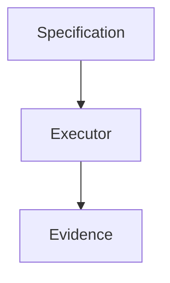
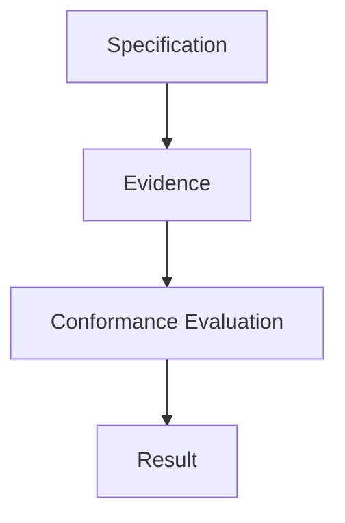
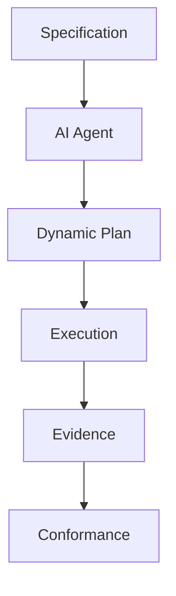
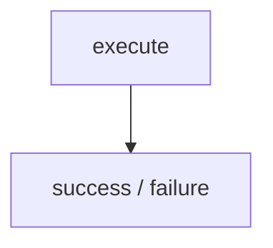
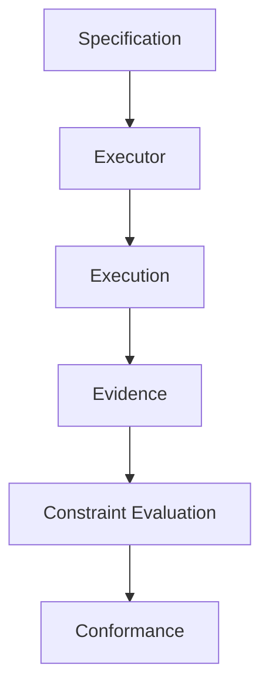

# {{ $frontmatter.title }} 관련

```component VPCard
{
  "title": "TypeScript > Article(s)",
  "desc": "Article(s)",
  "link": "/programming/ts/articles/README.md",
  "logo": "/images/ico-wind.svg",
  "background": "rgba(10,10,10,0.2)"
}
```

```component VPCard
{
  "title": "LLM > Article(s)",
  "desc": "Article(s)",
  "link": "/ai/llm/articles/README.md",
  "logo": "/images/ico-wind.svg",
  "background": "rgba(10,10,10,0.2)"
}
```

[[toc]]

---

<SiteInfo
  name="How to Measure Conformance Between an Operational Specification and Its Execution"
  desc="In my previous article, I explored executor independence: the idea that different execution mechanisms should be able to satisfy the same operational specification. By executor independence, I mean th"
  url="https://freecodecamp.org/news/measure-conformance-operational-specification-execution"
  logo="https://cdn.freecodecamp.org/universal/favicons/favicon.ico"
  preview="https://cdn.hashnode.com/uploads/covers/5e1e335a7a1d3fcc59028c64/55c7ea87-fbb5-4b3f-ae4e-1d1616362579.png"/>

In [**my previous article**](/freecodecamp.org/separate-operational-intent-from-executor.md), I explored executor independence: the idea that different execution mechanisms should be able to satisfy the same operational specification.

By **executor independence**, I mean that the operational specification remains stable even when the mechanism performing the work changes.

That gives us a useful architecture:



But it leaves an important question unanswered: how do we decide whether the evidence produced by an execution actually satisfies the specification?

That's a conformance problem.

A deployment can finish successfully from the executor's point of view and still violate the operational contract.

A remediation agent can complete every action it planned and still leave the system outside acceptable limits.

A restore operation can finish without errors and still fail to restore the required data.

This is why a generic status like:

```plaintext
success = true
```

isn't enough.

We need a way to compare what should have happened with what was actually observed and produce a result that's explicit, explainable, and useful.

In this article, I'll show you how to model operational conformance, evaluate individual constraints, distinguish pass, fail, and unknown outcomes, handle tolerances, work with missing evidence, assign severity, calculate a useful conformance summary, and avoid turning conformance into a misleading score.

The examples use TypeScript and a deployment scenario, but the same approach applies to infrastructure changes, incident response, backup restoration, data pipelines, and AI-operated systems.

The central idea is this: conformance isn't whether the executor says it succeeded. Conformance is whether observed evidence satisfies the operational specification.

::: note Prerequisites

You should be comfortable with:

- key software architecture concepts
- TypeScript or a similar language
- basic testing
- observability
- CI/CD concepts
- operational specifications
- executor independence

You don't need a particular deployment platform, and the examples are deliberately small so the evaluation model stays visible.

:::

---

## What Conformance Means in This Context

In ordinary language, conformance means complying with a rule, standard, or requirement.

Here, I use the term more specifically:

> Operational conformance is the evaluation of whether, and where, observed execution evidence satisfies the requirements defined by an operational specification.

In this context, **evidence** is the set of observable facts collected from the system that can be compared against the specification. It's not a success verdict. It's the data used to produce that verdict.

That definition has three parts.

### 1. The Specification

This defines what should be true.

For example:

```plaintext
version = v42
available replicas >= 3
error rate <= 1%
p95 latency <= 400 ms
```

### 2. The Evidence

This describes what was actually observed.

For example:

```plaintext
version = v42
available replicas = 3
error rate = 0.4%
p95 latency = 280 ms
```

### 3. The Evaluation

This compares the evidence with the specification.

For example:

```plaintext
version             PASS
available replicas  PASS
error rate           PASS
p95 latency          PASS
```

Conformance is therefore not an executor property. It's the result of evaluating evidence against a specification.

Conceptually:



---

## Start with a Specification and Evidence

Suppose we have this deployment specification:

```ts
type DeploymentSpec = {
  version: string;
  minReplicas: number;
  maxErrorRate: number;
  maxP95LatencyMs: number;
};

const spec: DeploymentSpec = {
  version: "v42",
  minReplicas: 3,
  maxErrorRate: 0.01,
  maxP95LatencyMs: 400,
};
```

Now define the evidence:

```ts
type DeploymentEvidence = {
  version: string;
  replicas: number;
  errorRate: number;
  p95LatencyMs: number;
};

const evidence: DeploymentEvidence = {
  version: "v42",
  replicas: 3,
  errorRate: 0.004,
  p95LatencyMs: 280,
};
```

The simplest possible evaluator might return a boolean:

```ts
function conforms(
  spec: DeploymentSpec,
  evidence: DeploymentEvidence
): boolean {
  return (
    evidence.version === spec.version &&
    evidence.replicas >= spec.minReplicas &&
    evidence.errorRate <= spec.maxErrorRate &&
    evidence.p95LatencyMs <= spec.maxP95LatencyMs
  );
}
```

This works, but it has a problem.

If the result is:

```plaintext
false
```

you don't know why. That's not enough for operational work.

---

## Evaluate Constraints Individually

Instead of one boolean, evaluate each constraint separately.

```ts
type ConstraintResult = {
  name: string;
  passed: boolean;
};

function evaluateDeployment(
  spec: DeploymentSpec,
  evidence: DeploymentEvidence
): ConstraintResult[] {
  return [
    {
      name: "version",
      passed:
        evidence.version === spec.version,
    },
    {
      name: "replicas",
      passed:
        evidence.replicas >= spec.minReplicas,
    },
    {
      name: "error-rate",
      passed:
        evidence.errorRate <= spec.maxErrorRate,
    },
    {
      name: "latency",
      passed:
        evidence.p95LatencyMs <= spec.maxP95LatencyMs,
    },
  ];
}
```

`ConstraintResult` gives each check a name and a boolean result. The `evaluateDeployment()` function compares one observed value at a time against the corresponding rule in the specification. It checks whether the deployed version matches exactly, whether the replica count is high enough, and whether error rate and latency stay below their limits.

Instead of collapsing all of those checks into one `true` or `false`, the function returns one result per constraint. That lets the caller see exactly which requirement passed or failed.

Now the output can be:

```plaintext
version       PASS
replicas      PASS
error-rate    PASS
latency       PASS
```

or:

```plaintext
version       PASS
replicas      FAIL
error-rate    PASS
latency       FAIL
```

This is much more useful. A failed operation becomes explainable.

---

## Don't Reduce Everything to Pass or Fail

Binary evaluation is still sometimes too simple.

Suppose the specification requires:

```plaintext
error rate <= 1%
```

but your observability system is unavailable.

What should the result be?

`PASS` is clearly wrong.

`FAIL` may also be misleading, because that mixes two different situations:

```plaintext
the system violated the constraint
```

and:

```plaintext
we do not know whether the system violated the constraint
```

A better model uses at least three states:

```plaintext
PASS
FAIL
UNKNOWN
```

For example:

```ts
type ConstraintStatus =
  | "PASS"
  | "FAIL"
  | "UNKNOWN";
```

Unknown evidence should never silently become success.

---

## Treat Missing Evidence as Unknown

Suppose evidence becomes partial. In other words, the system may return some observations but not all of them. A deployment record might tell us which version is running and how many replicas are available, while the error-rate metric is temporarily unavailable.

We can represent that by making each evidence field optional:

```ts
type DeploymentEvidence = {
  version?: string;
  replicas?: number;
  errorRate?: number;
  p95LatencyMs?: number;
};
```

The evaluator then needs to distinguish between a real violation and a missing observation:

```ts
function evaluateErrorRate(
  spec: DeploymentSpec,
  evidence: DeploymentEvidence
): ConstraintStatus {
  if (
    evidence.errorRate === undefined
  ) {
    return "UNKNOWN";
  }

  return (
    evidence.errorRate <= spec.maxErrorRate
  )
    ? "PASS"
    : "FAIL";
}
```

The first branch asks whether an error-rate value was observed at all. If it was not, the evaluator returns `UNKNOWN` instead of guessing. If the value exists, the function compares it with the maximum allowed error rate and returns `PASS` or `FAIL`.

This produces:

```plaintext
errorRate = 0.004 → PASS
errorRate = 0.03  → FAIL
errorRate missing → UNKNOWN
```

That distinction matters. **Missing telemetry**, here, means that a metric or operational signal we expected to observe wasn't available. For example, because the monitoring system didn't report an error-rate value for that execution window. If missing telemetry is treated as success, conformance becomes dangerously optimistic.

---

## Use Tolerances Where Exact Comparison Is Wrong

Some constraints should use exact equality.

For example:

```plaintext
deployed version must equal v42
```

Others should not.

Numerical systems may need tolerances because measured or computed values can differ by tiny amounts even when they're operationally equivalent. Floating-point arithmetic, sampling, rounding, and measurement noise can all produce values that shouldn't fail a constraint just because they're not exactly equal.

```ts
function withinTolerance(
  observed: number,
  expected: number,
  tolerance: number
): boolean {
  return (
    Math.abs(observed - expected)
    <= tolerance
  );
}
```

Then:

```ts
withinTolerance(
  1.9999999,
  2,
  0.0001
);
```

returns `true`.

The function computes the absolute difference between the observed and expected values, then checks whether that difference stays within the allowed tolerance. This is useful when tiny numeric differences are expected and exact equality would create false failures.

But tolerances should come from the operational domain. They shouldn't be introduced simply to make failures disappear.

---

## Add Severity to Constraints

Not every constraint has the same operational importance.

Suppose two constraints fail:

```plaintext
p95 latency = 405 ms
replicas = 0
```

Both are failures, but they're not equivalent.

A small latency miss may deserve attention without requiring an immediate rollback. Zero available replicas, on the other hand, may mean the service is unavailable and should trigger urgent recovery. Severity lets the evaluation preserve that operational difference instead of treating every failure as equally important.

```ts
type Severity =
  | "INFO"
  | "WARNING"
  | "CRITICAL";

type ConstraintResult = {
  name: string;
  status: ConstraintStatus;
  severity: Severity;
};
```

Here, `status` tells us whether the constraint passed, failed, or couldn't be evaluated. `severity` tells us how important that result is operationally.

The two dimensions are separate: a constraint can fail with `WARNING` severity or fail with `CRITICAL` severity.

Then:

```plaintext
latency
FAIL
WARNING

replicas
FAIL
CRITICAL
```

This matters when deciding whether to continue, pause, rollback, or escalate.

---

## Separate Hard Constraints from Advisory Constraints

Some requirements define whether the operation is acceptable at all. Others are useful signals but don't necessarily block execution.

This is different from severity. Severity describes the impact of a result, while constraint mode describes whether that rule participates in the final conformance decision. A `REQUIRED` constraint must pass for the operation to be conformant. An `ADVISORY` constraint can fail and still leave the operation conformant overall, although the failure should still be reported.

```ts
type ConstraintMode =
  | "REQUIRED"
  | "ADVISORY";
```

A result can now include:

```ts
type ConstraintResult = {
  name: string;
  status: ConstraintStatus;
  severity: Severity;
  mode: ConstraintMode;
  expected?: unknown;
  observed?: unknown;
};
```

For example:

```plaintext
version
REQUIRED
PASS

latency-target
ADVISORY
FAIL
```

The operation may still be conformant overall, but with a warning. That's more expressive than one global boolean.

---

## Build a Reusable Conformance Evaluator

So far, the examples have been tied to one deployment and a handful of hard-coded checks. The next step is to separate the evaluation mechanism from the individual rules so the same engine can evaluate different operational specifications.

To do that, we represent each rule as a `Constraint<T>`. Each constraint carries its own name, severity, mode, and evaluation function. An `OperationalSpec<T>` then becomes a collection of those constraints.

```ts
type Constraint<T> = {
  name: string;
  severity: Severity;
  mode: ConstraintMode;
  evaluate(
    evidence: T
  ): ConstraintStatus;
};

type OperationalSpec<T> = {
  name: string;
  constraints: Constraint<T>[];
};
```

Then:

```ts
function evaluateConformance<T>(
  spec: OperationalSpec<T>,
  evidence: T
): ConstraintResult[] {
  return spec.constraints.map(
    (constraint) => ({
      name: constraint.name,
      status:
        constraint.evaluate(evidence),
      severity:
        constraint.severity,
      mode:
        constraint.mode,
    })
  );
}
```

The specification owns what should be evaluated.

The evaluator collects the results. It doesn't need to know the meaning of each constraint. It simply executes every constraint's evaluation function and preserves the resulting status, severity, and mode. That keeps the evaluation engine generic while the specification remains responsible for the operational rules.

The `expected` and `observed` fields are optional in this minimal example, but in a production system I would populate them, or store references to the underlying evidence, so the final verdict remains explainable and auditable.

---

## Calculate a Conformance Summary Carefully

Individual results are useful, but sometimes you also need a summary.

```ts
type ConformanceSummary = {
  total: number;
  passed: number;
  failed: number;
  unknown: number;
  conformant: boolean;
};
```

Then:

```ts :collapsed-lines
function summarize(
  results: ConstraintResult[]
): ConformanceSummary {
  const required =
    results.filter(
      (result) =>
        result.mode === "REQUIRED"
    );

  const passed =
    results.filter(
      (result) =>
        result.status === "PASS"
    ).length;

  const failed =
    results.filter(
      (result) =>
        result.status === "FAIL"
    ).length;

  const unknown =
    results.filter(
      (result) =>
        result.status === "UNKNOWN"
    ).length;

  const conformant =
    required.every(
      (result) =>
        result.status === "PASS"
    );

  return {
    total: results.length,
    passed,
    failed,
    unknown,
    conformant,
  };
}
```

Overall conformance now requires all required constraints to pass.

Notice what that means for `UNKNOWN`: because `every()` requires a required constraint to have status `PASS`, a required constraint with missing evidence makes the overall result non-conformant rather than silently passing.

Advisory constraints still appear in the report. They just don't determine the final verdict.

---

## Why a Single Score Can Be Dangerous

It's tempting to create one single score:

```plaintext
conformance = 92%
```

But that can be misleading.

Suppose:

```plaintext
9 low-risk constraints pass
1 critical security constraint fails
```

A naïve score says:

```plaintext
90% conformant
```

Operationally, that may be completely unacceptable.

If you calculate a score, you should preserve:

```plaintext
constraint-level results
severity
required/advisory status
unknown evidence
failure reasons
```

The score can summarize, but it shouldn't erase the evidence.

---

## Preserve the Evidence Behind the Verdict

A conformance result shouldn't only say `FAIL`. It should preserve what produced that verdict.

```json
{
  "constraint": "minimum-replicas",
  "expected": ">= 3",
  "observed": 2,
  "status": "FAIL",
  "severity": "CRITICAL"
}
```

This lets someone answer:

```plaintext
What did we expect?
What did we observe?
Which rule was applied?
Why did it fail?
```

That is especially important when conformance decisions trigger automated recovery.

---

## Conformance Should Be Reproducible

Suppose an operation executes at 10:00. At 10:01, the error rate is:

```plaintext
0.6%
```

At 14:00, the dashboard shows:

```plaintext
2.1%
```

If you reevaluate the old operation using current telemetry, you may get a different result.

Conformance should therefore be evaluated against evidence associated with the execution window. By **execution window**, I mean the period during which the operation ran and its immediate effects were being verified. For a deployment that finished at 10:00, for example, you might evaluate health using the telemetry collected between 10:00 and 10:05 rather than whatever the dashboard happens to show several hours later.

The point is to bind the verdict to the evidence that was available for that specific execution. Otherwise, later changes in the system can retroactively change the apparent result of an operation that already happened.

A reproducible record might preserve:

```plaintext
specification version
execution ID
evidence snapshot
evaluation rules
timestamp
```

For example:

```json
{
  "executionId": "deploy-812",
  "specVersion": "3",
  "evaluatedAt": "2026-10-06T10:01:00Z",
  "evidence": {
    "version": "v42",
    "replicas": 3,
    "errorRate": 0.006,
    "p95LatencyMs": 290
  }
}
```

Now the decision can be reconstructed later.

---

## How This Applies to Multiple Executors

Suppose two executors run the same specification.

Executor A:

```plaintext
version      PASS
replicas     PASS
error-rate   PASS
latency      PASS
```

Executor B:

```plaintext
version      PASS
replicas     FAIL
error-rate   PASS
latency      PASS
```

The question is no longer:

> Which executor is better?

The immediate question is:

> Which execution satisfied the specification?

You answer that by running the same conformance evaluator against the evidence produced by each executor. The specification and evaluation rules stay the same; only the evidence changes.

In the example above, Executor A satisfies the specification because every required constraint evaluates to `PASS`. Executor B does not, because its replica constraint evaluates to `FAIL`. That gives us a common basis for comparison without requiring the two executors to use the same internal steps.

Over time, executor performance can be compared using conformance rate, failure categories, latency, cost, recovery frequency, and unknown evidence rate. But conformance remains the contract-level evaluation.

---

## How This Applies to AI Agents

AI agents make explicit conformance especially important.

An agent may choose different plans for the same objective.

```plaintext
Agent execution 1:
scale
deploy
observe
route

Agent execution 2:
deploy canary
observe
expand

Agent execution 3:
create parallel environment
switch traffic
```

Because the agent can choose a different plan each time, comparing executions step by step isn't very useful. One run might use a canary rollout while another creates a parallel environment, and both can still be valid ways to reach the same objective.

What stays stable is the specification: the objective, constraints, and evidence requirements don't change just because the agent chooses a different path.

After each run, the system collects evidence about the resulting state. The conformance evaluator then compares that evidence with the same specification used for every other run. This lets the agent vary the execution plan while keeping the definition of success outside the agent itself.



The agent can propose actions. It shouldn't be the only authority deciding whether those actions achieved the intended outcome.

---

## A Small End-to-End Example

Start by defining the evidence:

```ts
type DeploymentEvidence = {
  version?: string;
  replicas?: number;
  errorRate?: number;
  p95LatencyMs?: number;
};
```

Now define the constraints:

```ts :collapsed-lines
const constraints:
  Constraint<DeploymentEvidence>[] = [
    {
      name: "version",
      severity: "CRITICAL",
      mode: "REQUIRED",
      evaluate: (evidence) => {
        if (!evidence.version) {
          return "UNKNOWN";
        }

        return (
          evidence.version === "v42"
        )
          ? "PASS"
          : "FAIL";
      },
    },
    {
      name: "replicas",
      severity: "CRITICAL",
      mode: "REQUIRED",
      evaluate: (evidence) => {
        if (
          evidence.replicas === undefined
        ) {
          return "UNKNOWN";
        }

        return (
          evidence.replicas >= 3
        )
          ? "PASS"
          : "FAIL";
      },
    },
    {
      name: "error-rate",
      severity: "CRITICAL",
      mode: "REQUIRED",
      evaluate: (evidence) => {
        if (
          evidence.errorRate === undefined
        ) {
          return "UNKNOWN";
        }

        return (
          evidence.errorRate <= 0.01
        )
          ? "PASS"
          : "FAIL";
      },
    },
    {
      name: "latency-target",
      severity: "WARNING",
      mode: "ADVISORY",
      evaluate: (evidence) => {
        if (
          evidence.p95LatencyMs === undefined
        ) {
          return "UNKNOWN";
        }

        return (
          evidence.p95LatencyMs <= 350
        )
          ? "PASS"
          : "FAIL";
      },
    },
  ];
```

Create the specification:

```ts
const deploymentSpec:
  OperationalSpec<DeploymentEvidence> = {
    name: "deploy-orders-v42",
    constraints,
  };
```

Evaluate:

```ts
const evidence:
  DeploymentEvidence = {
    version: "v42",
    replicas: 3,
    errorRate: 0.004,
    p95LatencyMs: 370,
  };

const results =
  evaluateConformance(
    deploymentSpec,
    evidence
  );

const summary =
  summarize(results);
```

The result might be:

```plaintext
version          PASS     REQUIRED
replicas         PASS     REQUIRED
error-rate       PASS     REQUIRED
latency-target   FAIL     ADVISORY
```

And:

```plaintext
conformant = true
```

Every required constraint passed.

The advisory latency target failed, so the operation should still surface a warning.

::: note A Practical Conformance Workflow

If you want to introduce conformance evaluation into an existing system:

1. Pick one operation.
2. Define the specification.
3. Classify constraints as required or advisory.
4. Assign severity.
5. Define the evidence model.
6. Decide how missing evidence becomes `UNKNOWN`.
7. Evaluate constraints individually.
8. Produce a summary.
9. Preserve the evidence snapshot.
10. Version the specification.
11. Revisit rules that produce unexpected failures or unknowns.

Don't simply weaken the specification to make results pass.

:::

---

## What Conformance Can't Prove

Conformance can tell you:

> The observed evidence satisfies the specification.

It can't automatically tell you:

> The specification is correct.

The specification may be wrong, and the evidence may also be wrong.

So conformance depends on:

```plaintext
specification quality
evidence quality
evaluation correctness
```

It's a verification mechanism, not absolute truth.

---

## From Execution Success to Verifiable Operations

Traditional automation often ends here:



A conformance-based model adds more structure:



Now you can ask:

> Which requirements were satisfied?
>
> Which failed?
>
> Which could not be evaluated?
>
> What evidence supports the verdict?

If the system is conformant immediately after execution, you now have a baseline.

From that baseline, you can keep observing the system over time.

And then ask:

> What happens when reality starts to diverge from the specification after the operation has already succeeded?

That's operational drift.

---

## Conclusion

A successful executor isn't enough. Neither is a green pipeline or a completed agent plan.

What matters is whether the resulting system satisfies the operational specification.

That requires three things:

```plaintext
Specification
Evidence
Evaluation
```

A useful conformance model should preserve:

```plaintext
constraint-level results
PASS / FAIL / UNKNOWN
severity
required vs advisory rules
observed values
expected values
evidence snapshots
specification version
```

The executor performs the work, evidence describes what happened, and the specification defines what should have happened.

Then the conformance evaluator compares the two.

That gives us a stronger foundation for traditional automation and for increasingly autonomous systems.

But conformance at one point in time isn't the end of the story. A system can conform now and drift later.

The next question is:

> How do we detect when observed reality stops matching operational intent?

That's where I want to go next.

<!-- TODO: add ARTICLE CARD -->
```component VPCard
{
  "title": "How to Measure Conformance Between an Operational Specification and Its Execution",
  "desc": "In my previous article, I explored executor independence: the idea that different execution mechanisms should be able to satisfy the same operational specification. By executor independence, I mean th",
  "link": "https://chanhi2000.github.io/bookshelf/freecodecamp.org/measure-conformance-operational-specification-execution.html",
  "logo": "https://cdn.freecodecamp.org/universal/favicons/favicon.ico",
  "background": "rgba(10,10,35,0.2)"
}
```
